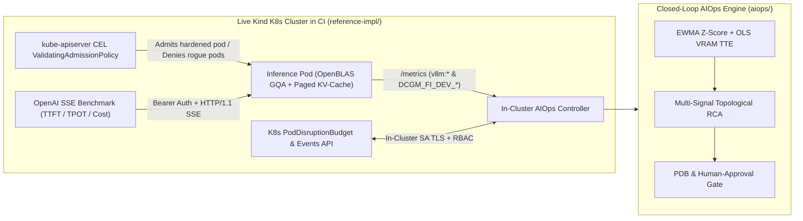

# AiOps on K8S: Closed-Loop Engine, Runnable K8s Reference Stack & GPU Platform Architecture

[](https://github.com/xsub/AiOps_on_K8S_Fundamentals_n_Practicies/actions/workflows/ci.yml)

**End-to-end runnable Kubernetes (`kind`) inference & closed-loop AIOps reference implementation, schema-validated Kustomize overlays (`KServe`/`KEDA`, `LeaderWorkerSet`/`Kueue`, `Volcano`), and an 11-chapter Day-2 GPU platform engineering handbook.**

---

## Scope, Positioning & Honest Validation Status

In industry practice, *"AIOps on Kubernetes"* is frequently conflated with *"Kubernetes for AI workloads"*. This repository deliberately separates, implements, and tests **both** disciplines:

1. **Runnable Reference Implementation & Closed-Loop AIOps** ([`reference-impl/`](./reference-impl/), [`aiops/`](./aiops/), [`docs/11`](./docs/11-aiops-closed-loop-architecture.md)):
   - Boots a real Kubernetes `v1.37` (`kind`) cluster in GitHub Actions CI on every push (`make deploy && make verify && make destroy`).
   - Enforces 4-rule CEL `ValidatingAdmissionPolicy` guardrails directly on `kube-apiserver`, serves OpenAI SSE streaming tokens from a Grouped-Query Attention (`GQA`) Transformer with a physical **Paged KV-Cache** allocator, measures `TTFT`/`TPOT`/throughput/cold-start/cost curves, and executes an in-cluster AIOps controller (`Telemetry -> EWMA Z-Score & OLS VRAM TTE -> Topological Correlation -> Live K8s PDB Check & Human Approval Gate`).
2. **GPU Platform Engineering Reference Overlays & Handbook** ([`deploy/`](./deploy/), [`manifests/`](./manifests/), `docs/00`–`10`):
   - Mutually exclusive Kustomize overlays and deep architectural runbooks covering NVIDIA `GPU Operator` (precompiled branch `"570"`), silicon partitioning (`MIG`, Volta+ `MPS`, `Time-Slicing`), gang/topology scheduling (`LeaderWorkerSet`, `Kueue`, `Volcano`), `vLLM`/`KServe`/`KEDA` serving, `DCGM` + `NPD` (`kmsg`) observability, and `Fluid` OIDC IRSA storage acceleration.



### Artifact Validation Tiers

No manifest in this repository claims unverified bare-metal GPU execution. Every artifact carries an explicit verification tier enforced across **5 parallel jobs** in [GitHub Actions CI](./.github/workflows/ci.yml):

| Component | Validation Tier | Automated Verification Executed in CI |
| :--- | :--- | :--- |
| **[`reference-impl/`](./reference-impl/) Runnable Stack** | `live-kind-k8s-e2e-executed` | Boots real `kind` K8s `v1.37` cluster (`make deploy && make verify && make destroy`), enforces live `kube-apiserver` CEL admission, benchmarks SSE `TTFT`/`TPOT`/`$/1k reqs`, and verifies live `PDB` closed-loop AIOps |
| **[`aiops/`](./aiops/) Closed-Loop Engine** | `executed-and-benchmarked` | `52` unit/integration tests + `python3 -m aiops evaluate` (`12` labeled scenarios, `56` raw alerts) |
| **[`deploy/`](./deploy/) Kustomize Overlays** | `schema-and-kustomize-validated` | `kustomize build` (`base`, `kserve-keda`, `lws-kueue`, `volcano-gang`) + `kubeconform -strict` with Datree CRD catalog |
| **[`manifests/`](./manifests/) Reference Specs** | `schema-and-security-validated` | `kubeconform -strict` (`53` resources), `@sha256` digest pinning, `yamllint`, `trivy config`, `gitleaks` |
| **Prometheus / DCGM Alert Rules** | `promtool-unit-tested` | `promtool check rules` + `promtool test rules` ([`prometheus-gpu-oom-alerts.test.yaml`](./manifests/05-observability/prometheus-gpu-oom-alerts.test.yaml)) |
| **CEL Admission Guardrails** | `live-apiserver-and-unit-tested` | Enforced live on `kube-apiserver` in `kind` CI + `16` unit/evasion tests ([`test_admission_policies.py`](./tests/test_admission_policies.py)) |
| **Bare-Metal GPU Silicon Specs** | `requires-nvidia-gpu-nodes` | Requires physical Ampere/Hopper nodes (`MIG` silicon, `NVLink`, `GPUDirect RDMA/GDS`) |

---

## Measured Results & Published Live Cluster Evidence

Full methodology, Mermaid `xychart-beta` latency/throughput/cost charts, and raw machine-readable outputs captured from CI are published in [**reference-impl/BENCHMARK_AND_EVIDENCE.md**](./reference-impl/BENCHMARK_AND_EVIDENCE.md) and [`reference-impl/evidence/`](./reference-impl/evidence/).

### 1. Live Kubernetes (`kind` v1.37) Streaming Inference Benchmark

_Environment: Kubernetes `v1.37.0` (`containerd://2.3.4`), pod limits `2000m CPU / 768Mi`, `/dev/shm` `Memory` `emptyDir` (`256Mi`), `numpy-openblas` 4-layer GQA Transformer (`115` effective Paged KV-Cache blocks), HTTP/1.1 SSE (`stream=true`). Cold-start readiness (`kubectl apply` → `/readyz` HTTP 200): **`2.242 s`** ([`cold-start.json`](./reference-impl/evidence/cold-start.json)). Note: absolute latencies reflect CPU OpenBLAS execution within a 2-vCPU cgroup rather than H100 Tensor Cores; [`run_benchmark.py`](./reference-impl/benchmark/run_benchmark.py) targets production `vLLM` GPU endpoints directly via `--base-url`._

| Concurrency (`128` in / `32` out) | RPS | Output Tok/s | TTFT p50 (ms) | TTFT p95 (ms) | TPOT p50 (ms) | TPOT p95 (ms) | Peak KV Ratio | Cost / 1k Reqs |
| :---: | :---: | :---: | :---: | :---: | :---: | :---: | :---: | :---: |
| `1` | 17.80 | 569.51 | 17.25 | **21.61** | 1.19 | **1.31** | 0.0783 | `$0.00300` |
| `2` | 13.62 | 435.90 | 32.15 | **47.80** | 3.63 | **3.79** | 0.1565 | `$0.00392` |
| `4` | 10.25 | 327.85 | 58.67 | **81.99** | 10.40 | **11.48** | 0.3304 | `$0.00521` |
| `8` | 9.87 | 315.69 | 143.22 | **168.09** | 21.25 | **23.90** | 0.6783 | `$0.00541` |

- **Live Operational Proof Artifacts**:
  - [`kubectl-cluster-state.txt`](./reference-impl/evidence/kubectl-cluster-state.txt) — `kubectl get` inventory of nodes, pods, `PDB`, `NetworkPolicy`, and live `AIOpsClosedLoopDiagnosis` Kubernetes `Events`.
  - [`vap-admission-live-output.txt`](./reference-impl/evidence/vap-admission-live-output.txt) — Deterministic `kube-apiserver` CEL admission denials for privileged containers and unmounted `/dev/shm` volumes.
  - [`smoke-test-inference.json`](./reference-impl/evidence/smoke-test-inference.json) — `HTTP 401` unauthenticated rejection, `/readyz` `/dev/shm` IPC validation, and `HTTP 200` inference payload.
  - [`closed-loop-aiops-live.json`](./reference-impl/evidence/closed-loop-aiops-live.json) — Live `PDB` state machine transition on `XID 79` (`replicas=1, disruptionsAllowed=0 -> BLOCKED_BY_PDB` vs. `replicas=2, disruptionsAllowed=1 -> PENDING_APPROVAL`).
  - [`benchmark-raw-results.csv`](./reference-impl/evidence/benchmark-raw-results.csv) & [`benchmark-raw-results.json`](./reference-impl/evidence/benchmark-raw-results.json) — Raw per-request SSE measurements (`98` streamed requests, including `64 -> 512` token context scaling).

### 2. Closed-Loop AIOps Engine Offline Benchmark (`python3 -m aiops evaluate`)

| Metric | Measured Result | Target SLA |
| :--- | :---: | :---: |
| **Evaluated Scenarios** ([`labeled_gpu_incidents.json`](./aiops/datasets/labeled_gpu_incidents.json)) | `12` (`10` failure + `2` benign prefill bursts) | `12` |
| **Alert Storm Compression (`56` raw alerts → `10` incidents)** | **`82.14%` noise reduction** | `> 75%` |
| **Top-1 Root-Cause Classification Accuracy** | **`100.0%`** | `>= 95%` |
| **Anomaly Detection Precision / Recall / F1** | **`1.0` / `1.0` / `1.0`** | `>= 0.90` |
| **PDB & Human-Approval Gate Safety Invariants** | **`100.0%`** (`0` unapproved mutations) | `100.0%` |

---

## Reference GPU Stack & Kustomize Overlay Orthogonality

Rather than mixing incompatible schedulers (`Kueue`, `Volcano`, `Run:ai`) or competing autoscalers (`KServe` vs. manual `KEDA`) into a single cluster state, [`deploy/`](./deploy/) isolates mutually exclusive GPU architectures into Kustomize overlays pinned to a single reference matrix:

| Layer | Reference Component & Version | Deployment Overlay / Path |
| :--- | :--- | :--- |
| **Cluster & Runtime** | Kubernetes `1.32+`, `containerd` + `RuntimeClass: nvidia`, default-deny `NetworkPolicy`, `PDB` | [`deploy/base/`](./deploy/base/) |
| **GPU Lifecycle** | NVIDIA GPU Operator `v25.3.x`, Precompiled Driver Branch `"570"` (`gds.enabled: false`) | [`gpu-operator-clusterpolicy.yaml`](./manifests/01-hardware-orchestration/gpu-operator-clusterpolicy.yaml) |
| **Inference Engine** | `vllm/vllm-openai:v0.33.0` (`@sha256:d825baf...`, remediating `v0.6.4` CVEs) | All serving overlays |
| **Single/Multi-GPU Serving + Canary** | KServe `v0.15.x` (`RawDeployment`, `TP=2` 70B FP8) + Gateway API `HTTPRoute` 90/10 canary | [`deploy/overlays/kserve-keda/`](./deploy/overlays/kserve-keda/) |
| **Multi-Node Serving + Fair-Share** | LeaderWorkerSet `v0.6.x` (Ray readiness barrier + `--distributed-executor-backend=ray`) + Kueue `v0.11.x` | [`deploy/overlays/lws-kueue/`](./deploy/overlays/lws-kueue/) |
| **Gang-Scheduled Distributed Serving** | Volcano `v1.11.x` (`PodGroup` `head` + `worker` + governing headless `Service`) | [`deploy/overlays/volcano-gang/`](./deploy/overlays/volcano-gang/) |
| **Hardware Fault Telemetry** | DCGM Exporter (`honorLabels: true`) + Node Problem Detector `v1.36.1` (`--config.system-log-monitor` `kmsg`) | [`manifests/05-observability/`](./manifests/05-observability/) |

---

## Quickstart: Live Cluster Lifecycle, Validation & Benchmarks

```bash
# Install Python validation & linting dependencies (AIOps engine itself uses pure Python stdlib):
pip install -r requirements-dev.txt

# 1. End-to-End Runnable Kubernetes Reference Implementation (requires Docker + kind + kubectl):
make deploy            # Boot kind K8s cluster, build/load image, apply RBAC/VAP/PDB/NetworkPolicy & pods
make verify            # Verify live CEL denials, 401/200 SSE smoke test, TTFT/TPOT benchmark & AIOps PDB loop
make destroy           # Tear down kind cluster cleanly

# 2. Fast Local CI Pipeline (no cluster required — runs in <2s):
make ci                # Runs validate + 52 unit/HTTP tests + AIOps benchmark + kustomize + promtool

# 3. Individual Verification & Interactive AIOps Targets:
make validate          # 10-check semantic AST & security validator (107+ links, 45 Mermaid blocks, @sha256 pins)
make test              # 52 unit/integration tests (CEL guardrails, VRAM math, PromQL, live HTTP SSE, AIOps)
make evaluate-aiops    # Run 12-scenario AIOps benchmark (outputs Precision/Recall/F1 & noise reduction)
make demo-aiops        # Walk through alert storm -> RCA -> PDB check -> human approval -> kubectl patch
make kustomize-build   # Render deploy/base + all 3 GPU overlays and validate with kubeconform -strict
make promtool-test     # Verify PrometheusRule syntax and execute promtool unit tests
```

---

## Repository Structure

```text
AiOps_on_K8S_Fundamentals_n_Practicies/
├── .github/workflows/ci.yml                                     # 5-Job CI: tests, kubeconform, promtool, trivy/gitleaks, live kind E2E
├── Makefile                                                     # Reproducible deploy / verify / destroy & local CI targets
├── requirements-dev.txt                                         # Pinned PyYAML & yamllint for AST validation and linting
├── reference-impl/                                              # End-to-End Runnable Kind K8s Reference Stack & Live Benchmark
│   ├── app/                                                     # OpenBLAS GQA Transformer + Paged KV-Cache SSE Server & Live K8s AIOps Agent
│   ├── benchmark/run_benchmark.py                               # Portable OpenAI SSE TTFT/TPOT/Throughput/Cost benchmark harness
│   ├── k8s/                                                     # Kind config, RBAC, live CEL VAP, NetworkPolicy, PDB, Deployments & negative fixtures
│   ├── scripts/                                                 # Automated deploy.sh, verify.sh & destroy.sh lifecycle scripts
│   ├── evidence/                                                # CI-captured kubectl state, VAP denials, smoke test & raw CSV/JSON results
│   └── BENCHMARK_AND_EVIDENCE.md                                # Methodology, live K8s outputs & Mermaid xychart-beta latency/cost charts
├── aiops/                                                       # Runnable Closed-Loop AIOps Engine (Python 3.10+ stdlib)
│   ├── models.py                                                # TelemetryPoint, RawAlert, CorrelatedIncident, RemediationPlan
│   ├── detector.py                                              # Rolling EWMA Z-Score, OLS VRAM TTE slope & prefill burst filter
│   ├── correlator.py                                            # Multi-signal topological correlator (7 failure classes + XID split)
│   ├── remediator.py                                            # PDB-checked & human-approval-gated remediation planner
│   ├── evaluate.py                                              # Reproducible 12-scenario offline benchmark harness
│   └── datasets/labeled_gpu_incidents.json                      # 12 labeled telemetry + alert-storm scenarios (56 raw alerts)
├── deploy/                                                      # Coherent Kustomize Base & Mutually Exclusive GPU Overlays
│   ├── base/                                                    # Namespace, least-privilege SA/RBAC, default-deny NetworkPolicy, PDB, PVC
│   └── overlays/                                                # kserve-keda/, lws-kueue/, volcano-gang/
├── manifests/                                                   # Schema-Validated Reference GPU Manifests & Promtool Unit Tests
├── docs/                                                        # 11-Chapter GPU Platform & AIOps Engineering Handbook (cited)
├── tests/                                                       # 52 Automated Unit, CEL Policy, Manifest & Live HTTP Integration Tests
└── scripts/validate_repo.py                                     # 10-check semantic AST validator (digests, services, gangs, NPD, PromQL)
```

---

## Engineering Handbook Navigation (`docs/`)

Start with [**00 — Foundations, Positioning & Compatibility Matrix**](./docs/00-aiops-on-k8s-foundations-and-practices.md):

1. [**01 — Hardware Abstraction & Orchestration**](./docs/01-hardware-abstraction-orchestration.md) — Device Plugin vs. DRA/CDI, GPU Operator precompiled driver branches vs. GDS, VFIO/vGPU, and Kueue/Run:ai quotas.
2. [**02 — GPU Partitioning & Sharing Strategies**](./docs/02-gpu-partitioning-strategies.md) — MIG binary-buddy silicon placement, post-Volta CUDA MPS address-space vs. fault boundaries, and Time-Slicing OOM math.
3. [**03 — Advanced Workload Scheduling**](./docs/03-advanced-workload-scheduling.md) — Volcano, KubeRay, LeaderWorkerSet Ray synchronization barriers, NUMA/NVSwitch topology, and GPUDirect RDMA.
4. [**04 — Inference Runtimes & Model Serving**](./docs/04-inference-runtimes-model-serving.md) — vLLM/TRT-LLM/SGLang, GQA/MLA KV-cache math, Disaggregated Prefill/Decode, Gateway API canaries, and KEDA scaling.
5. [**05 — Observability & Telemetry**](./docs/05-observability-and-telemetry.md) — `cAdvisor` + DCGM profiling (`honorLabels: true`), TTFT/TPOT SLOs, hardware vs. user-space XID catalog, and 5-way crash correlation.
6. [**06 — Model Storage & Cold-Start Optimization**](./docs/06-model-storage-and-cold-start-optimization.md) — Resolving `safetensors` `mmap()` cgroup page-cache `Exit 137` OOMs, OCI Modelcars, Fluid NVMe caching, and GPUDirect Storage.
7. [**07 — Security, Multi-Tenancy & Governance**](./docs/07-security-multitenancy-and-governance.md) — Least-privilege CDI containers, MIG vs. Confidential Computing, IRSA Workload Identity, NetworkPolicies, and CEL guardrails.
8. [**08 — Linux-to-Kubernetes Sysadmin Bridge**](./docs/08-linux-to-k8s-sysadmin-bridge.md) — Mapping bare-metal Linux/CUDA diagnostics (`nvidia-smi`, `topo -m`, `dcgmi`, `dmesg`, `numactl`, `ipcs`) to Kubernetes & PromQL.
9. [**09 — Day-2 SRE Incident Runbooks**](./docs/09-day2-incident-runbooks.md) — Eight step-by-step on-call playbooks (`INC-01`–`INC-08`) with mitigation and declarative fixes.
10. [**10 — Production Readiness Checklist & FinOps**](./docs/10-production-readiness-checklist.md) — Six-domain pre-flight audit matrix and Little's Law GPU capacity/cost worksheet.
11. [**11 — AIOps Closed-Loop Architecture**](./docs/11-aiops-closed-loop-architecture.md) — EWMA Z-score & OLS VRAM TTE detection math, topological alert correlation, and PDB-governed human approval gates.

---

## Companion CLI Tool: KubeVRAM

For terminal-centric GPU topology mapping, 5-way OOM/XID triage, deterministic `vLLM` KV-cache sizing, and interactive Linux-to-Kubernetes translation, see [**xsub/KubeVRAM**](https://github.com/xsub/KubeVRAM).
