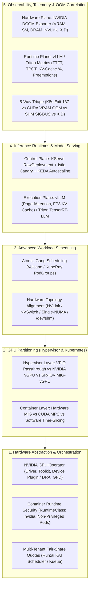

# AiOps on K8S: Foundations and Practices

## Executive Overview

This handbook serves as a **production engineering knowledge base** and **reference manifest collection** for architecting, scheduling, serving, and observing AI inference workloads on Kubernetes at scale.

Operating AI inference on Kubernetes exposes a fundamental architectural impedance mismatch:
- **Standard Kubernetes** assumes workloads are elastic, stateless, fast-booting microservices governed by compressible `cpu` (Linux CFS quotas) and cgroup `memory` (host system DRAM).
- **AI Inference Workloads** (LLMs, VLMs, embeddings, speech/vision pipelines) are **stateful in GPU High Bandwidth Memory (VRAM)**, **topology-bound across NVLink/NVSwitch/PCIe/NUMA fabrics**, sensitive to **hypervisor-level GPU virtualization**, and vulnerable to **silicon-level hardware faults (XID/ECC)** that standard Kubernetes tools never surface.

---

## Why Cloud-Native AI Operations Requires Dedicated Practices

Most AI engineering guides and general cloud AI certifications focus on model APIs, prompt engineering, or training pipelines—leaving **Day-2 Kubernetes GPU & Inference Infrastructure** underserved. Meanwhile, standard Kubernetes operational tools (`kubectl top`, `k9s`, `k8sgpt`, `Popeye`) operate strictly on Linux cgroups and generic Kubernetes `Events`:
- **`kubectl top` / `k9s`** display `metrics-server` CPU and host RAM while remaining blind to GPU framebuffer saturation (`DCGM_FI_DEV_FB_USED`), MIG slices, and NVLink topology.
- **Generic event analyzers** see `CrashLoopBackOff`, unable to distinguish a host cgroup `OOMKilled` (`Exit 137`) from a `vLLM` PagedAttention KV-cache pre-allocation collision on a Time-Sliced GPU (`Exit 1`) or an `NCCL` `64 MiB` `/dev/shm` bus error (`Exit 135`).

Bridging traditional **Linux/CUDA system administration mental models** (`nvidia-smi`, `nvidia-smi topo -m`, `dmesg -T`, `ipcs -m`, `numactl -H`) into **declarative Kubernetes & DCGM primitives** is the core focus of this handbook—and is automated in the companion CLI tool [**xsub/KubeVRAM**](https://github.com/xsub/KubeVRAM).

---

## Knowledge Base Navigation Matrix

| Engineering Pillar | Deep-Dive Chapter | Reference Manifests | Companion [`KubeVRAM`](https://github.com/xsub/KubeVRAM) CLI |
| :--- | :--- | :--- | :--- |
| **1. Hardware Abstraction & Orchestration** | [01-hardware-abstraction-orchestration.md](./01-hardware-abstraction-orchestration.md) | [`manifests/01-hardware-orchestration/`](../manifests/01-hardware-orchestration/) | `kubevram topology` `kubevram rbac-audit` |
| **2. GPU Partitioning (Hypervisor & K8s)** | [02-gpu-partitioning-strategies.md](./02-gpu-partitioning-strategies.md) | [`manifests/02-gpu-partitioning/`](../manifests/02-gpu-partitioning/) | `kubevram partition` |
| **3. Advanced Workload Scheduling** | [03-advanced-workload-scheduling.md](./03-advanced-workload-scheduling.md) | [`manifests/03-scheduling/`](../manifests/03-scheduling/) | `kubevram topology --fabric` `kubevram rbac-audit` |
| **4. Inference Runtimes & Model Serving** | [04-inference-runtimes-model-serving.md](./04-inference-runtimes-model-serving.md) | [`manifests/04-inference-serving/`](../manifests/04-inference-serving/) | `kubevram tune-vllm` |
| **5. Observability & Telemetry** | [05-observability-and-telemetry.md](./05-observability-and-telemetry.md) | [`manifests/05-observability/`](../manifests/05-observability/) | `kubevram triage` |

---

## Summary of the Five Engineering Pillars

### 1. Hardware Abstraction & Orchestration
#### Fundamentals
Kubernetes natively schedules only `cpu` and host `memory`. GPUs are exposed as extended integer resources (`nvidia.com/gpu`) through the **kubelet Device Plugin API** or modern **Dynamic Resource Allocation (DRA) + Container Device Interface (CDI)**. The **NVIDIA GPU Operator** reconciles the entire hardware stack—Node Feature Discovery (NFD), containerized kernel drivers (`nvidia.ko`), `nvidia-container-toolkit`, Device Plugin, GPU Feature Discovery (GFD), MIG Manager, and DCGM Exporter—via a single declarative `ClusterPolicy`.

#### Core Practices
- **Decoupled Containerized Drivers**: Manage kernel drivers via GPU Operator DaemonSets (preferring precompiled driver containers) so worker OS/kernel upgrades never break host DKMS state.
- **Explicit `RuntimeClass: nvidia`**: Enforce `runtimeClassName: nvidia` on all GPU workloads and forbid `securityContext.privileged: true` on application inference pods.
- **Dynamic Multi-Tenant Quotas**: Replace rigid Kubernetes `ResourceQuota` with **Run:ai (KAI Scheduler)** or **Kueue** to enable hierarchical departmental queues, idle GPU borrowing, and fair-share preemption.

> Deep Dive: [01-hardware-abstraction-orchestration.md](./01-hardware-abstraction-orchestration.md)

---

### 2. GPU Partitioning Across Hypervisors & Kubernetes
#### Fundamentals
Enterprise GPU clusters frequently run Kubernetes worker nodes as Virtual Machines atop Type-1 hypervisors (**KVM/QEMU, Proxmox VE, VMware vSphere, OpenStack**). Engineers must align **two layers of GPU sharing**:
1. **Hypervisor-to-VM Layer**: Choosing between **VFIO PCIe Passthrough** (full physical GPU passed to worker VM), **NVIDIA vGPU** (hypervisor time-sliced virtual functions), and **SR-IOV MIG-backed vGPU** (hardware-isolated silicon slices mapped to separate VMs).
2. **Kubernetes-to-Pod Layer**: Choosing between **Time-Slicing** (software context switching, shared VRAM), **Multi-Instance GPU (MIG)** (silicon-level SM/HBM partitioning on Ampere/Hopper/Blackwell), and **CUDA Multi-Process Service (MPS)** (single-context concurrent kernel overlap).

| Sharing Mechanism | Isolation Layer | VRAM Isolation | Fault Blast Radius | Latency Predictability | Best-Fit Workload |
| :--- | :--- | :--- | :--- | :--- | :--- |
| **Time-Slicing** | Software (CUDA Context Switch) | None (100% shared VRAM) | Whole physical GPU | Low (jitter under load) | Idle-heavy Jupyter notebooks, CI tests |
| **MIG** | Silicon (Dedicated SMs + HBM) | Strict hardware boundary | Contained to MIG slice | High (deterministic p99) | Multi-tenant production vLLM / Triton |
| **CUDA MPS** | CUDA Runtime (Shared Context) | Optional pinned limit (CUDA 12+) | Shared context reset on fault | High for small kernels | Single-tenant RAG microservices (Embeddings + Rerank) |

#### Core Practices
- **Prefer VFIO Passthrough + In-Cluster GPU Operator** when a single Kubernetes cluster owns the physical host; reserve **MIG-backed vGPU** for strict multi-cluster VM isolation.
- **Never run unguarded vLLM on Time-Sliced GPUs**: vLLM pre-allocates `--gpu-memory-utilization` (default `0.90` of total physical VRAM) at startup, causing immediate `torch.cuda.OutOfMemoryError` crashes for co-located pods.
- **Default to MIG (`mixed` or `single`) on A100/H100/H200/B200** for multi-tenant serving, and **CUDA MPS** on non-MIG GPUs (`L40S`, `L4`, `A10G`) for cooperative auxiliary pipelines.

> Deep Dive: [02-gpu-partitioning-strategies.md](./02-gpu-partitioning-strategies.md)

---

### 3. Advanced Workload Scheduling
#### Fundamentals
Default `kube-scheduler` assigns pods one-by-one and treats `nvidia.com/gpu: 4` as a flat integer. In distributed LLM serving, this causes **partial-allocation resource deadlocks** (two 8-GPU jobs each claiming 4 GPUs and waiting forever) and **severe TPOT latency regressions** when Tensor-Parallel ranks land across cross-socket CPU UPI/xGMI links instead of direct NVLink/NVSwitch bridges.

#### Core Practices
- **Atomic Gang Scheduling**: Use **Volcano** or **KubeRay** (`PodGroup` with `minMember` and `minResources`) so multi-pod inference clusters bind all-or-nothing.
- **NUMA & Fabric Alignment**: Configure kubelet `TopologyManager` (`single-numa-node`) + `CPUManager` (`static`), pin `tp >= 2` workloads to NVLink/NVSwitch SKUs via GFD labels, and always mount a memory-backed `emptyDir` (`>= 16Gi`) at `/dev/shm` for NCCL shared-memory rings.

> Deep Dive: [03-advanced-workload-scheduling.md](./03-advanced-workload-scheduling.md)

---

### 4. Inference Runtimes and Model Serving
#### Fundamentals
Separate the **Inference Engine** (**vLLM**, **Triton / TensorRT-LLM**, **SGLang**—handling PagedAttention, continuous batching, quantization, and CUDA graphs) from the **Serving Control Plane** (**KServe + Istio + KEDA**—handling OpenAI gateway routing, canary traffic splitting, and queue/KV-aware autoscaling).

#### Core Practices
- **Deterministic KV-Cache Budgeting**: Right-size `--max-model-len` to actual application needs (e.g., `16384` instead of `131072`), tune `--gpu-memory-utilization` (`0.88–0.92`), and enable `--kv-cache-dtype=fp8` on Hopper/Ada GPUs to halve per-token KV memory:
  $$\text{Bytes}_{\text{KV/token}} = 2 \times L \times n_{\text{kv\_heads}} \times d_{\text{head}} \times \text{Bytes}_{\text{kv\_dtype}}$$
- **Eliminate LLM Cold Starts**: Disable `scale-to-zero` (`minReplicas >= 2` in KServe `RawDeployment` mode), cache weights on NVMe RWX PVCs or local host NVMe, and autoscale via **KEDA** on `vllm:num_requests_waiting` and `vllm:gpu_cache_usage_perc` rather than CPU utilization.

> Deep Dive: [04-inference-runtimes-model-serving.md](./04-inference-runtimes-model-serving.md)

---

### 5. Observability, Telemetry & OOM Correlation
#### Fundamentals
Linux cgroups (`cAdvisor` / `kubectl top`) have zero visibility into GPU HBM allocations, SM occupancy, or PCIe/NVLink errors. Production AI observability requires correlating **NVIDIA DCGM Exporter** hardware metrics with **vLLM/Triton runtime metrics** and **Kubernetes Pod termination states**.

#### Core Practices
- **Scrape Hardware + Runtime Telemetry**: Alert on `DCGM_FI_DEV_FB_USED`, `DCGM_FI_PROF_SM_ACTIVE`, `DCGM_FI_PROF_DRAM_ACTIVE`, `DCGM_FI_DEV_XID_ERRORS`, alongside `vllm:gpu_cache_usage_perc` and `vllm:num_preemptions_total`.
- **Automate 5-Way Crash Triage**: Immediately separate **K8s Host RAM `OOMKilled` (`Exit 137`)**, **CUDA VRAM KV-Cache Overflow (`Exit 1`)**, **Time-Slicing Co-Tenant Collisions (`Exit 1`)**, **NCCL `/dev/shm` Exhaustion (`Exit 135` / `SIGBUS`)**, and **Silicon XID Faults (`XID 48, 79, 94, 95`)**.

> Deep Dive: [05-observability-and-telemetry.md](./05-observability-and-telemetry.md)

---

## Quick Reference: Linux Sysadmin to Kubernetes & DCGM Translation Matrix

| Bare-Metal Linux / CUDA Command | Kubernetes API Equivalent | DCGM / Prometheus Query |
| :--- | :--- | :--- |
| `nvidia-smi` | `kubectl get nodes -l nvidia.com/gpu.present=true -o custom-columns=NODE:.metadata.name,SKU:.metadata.labels.'nvidia\.com/gpu\.product',GPUS:.status.allocatable.'nvidia\.com/gpu'` | `DCGM_FI_DEV_GPU_UTIL` |
| `nvidia-smi --query-gpu=memory.used,memory.total --format=csv` | `kubectl describe node <node> \| grep -A 8 "Allocated resources"` | `DCGM_FI_DEV_FB_USED / (DCGM_FI_DEV_FB_USED + DCGM_FI_DEV_FB_FREE)` |
| `nvidia-smi topo -m` | `kubectl get nodes -L nvidia.com/gpu.family,nvidia.com/gpu.product,nvidia.com/gpu.machine` | `DCGM_FI_DEV_NVLINK_BANDWIDTH_TOTAL` |
| `nvidia-smi mig -lgi` | `kubectl get nodes -o custom-columns=NODE:.metadata.name,MIG_3G:.status.allocatable.'nvidia\.com/mig-3g\.40gb',MIG_2G:.status.allocatable.'nvidia\.com/mig-2g\.20gb'` | `DCGM_FI_DEV_FB_USED{GPU_I_ID!=""}` |
| `dmesg -T \| grep -iE "nvrm\|xid"` | `kubectl logs -n gpu-operator -l app=nvidia-driver-daemonset --tail=100` | `DCGM_FI_DEV_XID_ERRORS > 0` |
| `dmesg -T \| grep -i "out of memory"` | `kubectl get pods -A -o json \| jq '.items[] \| select(.status.containerStatuses[]?.lastState.terminated.reason=="OOMKilled")'` | `container_memory_working_set_bytes / container_spec_memory_limit_bytes > 0.95` |
| `df -h /dev/shm && ipcs -m` | `kubectl get pod <pod> -o jsonpath='{.spec.volumes[?(@.emptyDir.medium=="Memory")]}'` | `kube_pod_container_status_last_terminated_exitcode == 135` |
| `numactl --hardware` | `kubectl get --raw /api/v1/nodes/<node>/proxy/configz \| jq .kubeletconfig.topologyManagerPolicy` | `DCGM_FI_DEV_PCIE_REPLAY_COUNTER` |
