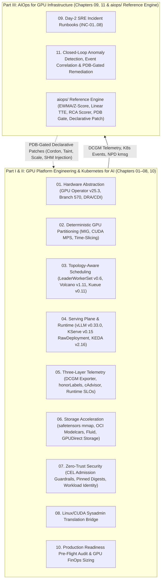

# AiOps on K8S: Foundations and Practices

## Introduction

This handbook is a production engineering reference for designing, scheduling, serving, securing, observing, and remediating **AI inference workloads on Kubernetes at scale**.

Operating GPU-accelerated AI inference on Kubernetes exposes a fundamental architectural gap: **Kubernetes was engineered around stateless, elastic, CPU/RAM-centric microservices**, whereas **LLM and deep-learning inference workloads are stateful in GPU High-Bandwidth Memory (VRAM), sensitive to intra-node NVLink/PCIe/NUMA topology, and governed by hardware failure domains invisible to Linux cgroups**.

---

## Strategic Architecture: GPU Platform Engineering vs. AIOps

To build reliable AI infrastructure, engineering teams must recognize the clear boundary between two tightly coupled disciplines:

1. **GPU Platform Engineering / Kubernetes for AI (Chapters 01–08, 10)**:
   The declarative substrate and runtime data plane: driver containerization, hardware abstraction via Dynamic Resource Allocation (DRA) and Container Device Interface (CDI), memory-isolated Multi-Instance GPU (MIG) slicing, gang-scheduled distributed model serving (LeaderWorkerSet, Volcano), KServe RawDeployment integration with KEDA, DCGM hardware metrics with `honorLabels: true`, high-bandwidth weight distribution, and CEL security guardrails.
2. **AIOps for GPU Infrastructure (Chapters 09, 11 & `aiops/` reference engine)**:
   The closed-loop cognitive control plane: online statistical anomaly detection (streaming EWMA and rolling Z-score), predictive linear-regression VRAM Time-To-Exhaustion (TTE) modeling, multi-signal alert storm correlation across topological failure domains, probabilistic root-cause analysis (RCA), and human-approval-gated remediation strictly bound by `PodDisruptionBudget` (PDB) constraints to prevent automated cascading cluster outages.

---

## Reference Stack & Version Compatibility Matrix

All architectural specifications, manifests, and runbooks in this repository are verified against the following production baseline:

| Technology Component | Certified Version | Architectural Role & Implementation Details |
| :--- | :--- | :--- |
| **Kubernetes Core** | `v1.32` | Base orchestration platform; native CEL `ValidatingAdmissionPolicy` and cgroup v2 systemd driver. |
| **NVIDIA GPU Operator** | `v25.3` | Reconciles driver containers, container toolkit, DCGM exporter, GFD, and MIG manager via `ClusterPolicy`. |
| **NVIDIA Data Center Driver** | **Branch `570`** | Driver branch (e.g. `570.86.16`). GPU Operator combines branch + kernel version + distro for precompiled images. |
| **vLLM Engine** | `v0.33.0` | PagedAttention continuous batching runtime; pinned image digest: `vllm/vllm-openai:v0.33.0@sha256:d825baf9ce4b1b6bfc5ecc7b79880c7e6748c65a72d697ce3d47607aafa84c6e`. |
| **KServe Serving Plane** | `v0.15` | Model serving control plane deployed in `RawDeployment` mode with Istio / Envoy Gateway API canary routing. |
| **KEDA Autoscaler** | `v2.16` | Event-driven autoscaling controller natively driven via `serving.kserve.io/autoscalerClass: "keda"`. |
| **LeaderWorkerSet (LWS)** | `v0.6` | Kubernetes SIG-Apps controller for multi-node LLM serving with coupled `RecreateGroupOnPodRestart` semantics. |
| **Kubernetes SIGs Kueue** | `v0.11` | *Alternative Scheduler A*: Hierarchical fair-share quotas, cohort lending/borrowing, and admission preemption. |
| **Volcano Batch Scheduler** | `v1.11` | *Alternative Scheduler B*: Gang-scheduling replacement scheduler with `PodGroup` and topology plugins. |
| **Run:ai Scheduler (KAI)** | `v2.18+` | *Alternative Scheduler C*: Dynamic GPU fractional sharing and multi-tenant department queues. |
| **Node Problem Detector** | `v1.36.1` | Kernel `kmsg` hardware monitor logging XID events and toggling `NodeCondition: GPUHardwareFault`. |

> [!IMPORTANT]
> **Mutual Exclusivity of Advanced Schedulers**:  
> `Kueue`, `Volcano`, and `Run:ai (KAI)` represent **mutually exclusive scheduling architectures**. Never run them simultaneously on the same workloads! This repository provides separate Kustomize overlays (`deploy/overlays/lws-kueue/`, `deploy/overlays/volcano-gang/`) so platforms deploy exactly one scheduling engine tailored to their workload archetype.

---

## Complete Handbook Navigation Matrix

| Chapter | Engineering Domain | Reference Manifests & Code | Companion Tools |
| :--- | :--- | :--- | :--- |
| **[01](./01-hardware-abstraction-orchestration.md)** | **Hardware Abstraction, DRA/CDI, GPU Operator & Quotas** | [`01-hardware-orchestration/`](../manifests/01-hardware-orchestration/) | `kubevram topology` |
| **[02](./02-gpu-partitioning-strategies.md)** | **GPU Partitioning: Hypervisor vGPU, MIG, MPS & Time-Slicing** | [`02-gpu-partitioning/`](../manifests/02-gpu-partitioning/) | `kubevram partition` |
| **[03](./03-advanced-workload-scheduling.md)** | **Gang Scheduling, LeaderWorkerSet, NVLink & GPUDirect RDMA** | [`03-scheduling/`](../manifests/03-scheduling/) | `kubevram topology --fabric` |
| **[04](./04-inference-runtimes-model-serving.md)** | **Inference Engines (vLLM/TRT-LLM), Disaggregated P/D & KEDA** | [`04-inference-serving/`](../manifests/04-inference-serving/) | `kubevram tune-vllm` |
| **[05](./05-observability-and-telemetry.md)** | **DCGM Profiling, LLM SLOs, XID Catalog & 5-Way OOM Triage** | [`05-observability/`](../manifests/05-observability/) | `kubevram triage` |
| **[06](./06-model-storage-and-cold-start-optimization.md)** | **Model Storage, `safetensors mmap` Traps, Modelcars & GDS** | [`06-model-storage/`](../manifests/06-model-storage/) | `kubevram triage` |
| **[07](./07-security-multitenancy-and-governance.md)** | **GPU Security, Multi-Tenancy, RBAC & CEL Admission Guardrails** | [`06-security-guardrails/`](../manifests/06-security-guardrails/) | `kubevram rbac-audit` |
| **[08](./08-linux-to-k8s-sysadmin-bridge.md)** | **Linux/CUDA Sysadmin to Kubernetes & PromQL Translation** | [`05-observability/`](../manifests/05-observability/) | `kubevram bridge` |
| **[09](./09-day2-incident-runbooks.md)** | **Day-2 SRE On-Call Incident Runbooks (`INC-01` – `INC-08`)** | [`05-observability/`](../manifests/05-observability/) | `kubevram triage` |
| **[10](./10-production-readiness-checklist.md)** | **Production Readiness Checklist & GPU Capacity / FinOps Sizing** | [`manifests/`](../manifests/) | `kubevram overview` |
| **[11](./11-aiops-closed-loop-architecture.md)** | **AIOps Closed-Loop Architecture, RCA & PDB-Gated Remediation** | [`aiops/`](../aiops/) (Reference Engine) | `python3 -m aiops evaluate` |

---

## Executive Summary of Core Architectural Principles

### 1. Hardware Abstraction & Quota Governance
- **Decoupled Lifecycle**: Manage kernel modules (`nvidia.ko`, `nvidia-peermem.ko`), Container Toolkit, and DCGM Exporter declaratively via NVIDIA GPU Operator using driver branch `"570"`. For rapid autoscaling, use precompiled driver images (`usePrecompiled: true`).
- **Dynamic Resource Allocation (DRA) & CDI**: Transition from scalar integer `nvidia.com/gpu` counts toward structured claims evaluated via CEL against `ResourceSlice` objects, mapped to `/dev/nvidia*` via Container Device Interface (CDI).
- **Fair-Share Multi-Tenancy**: Deploy either Kueue or Run:ai KAI via dedicated overlays (`deploy/overlays/`) for dynamic borrowing, nominal quotas, and admission-level preemption.

### 2. Deterministic GPU Sharing
- **Hardware MIG for Multi-Tenant LLMs**: On A100, H100, and Blackwell, partition silicon via MIG for dedicated HBM memory controllers, L2 cache banks, and fault isolation. MIG provides silicon boundary isolation, but hardware memory encryption requires NVIDIA Confidential Computing (CC) mode.
- **CUDA MPS Address Space Isolation**: Starting with NVIDIA Volta through Ampere/Hopper/Blackwell, MPS provides **isolated GPU virtual address spaces** for each client process while sharing the hardware execution context. Unhandled kernel exceptions still reset the shared context (no hardware fault containment).
- **Guardrail Time-Slicing**: Restrict software Time-Slicing to bursty dev/CI workloads; never schedule un-capped vLLM pods without explicit per-replica memory caps (`--gpu-memory-utilization <= 0.45`).

### 3. Topology- & Gang-Aware Distributed Placement
- **Atomic Gang Placement**: Schedule multi-pod/multi-node inference via **LeaderWorkerSet (`LWS`)** or **Volcano (`PodGroup`)**. Ensure LWS startup routines wait for all Ray worker nodes to join before launching `vllm serve --distributed-executor-backend=ray`.
- **Intra-Node & Network Fabric**: Enforce kubelet `topologyManagerPolicy: single-numa-node`, co-locate GPUs and RDMA HCAs on shared PCIe Gen5 switches, and provision memory-backed `/dev/shm` (`16Gi`–`64Gi`) to prevent NCCL `SIGBUS` (`Exit 135`).

### 4. Inference Engine Budgeting, Disaggregation & Storage
- **Explicit KV-Cache Math**: Budget total VRAM across weights, CUDA graphs, activations, and KV cache:
  $$\text{Bytes}_{\text{KV/token}} = 2 \times L \times n_{\text{kv\_heads}} \times d_{\text{head}} \times \text{Bytes}_{\text{kv\_dtype}}$$
- **Cold-Start & `mmap` Mitigation**: Disable `scale-to-zero` on production LLMs (`minReplicas >= 2`). Size host memory limits ($\ge 1.5\times$ weights) to survive safetensors `mmap()` page-cache pressure. Note that precompiled drivers do NOT support GPUDirect Storage; DKMS driver containers or host-installed drivers are required for GDS.
- **Native KServe Autoscaling**: In KServe `RawDeployment`, leverage native `serving.kserve.io/autoscalerClass: "keda"` integration rather than attaching unmanaged external `ScaledObject` resources.

### 5. AIOps Closed-Loop Control & SRE Runbooks
- **Three-Layer Observability**: Configure Prometheus `ServiceMonitor` with `honorLabels: true` to prevent renaming native `pod` and `namespace` labels to `exported_pod`.
- **NPD vs. Remediation**: Node Problem Detector uses `--config.system-log-monitor` to monitor `/dev/kmsg` and **only** updates `NodeCondition` and `Event`s; downstream controllers (such as `aiops/remediator.py` or Draino) execute `cordon`/`taint`/`drain` subject to strict `PodDisruptionBudget` checks.
- **Separation of Hardware vs. Software XIDs**: Distinguish unrecoverable silicon hardware XIDs (`48, 63, 64, 74, 79, 94, 95`) from non-fatal user-space MMU and CUDA kernel exceptions (`13, 31, 43`).

---

## References

1. Kubernetes Dynamic Resource Allocation (DRA): <https://kubernetes.io/docs/concepts/scheduling-eviction/dynamic-resource-allocation/>
2. Container Device Interface (CDI) Specification: <https://github.com/container-orchestrated-devices/container-device-interface>
3. NVIDIA GPU Operator Documentation: <https://docs.nvidia.com/datacenter/cloud-native/gpu-operator/latest/>
4. NVIDIA Multi-Instance GPU (MIG) User Guide: <https://docs.nvidia.com/datacenter/tesla/mig-user-guide/>
5. NVIDIA Multi-Process Service (MPS) Architecture: <https://docs.nvidia.com/deploy/mps/index.html>
6. Kubernetes SIG-Apps LeaderWorkerSet (LWS): <https://github.com/kubernetes-sigs/lws>
7. Kubernetes SIGs Kueue: <https://kueue.sigs.k8s.io/>
8. Volcano Batch Scheduling: <https://volcano.sh/en/docs/>
9. KServe InferenceService & RawDeployment: <https://kserve.github.io/website/master/modelserving/v1beta1/raw_deployment/>
10. KEDA Kubernetes Event-driven Autoscaling: <https://keda.sh/docs/latest/>
11. vLLM Distributed Serving Documentation: <https://docs.vllm.ai/en/latest/serving/distributed_serving.html>
12. NVIDIA DCGM Exporter & Prometheus Metrics: <https://github.com/NVIDIA/dcgm-exporter>
