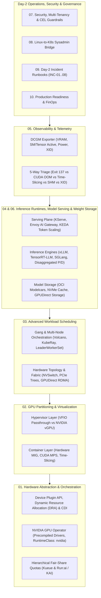

# AiOps on K8S: Foundations and Practices

## Introduction

This handbook is a production engineering reference for designing, scheduling, serving, securing, and troubleshooting **AI inference workloads on Kubernetes at scale**.

Operating GPU-accelerated AI inference on Kubernetes exposes a fundamental architectural gap: **Kubernetes was engineered around stateless, elastic, CPU/RAM-centric microservices**, whereas **LLM and deep-learning inference workloads are stateful in GPU High-Bandwidth Memory (VRAM), sensitive to intra-node NVLink/PCIe/NUMA topology, and governed by hardware failure domains invisible to Linux cgroups**.

---

## Strategic Positioning: Why Cloud-Native AI Operations?

### 1. The Day-2 AI Infrastructure Gap
Most AI engineering literature focuses on model training, prompt engineering, or application-level orchestration—leaving **Day-2 Kubernetes GPU & Inference Operations** underserved. In production, platform and SRE teams face recurring operational bottlenecks:
- Multi-gigabyte `safetensors` weight loads triggering Linux cgroup `OOMKilled` (`Exit 137`) even while 80 GB GPUs sit idle.
- Co-located `vLLM` pods crashing with `torch.cuda.OutOfMemoryError` (`Exit 1`) on Time-Sliced GPUs due to greedy KV-cache pre-allocation.
- Multi-GPU Tensor Parallel (`TP >= 2`) deployments hanging or crashing with `SIGBUS` (`Exit 135`) on Kubernetes' default `64Mi` `/dev/shm` mount or cross-socket UPI links.
- Silent throughput collapse from KV-cache preemption storms (`vllm:num_preemptions_total`) or unisolated hardware ECC faults (`XID 48, 79, 94, 95`).

### 2. Bridging Linux/CUDA Mental Models to Kubernetes
Existing Kubernetes tools (`k9s`, `k8sgpt`, `Popeye`) inspect generic Pod states and `metrics-server` CPU/RAM metrics without GPU hardware or inference-engine awareness. This handbook—together with its companion CLI tool [**KubeVRAM**](https://github.com/xsub/KubeVRAM)—bridges bare-metal Linux/CUDA operations directly to declarative Kubernetes control planes.

---

## Complete Handbook Navigation Matrix

| Chapter | Engineering Domain | Reference Manifests | Companion CLI |
| :--- | :--- | :--- | :--- |
| **[01](./01-hardware-abstraction-orchestration.md)** | **Hardware Abstraction, DRA/CDI, GPU Operator & Quotas** | [`01-hardware-orchestration/`](../manifests/01-hardware-orchestration/) | `kubevram topology` |
| **[02](./02-gpu-partitioning-strategies.md)** | **GPU Partitioning: Hypervisor vGPU, MIG, MPS & Time-Slicing** | [`02-gpu-partitioning/`](../manifests/02-gpu-partitioning/) | `kubevram partition` |
| **[03](./03-advanced-workload-scheduling.md)** | **Gang Scheduling, LeaderWorkerSet, NVLink & GPUDirect RDMA** | [`03-scheduling/`](../manifests/03-scheduling/) | `kubevram topology --fabric` |
| **[04](./04-inference-runtimes-model-serving.md)** | **Inference Engines (vLLM/TRT-LLM), Disaggregated P/D & KEDA** | [`04-inference-serving/`](../manifests/04-inference-serving/) | `kubevram tune-vllm` |
| **[05](./05-observability-and-telemetry.md)** | **DCGM Profiling, LLM SLOs, XID Catalog & 5-Way OOM Triage** | [`05-observability/`](../manifests/05-observability/) | `kubevram triage` |
| **[06](./06-model-storage-and-cold-start-optimization.md)** | **Model Storage, `safetensors mmap` Traps, Modelcars & GDS** | [`06-model-storage/`](../manifests/06-model-storage/) | `kubevram triage` |
| **[07](./07-security-multitenancy-and-governance.md)** | **GPU Security, Multi-Tenancy, RBAC & CEL Admission Guardrails** | [`06-security-guardrails/`](../manifests/06-security-guardrails/) | `kubevram rbac-audit` |
| **[08](./08-linux-to-k8s-sysadmin-bridge.md)** | **Linux/CUDA Sysadmin to Kubernetes & PromQL Translation** | [`05-observability/`](../manifests/05-observability/) | `kubevram bridge` |
| **[09](./09-day2-incident-runbooks.md)** | **Day-2 SRE On-Call Incident Runbooks (`INC-01` – `INC-08`)** | [`05-observability/`](../manifests/05-observability/) | `kubevram triage` |
| **[10](./10-production-readiness-checklist.md)** | **Production Readiness Checklist & GPU Capacity / FinOps Sizing** | [`manifests/`](../manifests/) | `kubevram overview` |

---

## Executive Summary of Core Architectural Principles

### 1. Hardware Abstraction & Quota Governance
- **Decoupled Lifecycle**: Manage kernel modules (`nvidia.ko`, `nvidia-peermem.ko`), `nvidia-container-toolkit`, Device Plugin / DRA drivers, and DCGM Exporter declaratively via the **NVIDIA GPU Operator** using precompiled driver containers for fast node scale-out.
- **Dynamic Resource Allocation (DRA) & CDI**: Transition from scalar integer `nvidia.com/gpu` counts toward **DRA (`resource.k8s.io/v1beta1`)** and **CDI** for topology-aware multi-GPU, MIG, and IMEX channel claims.
- **Fair-Share Multi-Tenancy**: Replace static `ResourceQuota` islands with hierarchical fair-share schedulers (**Kueue** or **Run:ai / KAI Scheduler**) supporting guaranteed nominal quotas, idle cohort borrowing, and priority preemption.

### 2. Deterministic GPU Sharing
- **Hardware MIG First for Multi-Tenant LLMs**: On Ampere (`A100`), Hopper (`H100`/`H200`), and Blackwell (`B200`), partition silicon via **MIG** (`1g.10gb`, `2g.20gb`, `3g.40gb`, `4g.40gb`) for dedicated HBM controllers, L2 cache banks, and fault isolation.
- **CUDA MPS for Cooperative Non-MIG Pipelines**: On PCIe inference GPUs lacking MIG (`L4`, `L40S`, `A10G`), use **CUDA MPS** with explicit `CUDA_MPS_PINNED_DEVICE_MEM_LIMIT` and `CUDA_MPS_ACTIVE_THREAD_PERCENTAGE` caps for trusted pipelines (e.g., RAG embedding + reranking).
- **Guardrail Time-Slicing**: Restrict software Time-Slicing to bursty dev/CI workloads; never schedule default `vLLM` pods (`--gpu-memory-utilization=0.90`) onto time-sliced GPUs without explicit per-replica memory caps.

### 3. Topology- & Gang-Aware Distributed Placement
- **Atomic Gang Placement**: Schedule multi-pod/multi-node inference via **LeaderWorkerSet (`LWS`)**, **Volcano (`PodGroup`)**, or **KubeRay** so partial pod placements never deadlock cluster GPUs.
- **NUMA, NVSwitch & RDMA Alignment**: Enforce kubelet `topologyManagerPolicy: single-numa-node`, co-locate GPUs and RoCEv2/InfiniBand NICs on shared PCIe Gen5 switches (`PIX`/`NVL`), and provision memory-backed `/dev/shm` (`16Gi`–`64Gi`) for NCCL collectives.

### 4. Inference Engine Budgeting, Disaggregation & Storage
- **Explicit KV-Cache Math**: Budget total VRAM across weights, CUDA context/graphs, activations, and GQA/MLA KV cache:
  $$\text{Bytes}_{\text{KV/token}} = 2 \times L \times n_{\text{kv\_heads}} \times d_{\text{head}} \times \text{Bytes}_{\text{kv\_dtype}}$$
- **Cold-Start & `mmap` Mitigation**: Disable `scale-to-zero` on latency-critical LLMs, serve weights from NVMe RWX caches / OCI Modelcars / GPUDirect Storage, and account for `safetensors` `mmap()` page-cache pressure inside container `resources.limits.memory`.
- **Queue- & KV-Aware Autoscaling**: Scale replicas via **KEDA** on `vllm:num_requests_waiting` and `vllm:gpu_cache_usage_perc` with long scale-down stabilization windows (`>= 600s`).

### 5. Hardware Telemetry, Security & SRE Runbooks
- **Three-Layer Observability**: Correlate cgroup metrics (`cAdvisor`), silicon profiling (`DCGM_FI_DEV_FB_USED`, `DCGM_FI_PROF_SM_ACTIVE`, `DCGM_FI_PROF_DRAM_ACTIVE`, `DCGM_FI_DEV_XID_ERRORS`), and runtime SLOs (`TTFT`, `TPOT`, `vllm:num_preemptions_total`).
- **Zero-Privilege Runtime Security**: Enforce `runtimeClassName: nvidia` and block `securityContext.privileged: true` via native Kubernetes **CEL `ValidatingAdmissionPolicy`**, preventing cross-tenant `/dev/nvidia*` device exposure.
