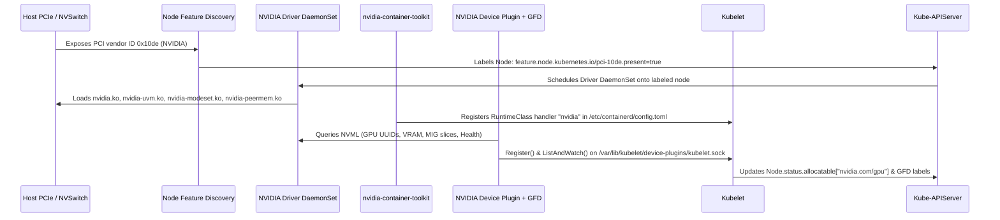
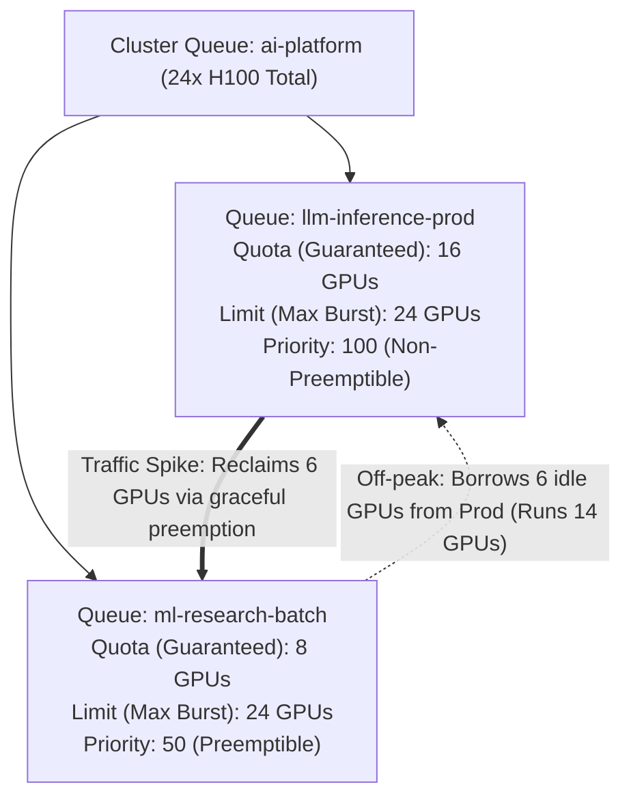

# 1. Hardware Abstraction & Orchestration

> **Related Manifests**: [`gpu-operator-clusterpolicy.yaml`](../manifests/01-hardware-orchestration/gpu-operator-clusterpolicy.yaml) | [`nvidia-runtimeclass.yaml`](../manifests/01-hardware-orchestration/nvidia-runtimeclass.yaml)  
> **Companion CLI ([`KubeVRAM`](https://github.com/xsub/KubeVRAM))**: `kubevram topology` | `kubevram rbac-audit` | `kubevram bridge driver`

---

## 1.1 The Kubernetes Hardware Abstraction Gap

Kubernetes natively schedules only two compute primitives at the kernel cgroup level:
1. **`cpu`**: Compressible compute time measured in millicores (`1000m = 1 vCPU`), enforced via the Linux Completely Fair Scheduler (CFS `cpu.cfs_quota_us` / cgroup v2 `cpu.max`). Throttling slows execution without killing the process.
2. **`memory`**: Incompressible host DRAM measured in bytes (`Gi` / `Mi`), enforced via the Linux cgroup memory controller (`memory.max`). Exceeding this limit invokes the kernel OOM killer (`SIGKILL`, Exit Code `137`).

Everything outside CPU and host DRAM—NVIDIA GPUs, HBM3e VRAM, Tensor Cores, NVSwitches, and InfiniBand/RoCEv2 HCAs—is **opaque to core Kubernetes**.

### Evolution: Device Plugin API vs. Dynamic Resource Allocation (DRA)

Kubernetes bridges this hardware gap through two mechanisms:

| Dimension | Device Plugin Framework (`v1beta1`, Current Standard) | Dynamic Resource Allocation (DRA + CDI, K8s 1.31–1.32+) |
| :--- | :--- | :--- |
| **Resource Syntax** | Scalar integer in `resources.limits` (`nvidia.com/gpu: 2`) | Structured `ResourceClaim`, `ResourceClaimTemplate`, `DeviceClass` |
| **Parameter Passing** | Static ConfigMaps per node; no per-pod parameters | Arbitrary structured parameters per claim (MPS limits, MIG profile, fabric clique) |
| **Multi-Pod Sharing** | Workarounds only (Time-Slicing integer multiplication) | Native multi-container & multi-pod sharing of a single `ResourceClaim` |
| **Topology Awareness** | Node-local `TopologyManager` hints only | Scheduler-level CEL expressions across `ResourceSlice` attributes (e.g., NVLink domain IDs) |
| **Container Injection** | Device Plugin `Allocate()` gRPC response + OCI hook | Standardized **CDI (Container Device Interface)** JSON specs (`/var/run/cdi/nvidia.yaml`) |



---

## 1.2 NVIDIA GPU Operator Architecture & Lifecycle

Installing NVIDIA drivers manually on host OS images (`apt install nvidia-driver-550` or golden AMIs) breaks down in Day-2 Kubernetes operations:
- Unattended Linux kernel security updates break DKMS module builds on reboot.
- Upgrading CUDA drivers across a 64-node H100 cluster requires manual SSH drain scripts and image rebuilds.
- Host user-space library paths (`/usr/lib/x86_64-linux-gnu/libcuda.so`) drift across node pools.

The **NVIDIA GPU Operator** solves this by managing the entire GPU software stack declaratively through a single `ClusterPolicy` Custom Resource:

| Operator DaemonSet | Core Responsibility | Failure Symptom When Broken | Diagnostic Command |
| :--- | :--- | :--- | :--- |
| **Node Feature Discovery (NFD)** | Scans PCIe bus (`0x10de` = NVIDIA, `0x15b3` = Mellanox/NVIDIA Networking) and applies `feature.node.kubernetes.io/*` labels. | None of the GPU Operator pods schedule onto new worker nodes. | `kubectl get node <node> --show-labels \| grep 10de` |
| **NVIDIA Driver Container** | Runs a privileged container that loads precompiled (or compiles) `nvidia.ko`, `nvidia-uvm.ko`, and `nvidia-peermem.ko` (for GPUDirect RDMA). | `NVIDIA-SMI has failed because it couldn't communicate with the NVIDIA driver`. | `kubectl logs -n gpu-operator -l app=nvidia-driver-daemonset` |
| **NVIDIA Container Toolkit** | Installs `nvidia-container-runtime` / CDI specs and updates `/etc/containerd/config.toml` with the `nvidia` runtime handler and restarts/signals `containerd`. | Pod schedules and runs, but `torch.cuda.is_available()` returns `False` or `/dev/nvidiactl` is missing. | `kubectl logs -n gpu-operator -l app=nvidia-container-toolkit-daemonset` |
| **NVIDIA Operator Validator** | Executes init/validation checks (`driver`, `toolkit`, `cuda`, `plugin`) before marking the node ready for user GPU pods. | Device plugin stays in `Init:0/1`; `nvidia.com/gpu` remains `0`. | `kubectl get pods -n gpu-operator -l app=nvidia-operator-validator` |
| **NVIDIA Device Plugin** | Queries NVML, applies Time-Slicing/MPS ConfigMaps, monitors XID health (`ListAndWatch`), and advertises `nvidia.com/gpu` or `nvidia.com/mig-*` to `kubelet`. | `0/N nodes are available: Insufficient nvidia.com/gpu`. | `kubectl logs -n gpu-operator -l app=nvidia-device-plugin-daemonset` |
| **GPU Feature Discovery (GFD)** | Enriches nodes with SKU, VRAM, compute capability, and MIG labels (`nvidia.com/gpu.product`, `nvidia.com/gpu.memory`, `nvidia.com/cuda.runtime.major`). | `nodeSelector` rules targeting `NVIDIA-H100-80GB-HBM3` never match. | `kubectl describe node <node> \| grep nvidia.com/` |
| **MIG Manager (`mig-parted`)** | Watches `nvidia.com/mig.config` node labels, drains/stops GPU clients if needed, and reconfigures hardware MIG instances via NVML. | `nvidia.com/mig.config.state=failed` (usually due to an active process holding `/dev/nvidia*`). | `kubectl logs -n gpu-operator -l app=nvidia-mig-manager` |
| **DCGM Exporter** | Exports per-GPU and per-MIG-slice hardware counters (`DCGM_FI_*`) on `:9400/metrics` with pod metadata labels. | Prometheus/Grafana and OOM triage lose hardware visibility. | `kubectl port-forward -n gpu-operator ds/nvidia-dcgm-exporter 9400:9400` |

### Essential GFD Node Labels for Production Scheduling

When GFD runs healthy, every GPU node exposes deterministic scheduling labels:

```yaml
metadata:
  labels:
    nvidia.com/gpu.present: "true"
    nvidia.com/gpu.product: "NVIDIA-H100-80GB-HBM3"
    nvidia.com/gpu.family: "hopper"
    nvidia.com/gpu.compute.major: "9"
    nvidia.com/gpu.compute.minor: "0"
    nvidia.com/gpu.count: "8"
    nvidia.com/gpu.memory: "81920"
    nvidia.com/gpu.replicas: "1"
    nvidia.com/gpu.sharing-strategy: "none"   # none | time-slicing | mps
    nvidia.com/mig.strategy: "mixed"          # none | single | mixed
    nvidia.com/cuda.driver.major: "550"
```

---

## 1.3 Production Engineering Practices

### Practice 1: Decoupled Precompiled Drivers & Safe Rolling Upgrades

Configure `ClusterPolicy` (see [`manifests/01-hardware-orchestration/gpu-operator-clusterpolicy.yaml`](../manifests/01-hardware-orchestration/gpu-operator-clusterpolicy.yaml)) with:
1. **`driver.enabled: true` and `driver.usePrecompiled: true`**: Precompiled driver images match exact Ubuntu/RHEL/COS kernel versions, cutting node scale-up time from **4–7 minutes** (GCC compilation) down to **~20–35 seconds** and eliminating compiler/header drift.
2. **Controlled `upgradePolicy`**: Never upgrade GPU drivers across all nodes simultaneously! Because unloading `nvidia.ko` requires zero open file descriptors on `/dev/nvidia*`, the Driver Upgrade Controller must cordon the node, evict inference pods (respecting `PodDisruptionBudget`), reload the kernel module, re-validate CUDA, and uncordon:
   ```yaml
   driver:
     enabled: true
     usePrecompiled: true
     version: "550.90.07"
     upgradePolicy:
       autoUpgrade: true
       maxParallelUpgrades: 1          # Upgrade 1 GPU node at a time to protect serving capacity
       cordon: true
       podDeletion:
         force: false
         timeoutSeconds: 300           # Allow in-flight LLM streaming responses to drain cleanly
   ```
3. **Startup Taints (`nvidia.com/gpu:NoSchedule`)**: Apply `nvidia.com/gpu:NoSchedule` to GPU node pools at provisioning time so CPU-only microservices (`coredns`, `fluent-bit` without tolerations, general web APIs) never consume scarce CPU/RAM on \$30/hr GPU nodes.

> [!WARNING]
> **Hypervisor / Managed Cloud Exception**: If your Kubernetes worker VMs receive **NVIDIA vGPU** profiles from a hypervisor (VMware vSphere / Proxmox / KVM `nvidia-vgpu-mgr`) OR use a cloud provider image with pre-installed drivers, check whether host drivers are already loaded (`driver.enabled: false` vs `vGPU` guest driver image with license ConfigMap). Loading a bare-metal driver container atop an existing host `nvidia.ko` will fail module insertion! (See [Guide 02, Section 2.1](./02-gpu-partitioning-strategies.md) for hypervisor architecture.)

---

### Practice 2: Explicit `RuntimeClass: nvidia` & Zero-Privilege Inference Containers

A widespread anti-pattern inherited from legacy Docker workflows (`docker run --privileged ...`) is deploying inference pods with `securityContext.privileged: true`.
- **Why `privileged: true` is catastrophic**: A privileged container sees **every physical GPU** on the host (`/dev/nvidia0`..`/dev/nvidia7`), bypasses Device Plugin isolation, can read co-tenant GPU memory, and gives full host root capabilities if a model server or Python dependency suffers a Remote Code Execution (RCE) vulnerability.
- **Correct Pattern**: Define an explicit `RuntimeClass` (`handler: nvidia`) with `scheduling.nodeSelector` and `tolerations` (see [`nvidia-runtimeclass.yaml`](../manifests/01-hardware-orchestration/nvidia-runtimeclass.yaml)), set `runtimeClassName: nvidia` on the Pod, and drop all Linux capabilities:

```yaml
apiVersion: v1
kind: Pod
metadata:
  name: vllm-secure-predictor
  namespace: ai-inference
spec:
  runtimeClassName: nvidia              # Invokes nvidia-container-toolkit OCI/CDI hook
  automountServiceAccountToken: false   # Model servers rarely need K8s API access
  containers:
    - name: vllm
      image: vllm/vllm-openai:v0.6.4
      securityContext:
        privileged: false
        allowPrivilegeEscalation: false
        capabilities:
          drop: ["ALL"]
      resources:
        limits:
          nvidia.com/gpu: "1"           # Device Plugin injects ONLY the assigned GPU UUID
```

You can audit any cluster for `privileged: true` violations, missing `runtimeClassName: nvidia`, and wildcard secret bindings with `kubectl` or the companion CLI:
```bash
# Pure kubectl check for GPU pods missing runtimeClassName: nvidia or running privileged
kubectl get pods -A -o json | jq -r '
  .items[]
  | select(.spec.containers[].resources.limits."nvidia.com/gpu" != null)
  | select(.spec.runtimeClassName != "nvidia" or (.spec.containers[].securityContext.privileged == true))
  | "\(.metadata.namespace)/\(.metadata.name) runtimeClass=\(.spec.runtimeClassName) privileged=\(.spec.containers[0].securityContext.privileged)"
'

# Companion KubeVRAM CLI check
kubevram rbac-audit
```

---

### Practice 3: Hierarchical Fair-Share Quotas with Run:ai (KAI Scheduler) or Kueue

Standard Kubernetes `ResourceQuota` enforces hard static ceilings per namespace:
- If `team-chat-prod` has a `ResourceQuota` of `16` H100 GPUs and only uses `10` off-peak, the `6` idle GPUs sit dark while `team-eval-batch` sits queued in `Pending`.
- Conversely, without quotas, a single batch evaluation job can monopolize the entire cluster and block production autoscaling.

**Run:ai (open-sourced as KAI Scheduler under Apache 2.0)** and **Kubernetes Kueue** introduce **Hierarchical Fair-Share Queues** (see [`nvidia-runtimeclass.yaml`](../manifests/01-hardware-orchestration/nvidia-runtimeclass.yaml)):



Key operational rules for GPU Queue design:
1. **Separate Latency-Critical Online Inference from Preemptible Batch Inference**: Online KServe/vLLM replicas must use a non-preemptible high-priority class (`priority >= 100`) so live user streams are never evicted mid-generation.
2. **Make Offline Batch / Fine-Tuning / Eval Workloads Checkpoint- & Preemption-Safe**: Batch jobs that borrow idle over-quota GPUs (`quota: 8, limit: 24`) must handle `SIGTERM` gracefully and persist progress to object storage/PVC so reclamation is lossless.
3. **Track GPU-Hours by Queue**: Combine `DCGM_FI_DEV_FB_USED` and `DCGM_FI_PROF_SM_ACTIVE` with queue labels to distinguish **allocated GPUs** from **actually utilized GPUs**.

---

## 1.4 Day-2 Verification & Linux-to-Kubernetes Bridge

| Linux / Bare-Metal Command | Kubernetes + GPU Operator Equivalent | KubeVRAM Shortcut |
| :--- | :--- | :--- |
| `lspci \| grep -i nvidia` | `kubectl get nodes -l feature.node.kubernetes.io/pci-10de.present=true` | `kubevram bridge driver` |
| `lsmod \| grep nvidia && modinfo nvidia` | `kubectl get pods -n gpu-operator -l app.kubernetes.io/component=nvidia-driver -o wide` | `kubevram bridge driver` |
| `nvidia-smi -L` | `kubectl get nodes -o custom-columns=NODE:.metadata.name,SKU:.metadata.labels.'nvidia\.com/gpu\.product',GPUS:.status.allocatable.'nvidia\.com/gpu'` | `kubevram topology` |
| `cat /etc/containerd/config.toml` | `kubectl get runtimeclass nvidia -o yaml && kubectl logs -n gpu-operator -l app=nvidia-operator-validator` | `kubevram rbac-audit` |
