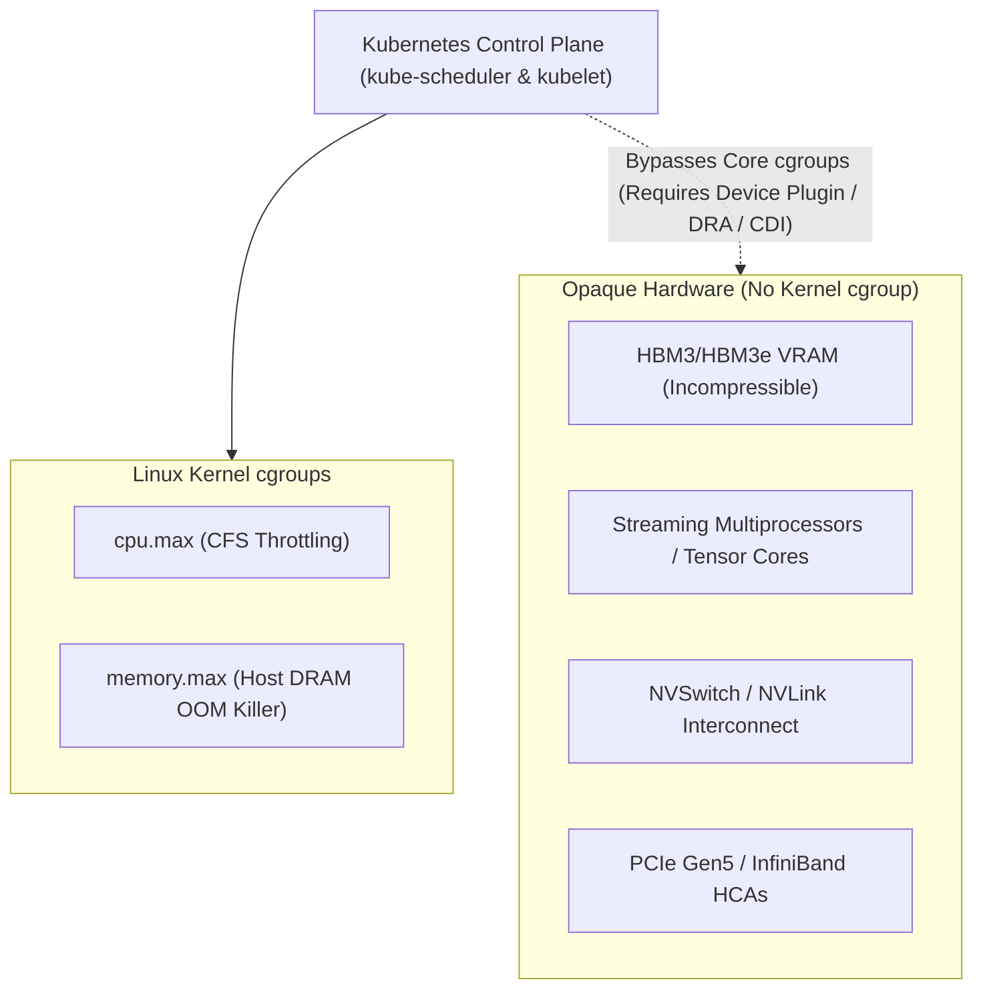
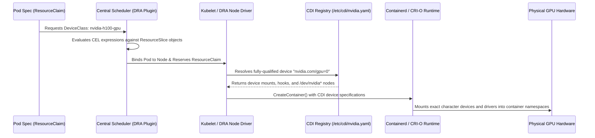
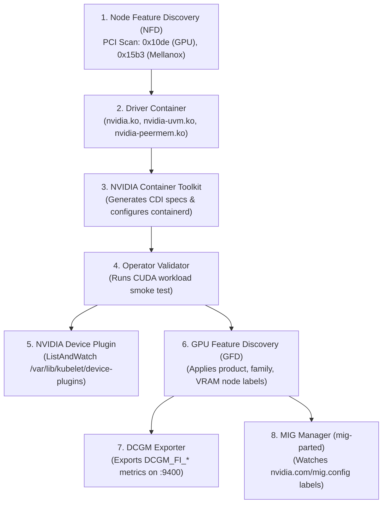
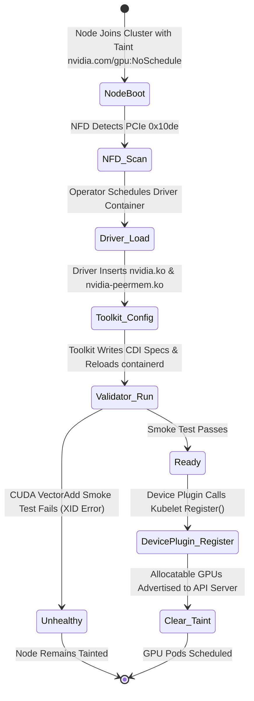
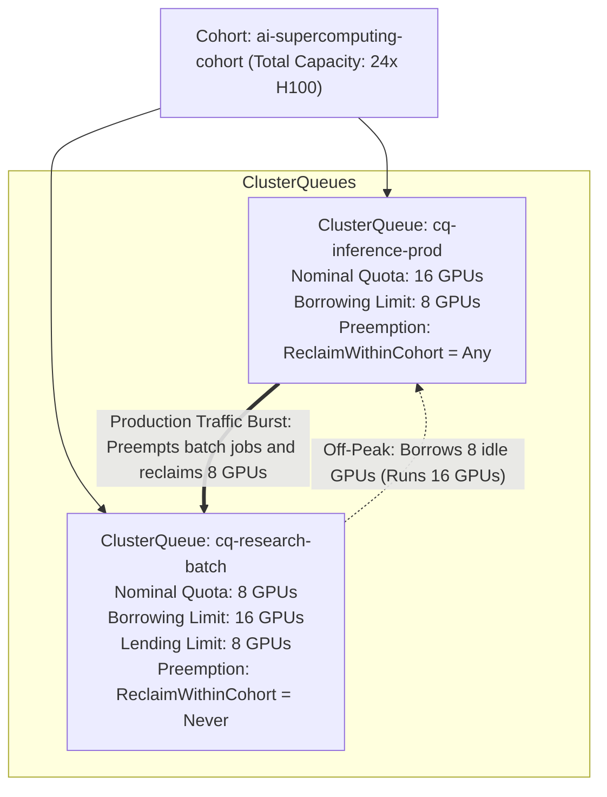

# 1. Hardware Abstraction & Orchestration

> **Related Manifests**:
> - [`gpu-operator-clusterpolicy.yaml`](../manifests/01-hardware-orchestration/gpu-operator-clusterpolicy.yaml)
> - [`nvidia-runtimeclass.yaml`](../manifests/01-hardware-orchestration/nvidia-runtimeclass.yaml)
> - [`kueue-gpu-clusterqueue.yaml`](../manifests/01-hardware-orchestration/kueue-gpu-clusterqueue.yaml)
> - [`dra-gpu-resourceclaim.yaml`](../manifests/01-hardware-orchestration/dra-gpu-resourceclaim.yaml)  
>
> **Companion CLI ([`KubeVRAM`](https://github.com/xsub/KubeVRAM))**: `kubevram topology` | `kubevram rbac-audit` | `kubevram bridge driver`

---

## 1.1 The Kubernetes Hardware Abstraction Gap

Kubernetes was architected around general-purpose CPU compute and host DRAM. At the Linux kernel level, the kubelet manages container resource boundaries using two native cgroup controllers:
1. **`cpu` controller**: Compressible compute cycles measured in millicores (`1000m = 1 vCPU`), enforced via the Linux Completely Fair Scheduler (CFS `cpu.cfs_quota_us` in cgroup v1 or `cpu.max` in cgroup v2). When a container exceeds its quota, the kernel throttles execution without terminating the process.
2. **`memory` controller**: Incompressible host DRAM measured in bytes (`Gi` or `Mi`), enforced via `memory.max`. When physical memory consumption crosses the cgroup limit, the Linux kernel Out-Of-Memory (OOM) killer invokes `SIGKILL` (Exit Code `137`).

Accelerated AI hardware—such as NVIDIA Hopper/Blackwell GPUs, High Bandwidth Memory (HBM3/HBM3e), Tensor Cores, NVSwitch fabrics, and InfiniBand/RoCEv2 Host Channel Adapters (HCAs)—**is completely invisible to core Kubernetes**. A GPU does not possess a native Linux cgroup controller for VRAM allocation or compute engine time-slicing.



---

### Evolution: Device Plugin Framework vs. Dynamic Resource Allocation (DRA) & CDI

To bridge this hardware gap, Kubernetes has evolved through two distinct resource management architectures:

| Architectural Dimension | Device Plugin Framework (`v1beta1`) | Dynamic Resource Allocation (DRA `resource.k8s.io/v1beta1`) |
| :--- | :--- | :--- |
| **API Abstraction** | Scalar integer in `resources.limits` (e.g., `nvidia.com/gpu: 2`) | Structured `ResourceClaim`, `ResourceClaimTemplate`, and `DeviceClass` |
| **Configuration Model** | Node-level static ConfigMaps; zero container-specific flags | Declarative, per-claim parameters (e.g., VRAM minimums, compute capability, MIG profile) |
| **Device Selection Logic** | Kubelet picks devices sequentially via node-local state | Dynamic CEL (Common Expression Language) evaluation across `ResourceSlice` objects |
| **Sharing Model** | Global node-level multiplexing (Time-Slicing integer multiplier) | First-class sharing: multiple pods and containers bind to a single `ResourceClaim` |
| **Interconnect Topology** | Weak heuristics via local Kubelet `TopologyManager` | Native fabric awareness: claims evaluate NVLink clique IDs and PCIe switch domains |
| **Container Runtime Hook** | Proprietary OCI prestart hooks (`nvidia-container-runtime-hook`) | Standardized **Container Device Interface (CDI)** (`/etc/cdi/nvidia.yaml`) |

#### Device Plugin Protocol Mechanics (`v1beta1`)

The legacy Device Plugin model operates as an out-of-process gRPC server communicating with `kubelet` over a UNIX domain socket:
1. **Registration**: The device plugin connects to `/var/lib/kubelet/device-plugins/kubelet.sock` and issues a `Register()` call advertising its resource name (`nvidia.com/gpu`).
2. **ListAndWatch**: Kubelet opens a persistent stream. The plugin queries NVML and streams back a list of healthy device UUIDs (`[GPU-aaa, GPU-bbb]`). If a GPU experiences an unrecoverable hardware XID error, the plugin reports it as unhealthy.
3. **Allocate**: When a pod requesting `nvidia.com/gpu: 1` lands on the node, kubelet calls `Allocate()`. The plugin returns environment variables (`NVIDIA_VISIBLE_DEVICES=GPU-aaa`), character device paths, and mount points.

#### Container Device Interface (CDI) & Dynamic Resource Allocation

While the Device Plugin protocol relied on custom OCI prestart hooks to inspect environment variables and inject `/dev/nvidia*` nodes into container root filesystems, **CDI** standardizes device injection directly into the Container Runtime Interface (CRI):

```yaml
# Generated by nvidia-container-toolkit at /var/run/cdi/nvidia.yaml
cdiVersion: "0.5.0"
kind: "nvidia.com/gpu"
devices:
  - name: "0"
    containerEdits:
      deviceNodes:
        - path: "/dev/nvidia0"
          hostPath: "/dev/nvidia0"
          type: "c"
          permissions: "rw"
        - path: "/dev/nvidiactl"
          hostPath: "/dev/nvidiactl"
          type: "c"
          permissions: "rw"
        - path: "/dev/nvidia-uvm"
          hostPath: "/dev/nvidia-uvm"
          type: "c"
          permissions: "rw"
      mounts:
        - hostPath: "/usr/lib/x86_64-linux-gnu/libcuda.so"
          containerPath: "/usr/lib/x86_64-linux-gnu/libcuda.so"
          options: ["ro", "nosuid", "nodev", "bind"]
```

Under Kubernetes **DRA (`resource.k8s.io/v1beta1`)**, scheduling decisions are no longer constrained by simple integer arithmetic. Instead, the central scheduler evaluates structured claims against `ResourceSlice` objects using Common Expression Language (CEL). Once scheduled, the DRA driver invokes `NodePrepareResource`, maps the hardware via CDI, and binds it to the pod's container lifecycle (see [`dra-gpu-resourceclaim.yaml`](../manifests/01-hardware-orchestration/dra-gpu-resourceclaim.yaml)).



---

## 1.2 NVIDIA GPU Operator Lifecycle & Internals

The **NVIDIA GPU Operator** automates the deployment and Day-2 management of all GPU software components on Kubernetes. Rather than baking proprietary drivers and CUDA libraries into mutable OS golden images, the Operator reconciles the entire software stack via the `ClusterPolicy` Custom Resource (see [`gpu-operator-clusterpolicy.yaml`](../manifests/01-hardware-orchestration/gpu-operator-clusterpolicy.yaml)).

### Subsystem Architecture



| Component | Execution Mode | Responsibilities & Failure Modes | Diagnostic Command |
| :--- | :--- | :--- | :--- |
| **Node Feature Discovery (NFD)** | DaemonSet | Scans host PCIe bus for vendor ID `0x10de` (NVIDIA) and `0x15b3` (Mellanox). Labels node with `feature.node.kubernetes.io/pci-10de.present=true`. If broken, GPU Operator ignores the node. | `kubectl get nodes -l feature.node.kubernetes.io/pci-10de.present=true` |
| **NVIDIA Driver Container** | DaemonSet (Privileged) | Compiles or loads precompiled kernel modules (`nvidia.ko`, `nvidia-uvm.ko`, `nvidia-modeset.ko`, `nvidia-peermem.ko`). Failure leaves nodes without `/dev/nvidiactl`. | `kubectl logs -n gpu-operator -l app=nvidia-driver-daemonset --tail=100` |
| **Container Toolkit** | DaemonSet | Installs `/usr/local/nvidia/toolkit`, writes `/etc/cdi/nvidia.yaml`, and configures `/etc/containerd/config.toml` runtime handlers. | `crictl info \| jq .config.containerd.runtimes` |
| **Operator Validator** | DaemonSet / Init | Runs validation containers to verify driver loading, toolkit integration, and CUDA sample execution before un-tainting the node. | `kubectl describe pod -n gpu-operator -l app=nvidia-operator-validator` |
| **Device Plugin** | DaemonSet | Implements Kubelet Device Plugin gRPC API (`ListAndWatch`, `Allocate`). Monitors device health (XID errors). | `kubectl logs -n gpu-operator -l app=nvidia-device-plugin-daemonset` |
| **GPU Feature Discovery (GFD)** | DaemonSet | Discovers GPU SKU, VRAM capacity, compute capability, and driver version. Applies node labels used by schedulers. | `kubectl get node <node> -o json \| jq .metadata.labels` |
| **MIG Manager (`mig-parted`)** | DaemonSet | Reconfigures physical GPU hardware into MIG slices based on `nvidia.com/mig.config` label changes. | `kubectl logs -n gpu-operator -l app=nvidia-mig-manager` |
| **DCGM Exporter** | DaemonSet | Collects hardware telemetries (SM activity, memory usage, NVLink bandwidth) at sub-second granularity. | `curl -s http://<node-ip>:9400/metrics \| grep DCGM_FI_` |

---

### Precompiled Driver Containers vs. DKMS Compilation

During cluster autoscaling, the driver installation strategy represents the primary operational bottleneck:

| Evaluation Criteria | Precompiled Driver Containers (`usePrecompiled: true`) | Dynamic Kernel Module Support (DKMS Compilation) |
| :--- | :--- | :--- |
| **Scale-Up Node Latency** | **20 to 45 seconds** (image pull + container start) | **4 to 10 minutes** (downloads GCC, kernel headers, builds `.ko`) |
| **Cluster Autoscaling Behavior** | Predictable, low-jitter scale-out during inference traffic spikes | High risk of autoscaler scale-up timeouts; pods stay `Pending` |
| **Failure Surface** | Requires prebuilt image matching exact kernel commit hash | Fails if public apt/yum repos are offline or kernel headers mismatch |
| **Network & Air-Gap Suitability** | Excellent: self-contained image mirrored to private registry | High risk in air-gapped clusters due to external compiler dependencies |
| **OS Patch Rollouts** | Host kernel updates require pushing updated driver image tags | Attempts automatic rebuild on reboot (prone to GCC version incompatibilities) |
| **GPUDirect Storage (GDS) Support** | **UNSUPPORTED**: Precompiled images do NOT include `nvidia-fs` | **Supported**: Compiles `nvidia-fs.ko` alongside `nvidia.ko` (`gds.enabled: true`) |

#### Driver Branch Specification Mechanics
In the GPU Operator `ClusterPolicy`, when using `usePrecompiled: true`, configure the driver **branch** string rather than a point release:

```yaml
spec:
  driver:
    enabled: true
    usePrecompiled: true
    repository: nvcr.io/nvidia
    image: driver
    version: "570"   # Driver branch string (e.g., branch 570, NOT a static 550.90.07 tag)
```

The GPU Operator automatically queries the host node's kernel release and OS distribution to construct the complete image tag:
$$\text{Image Tag} = \langle\text{branch}\rangle-\langle\text{kernel-version}\rangle-\langle\text{distro}\rangle$$
For example, on Ubuntu 22.04 with kernel `5.15.0-1070-aws`, the operator pulls:
`nvcr.io/nvidia/driver:570-5.15.0-1070-aws-ubuntu22.04`

> [!WARNING]
> **GPUDirect Storage (GDS / `nvidia-fs`) Incompatibility**:  
> NVIDIA precompiled driver containers **do NOT package GPUDirect Storage (`nvidia-fs.ko`)**. If GPUDirect Storage is required (e.g., for NVMe-to-VRAM model weight streaming in Chapter 06), you **must** either:
> 1. Set `driver.usePrecompiled: false` and `gds.enabled: true` to compile `nvidia.ko` and `nvidia-fs.ko` via DKMS in the driver container, or
> 2. Install the NVIDIA driver, MOFED, and `nvidia-fs` directly on the host OS golden image and configure `driver.enabled: false`.

> [!IMPORTANT]
> When using `driver.usePrecompiled: true` in production, lock host kernel packages (`apt-mark hold linux-image-generic` or immutable OS distros like Flatcar / Talos) to ensure that unattended host OS upgrades do not break precompiled image resolution.

---

### Safe Driver Rolling Upgrades (`upgradePolicy`)

Upgrading NVIDIA drivers live in a running Kubernetes cluster presents a severe hazard: the Linux kernel cannot unload `nvidia.ko` if any open file descriptor points to `/dev/nvidia*`. The GPU Operator solves this through the Driver Upgrade Controller:
1. **Node Cordoning**: The controller marks the node unschedulable (`schedulable=false`).
2. **Pod Eviction**: Evicts running inference and batch pods, honoring `PodDisruptionBudget` rules until `timeoutSeconds` expires.
3. **Module Unload & Reload**: Once all `/dev/nvidia*` file handles close, the driver container unloads old `.ko` modules and inserts the new version.
4. **Validation Smoke Test**: The operator validator runs CUDA verification containers.
5. **Node Uncordon**: The node is marked ready, and GFD updates driver version labels.



### Production Node Labeling via GPU Feature Discovery (GFD)

Once the Operator Validator marks the stack healthy, GFD attaches standard attributes directly to the Node resource:

```yaml
metadata:
  labels:
    nvidia.com/gpu.present: "true"
    nvidia.com/gpu.product: "NVIDIA-H100-80GB-HBM3"
    nvidia.com/gpu.family: "hopper"
    nvidia.com/gpu.compute.major: "9"
    nvidia.com/gpu.compute.minor: "0"
    nvidia.com/gpu.count: "8"
    nvidia.com/gpu.memory: "81920"
    nvidia.com/gpu.sharing-strategy: "none"
    nvidia.com/mig.strategy: "mixed"
    nvidia.com/cuda.driver.major: "570"
```

---

## 1.3 Hypervisor vs. Bare-Metal Kubernetes Nodes

Architecting Kubernetes GPU worker nodes requires selecting the appropriate infrastructure layer:

| Architectural Metric | Bare-Metal Kubernetes | VFIO-PCI Passthrough (VM) | NVIDIA vGPU Mediated Devices (VM) |
| :--- | :--- | :--- | :--- |
| **Compute Overhead** | **0%** (Direct bare-metal execution) | **<1%** (Near-native CPU/GPU execution) | **2% to 6%** (Hypervisor context switching) |
| **Interconnect (NVLink/NVSwitch)** | Full hardware bandwidth (`900 GB/s` on H100) | Full bandwidth only if all linked GPUs pass to 1 VM | Severely limited or unsupported across VMs |
| **GPUDirect RDMA Throughput** | Line rate (`400 Gbps` / `800 Gbps` per NIC) | Requires SR-IOV vNIC passthrough + IOMMU pinning | High latency jitter; virtual switch traversal |
| **Licensing Requirement** | None (Standard Data Center drivers) | None (Standard Data Center drivers) | **Mandatory NVIDIA AI Enterprise (NVAIE) NLS license** |
| **VRAM & Compute Partitioning** | Kubernetes native (MIG, MPS, Time-Slicing) | Kubernetes native (MIG, MPS, Time-Slicing) | Fixed by hypervisor profile (e.g., `L40S-24Q`, `A100-3-40C`) |
| **Driver Management Layer** | Managed entirely by Kubernetes GPU Operator | Managed entirely by Kubernetes GPU Operator | Hypervisor host driver + guest vGPU driver lockstep |

### Deep Dive: VFIO-PCI Passthrough Constraints

When passing raw PCIe GPUs into virtual machines (e.g., KubeVirt, Proxmox, VMware ESXi):
1. **IOMMU Groups and PCIe Access Control Services (ACS)**:
   The host Linux kernel groups PCIe devices into IOMMU groups to prevent DMA attacks between devices. If a server's PCIe root port lacks hardware ACS support, or if cards share an upstream PCIe switch, the kernel bundles multiple GPUs and NICs into a single IOMMU group. Passing a single GPU into a VM requires passing all devices within that IOMMU group.
   
   Applying the kernel parameter `pci=noacs` or custom ACS override patches breaks kernel memory isolation and can cause silent data corruption or disable PCIe Peer-to-Peer (P2P) DMA routing.

2. **Base Address Register (BAR1) Sizing for 80GB+ GPUs**:
   Accelerators map GPU memory into CPU addressable space via PCIe Base Address Registers. **BAR1** is used by the host OS and peer devices to access GPU VRAM directly. 
   
   Older hypervisor virtual BIOS configurations default to a **256 MiB BAR1 window**. When passing an 80GB A100 or H100 GPU, this legacy window causes driver initialization failure (`NVRM: BAR1 is too small`) and prevents GPUDirect P2P transfers. The hypervisor VM must be explicitly configured with **64-bit PCI MMIO mapping** enabled and an aperture size of at least `128 GiB` per physical GPU (e.g., `qemu -global q35-pcihost.pci-hole64-size=512G`).

---

## 1.4 Multi-Tenant Quota & Fair-Share Orchestration

Standard Kubernetes `ResourceQuota` operates as an absolute hard ceiling within an individual namespace:
- If `team-inference` is granted 16 GPUs but currently utilizes only 8, the remaining 8 GPUs remain idle.
- If `team-batch` has queued research jobs, those jobs cannot utilize the idle GPUs because Kubernetes quotas cannot dynamically lend or borrow resources across namespaces.

Modern AI platforms deploy **Hierarchical Fair-Share Scheduling** using either **Run:ai (KAI Scheduler)** or **Kubernetes-SIGs Kueue**.



### Architectural Comparison: Run:ai (KAI Scheduler) vs. Kubernetes-SIGs Kueue

| Capability | Run:ai (KAI Scheduler) | Kubernetes-SIGs Kueue |
| :--- | :--- | :--- |
| **Architecture** | Proprietary / Apache 2.0 open-sourced replacement `kube-scheduler` | Native Kubernetes Controller operating as an admission gate for workloads |
| **Workload Abstractions** | Custom Workload CRDs, standard Deployments, StatefulSets | Batch `Job`, Ray `RayJob`/`RayCluster`, PyTorch `MPIJob`, `LeaderWorkerSet` |
| **Queue Hierarchy** | Multi-level tree (Root -> Department -> Project Queues) | `Cohort` groupings linking multiple `ClusterQueue` resources |
| **Borrowing Mechanism** | Dynamic borrowing based on `overQuotaWeight` ratios | Declarative `borrowingLimit` and `lendingLimit` per resource flavor |
| **Preemption Engine** | Direct kernel pod eviction and GPU context reset | Preempts workloads at the Kueue admission level via graceful eviction |
| **Scheduling Decision Point** | Replaces Kubernetes scheduling cycle | Suspends pods (`spec.suspend: true`) until quota is granted, then hands to `kube-scheduler` |

See [`kueue-gpu-clusterqueue.yaml`](../manifests/01-hardware-orchestration/kueue-gpu-clusterqueue.yaml) for production configurations of `ResourceFlavor`, `ClusterQueue`, and cohort borrowing definitions.

#### Preemption Policy Matrix in Kueue

When designing multi-tenant clusters, configure Kueue preemption rules to prevent serving degradation:
- **`reclaimWithinCohort: Any`**: High-priority production queues can reclaim their nominal quota by evicting any borrowing workload from peer queues within the cohort.
- **`withinClusterQueue: LowerPriority`**: Within the same queue, higher-priority inference pods preempt lower-priority pods.
- **`borrowWithinCohort: policy: Never`**: Critical production queues never borrow above their limit if it risks being evicted later, ensuring latency guarantees remain intact.

---

## 1.5 Hardening Practices & Day-2 Verification

### Practice 1: Zero-Privilege Inference Containers and Explicit RuntimeClass

Running GPU containers with `securityContext.privileged: true` exposes all physical host character devices (`/dev/nvidia0` through `/dev/nvidia7`), bypasses Device Plugin isolation, and invalidates multi-tenancy guarantees.

Inference pods must declare `runtimeClassName: nvidia` (see [`nvidia-runtimeclass.yaml`](../manifests/01-hardware-orchestration/nvidia-runtimeclass.yaml)) and drop all Linux capabilities:

```yaml
apiVersion: v1
kind: Pod
metadata:
  name: vllm-inference-secure
  namespace: ai-inference
spec:
  runtimeClassName: nvidia
  automountServiceAccountToken: false
  containers:
    - name: vllm-engine
      image: vllm/vllm-openai:v0.33.0@sha256:d825baf9ce4b1b6bfc5ecc7b79880c7e6748c65a72d697ce3d47607aafa84c6e
      securityContext:
        privileged: false
        allowPrivilegeEscalation: false
        readOnlyRootFilesystem: true
        capabilities:
          drop: ["ALL"]
      resources:
        limits:
          nvidia.com/gpu: "1"
          cpu: "8"
          memory: "32Gi"
```

### Auditing Cluster Isolation with `kubectl`

Run this script to locate GPU pods running as privileged or missing explicit `RuntimeClass`:

```bash
kubectl get pods -A -o json | jq -r '
  .items[]
  | select(.spec.containers[].resources.limits."nvidia.com/gpu" != null)
  | select(.spec.runtimeClassName != "nvidia" or (.spec.containers[].securityContext.privileged == true))
  | "VIOLATION: \(.metadata.namespace)/\(.metadata.name) runtimeClass=\(.spec.runtimeClassName // "none") privileged=\(.spec.containers[0].securityContext.privileged // false)"
'
```

### Day-2 Command Bridge: Linux Bare-Metal to Kubernetes

| Bare-Metal Linux Command | Kubernetes GPU Operator Equivalent | KubeVRAM Companion Shortcut |
| :--- | :--- | :--- |
| `lspci \| grep -i nvidia` | `kubectl get nodes -l feature.node.kubernetes.io/pci-10de.present=true` | `kubevram bridge driver` |
| `cat /proc/driver/nvidia/version` | `kubectl get pods -n gpu-operator -l app=nvidia-driver-daemonset -o wide` | `kubevram bridge driver` |
| `nvidia-smi -L` | `kubectl get nodes -o custom-columns=NODE:.metadata.name,MODEL:.metadata.labels.'nvidia\.com/gpu\.product',ALLOC_GPUS:.status.allocatable.'nvidia\.com/gpu'` | `kubevram topology` |
| `dmesg \| grep -i NVRM` | `kubectl logs -n gpu-operator -l app=nvidia-operator-validator` | `kubevram rbac-audit` |
| `cat /etc/cdi/nvidia.yaml` | `kubectl exec -n gpu-operator ds/nvidia-container-toolkit-daemonset -- cat /var/run/cdi/nvidia.yaml` | `kubevram bridge driver` |

---

## References

1. Kubernetes Device Plugin Framework: <https://kubernetes.io/docs/concepts/extend-kubernetes/compute-storage-net/device-plugins/>
2. Kubernetes Dynamic Resource Allocation (DRA): <https://kubernetes.io/docs/concepts/scheduling-eviction/dynamic-resource-allocation/>
3. Container Device Interface (CDI) Specification: <https://github.com/container-orchestrated-devices/container-device-interface>
4. NVIDIA GPU Operator Architecture & ClusterPolicy: <https://docs.nvidia.com/datacenter/cloud-native/gpu-operator/latest/architecture.html>
5. NVIDIA GPU Operator Precompiled Drivers: <https://docs.nvidia.com/datacenter/cloud-native/gpu-operator/latest/install-gpu-operator.html#precompiled-drivers>
6. Kubernetes SIGs Kueue Documentation: <https://kueue.sigs.k8s.io/docs/overview/>
7. Run:ai Platform & KAI Scheduler Documentation: <https://docs.run.ai/>
8. Linux VFIO & IOMMU Grouping: <https://www.kernel.org/doc/html/latest/driver-api/vfio.html>

