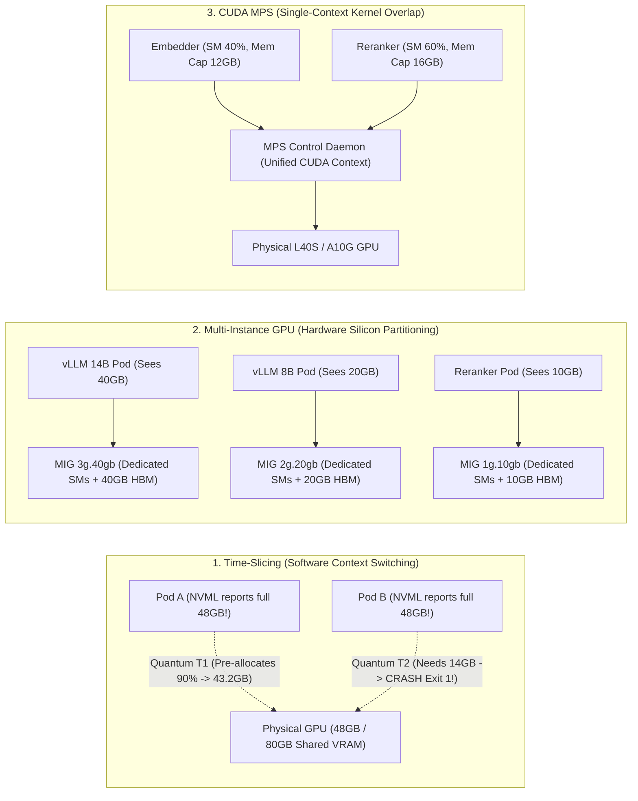

# 2. GPU Partitioning & Sharing Strategies (Hypervisor & Kubernetes)

> **Related Manifests**: [`mig-parted-configmap.yaml`](../manifests/02-gpu-partitioning/mig-parted-configmap.yaml) | [`time-slicing-and-mps-configmap.yaml`](../manifests/02-gpu-partitioning/time-slicing-and-mps-configmap.yaml)  
> **Companion CLI ([`KubeVRAM`](https://github.com/xsub/KubeVRAM))**: `kubevram partition --gpu H100-80GB --workload vllm --tenants multi --emit-configmap` | `kubevram bridge mig`

---

## 2.1 Sharing NVIDIA GPUs on Hypervisor Machines (VM Infrastructure Layer)

Before a GPU ever reaches `kubelet` inside a Kubernetes worker node, enterprise on-premises and private-cloud clusters frequently run Kubernetes atop **Type-1 Hypervisors** (**KVM/QEMU, Proxmox VE, Red Hat OpenShift Virtualization / KubeVirt, VMware vSphere ESXi, OpenStack Nova**).

When designing an AI inference platform on virtualized hosts, infrastructure engineers must first choose **how the hypervisor exposes physical NVIDIA GPUs to Guest Kubernetes Worker VMs**, because that choice dictates what sharing modes and GPU Operator settings are valid inside Kubernetes.

```mermaid
flowchart TB
    subgraph ModeA["Mode A: VFIO PCIe Passthrough (1:1 Physical GPU -> VM)"]
        H_A["Physical GPU (H100 / L40S)"] -->|"IOMMU + vfio-pci"| VM_A["K8s Worker VM (Full PCIe Control)"]
        VM_A -->|"GPU Operator driver.enabled=true"| Pod_A["K8s Pods: Full GPU, Guest MIG, MPS, or Time-Slicing"]
    end

    subgraph ModeB["Mode B: Hypervisor Time-Sliced NVIDIA vGPU"]
        H_B["Physical GPU + Host nvidia-vgpu-mgr"] -->|"MDEV / SR-IOV VF"| VM_B1["K8s Worker VM 1 (vGPU Profile e.g. L40S-24Q)"]
        H_B -->|"MDEV / SR-IOV VF"| VM_B2["K8s Worker VM 2 (vGPU Profile e.g. L40S-24Q)"]
        VM_B1 -->|"vGPU Guest Driver + NLS License"| Pod_B1["K8s Pods (Fixed VF VRAM, Time-Sliced SMs)"]
    end

    subgraph ModeC["Mode C: SR-IOV + Hardware MIG-Backed vGPU (Ampere/Hopper/Blackwell)"]
        H_C["Physical H100/A100 + Host MIG + SR-IOV"] -->|"VF 0 (Hardware MIG 3g.40gb)"| VM_C1["Tenant A K8s Worker VM"]
        H_C -->|"VF 1 (Hardware MIG 2g.20gb)"| VM_C2["Tenant B K8s Worker VM"]
        H_C -->|"VF 2 (Hardware MIG 2g.20gb)"| VM_C3["Tenant C K8s Worker VM"]
    end
```



### Hypervisor Sharing Approaches Compared

| Hypervisor Mode | Underlying Mechanism | VRAM Isolation Across VMs | Compute (SM) Isolation Across VMs | NVIDIA Licensing Required? | GPU Operator `ClusterPolicy` Impact |
| :--- | :--- | :--- | :--- | :--- | :--- |
| **1. VFIO PCIe Passthrough** | Linux IOMMU (`intel_iommu=on` / `amd_iommu=on`) binds raw PCIe BDF (`0000:c1:00.0`) via `vfio-pci` directly into 1 VM. | **Strict** (100% physical GPU dedicated to 1 VM). | **Strict** (Zero hypervisor scheduling overhead; supports NVLink pass-through when all linked GPUs + NVSwitches pass to same VM). | **No** (Standard Data Center driver). | Standard bare-metal mode: `driver.enabled: true` (datacenter image), `migManager.enabled: true`. |
| **2. Time-Sliced NVIDIA vGPU** | Host hypervisor runs `nvidia-vgpu-mgr`; exposes Virtual Functions (SR-IOV / MDEV) such as `L40S-12Q` or `A100-20C`. | **Enforced per VF** by hypervisor MMU (unlike K8s software time-slicing!). | **Temporal (Time-Sliced)** across VMs (`best_effort`, `equal_share`, or `fixed_share` scheduler). | **Yes** (NVIDIA AI Enterprise / vCS NLS token). | Requires **vGPU Guest Driver** container matching exact host `vgpu-kvm` branch + `licensingConfig` Secret; `migManager.enabled: false`. |
| **3. MIG-Backed NVIDIA vGPU** | Ampere/Hopper/Blackwell SR-IOV + hardware MIG on hypervisor (`H100-2-20C`, `A100-3-40C`). | **Strict Silicon HBM Partition** per VM. | **Strict Silicon SM/L2 Partition** per VM (deterministic p99 latency across untrusted VMs). | **Yes** (NVIDIA AI Enterprise / vCS NLS token). | Requires **vGPU Guest Driver**; MIG is pre-sliced by hypervisor (`migManager.enabled: false` inside K8s; each VM sees `1` isolated GPU). |

> [!IMPORTANT]
> **Architectural Rule of Thumb for Hypervisors**:
> - If a single Kubernetes cluster owns the physical server, **prefer VFIO PCIe Passthrough** into large Kubernetes GPU Worker VMs (1 VM per NUMA socket or 1 VM per node) and manage **MIG / MPS / Time-Slicing natively inside Kubernetes** via the NVIDIA GPU Operator. This avoids vGPU license overhead, eliminates host/guest driver version lockstep, and preserves full NVLink/GPUDirect RDMA performance.
> - Use **MIG-Backed vGPU** only when you must isolate **separate, untrusted Kubernetes clusters** (hard VM kernel boundaries per customer) on the same physical A100/H100 host.

---

## 2.2 The Kubernetes Fractional GPU Problem

Inside Kubernetes, `nvidia.com/gpu` is an indivisible integer (`1`, `2`, `4`, `8`). Submitting `nvidia.com/gpu: 0.25` fails API validation immediately. Yet real-world AI platforms run a heterogeneous mix of workloads alongside frontier LLMs:
- **Guardrail & PII Classifiers** (`Llama-Guard-3-8B-INT8`, `DeBERTa-v3`): `1.5–8 GB` VRAM
- **Dense Embeddings & Cross-Encoder Rerankers** (`BGE-M3`, `E5-Mistral-7B`, `NV-Embed`): `2–14 GB` VRAM
- **Audio & Vision Microservices** (`Whisper-large-v3`, `PaddleOCR`, `YOLOv10`): `2–6 GB` VRAM

Allocating a dedicated 80GB H100 (\$30,000+ hardware) to a 4GB embedding pod wastes **95% of HBM3 memory** and **>85% of Streaming Multiprocessors (SMs)**.

NVIDIA provides three container-level sharing mechanisms via the GPU Operator: **Time-Slicing**, **Multi-Instance GPU (MIG)**, and **CUDA Multi-Process Service (MPS)**.



---

## 2.3 Deep Technical Breakdown: Time-Slicing vs. MIG vs. MPS

### 1. GPU Time-Slicing (Temporal Software Multiplexing)

- **Mechanism**: Configured via a ConfigMap passed to `devicePlugin.config` (see [`time-slicing-and-mps-configmap.yaml`](../manifests/02-gpu-partitioning/time-slicing-and-mps-configmap.yaml)). Setting `replicas: 4` causes the NVIDIA Device Plugin to register `4` virtual `nvidia.com/gpu` tokens per physical GPU (`gpu-0::0`, `gpu-0::1`, `gpu-0::2`, `gpu-0::3`) and label the node `nvidia.com/gpu.sharing-strategy=time-slicing`.
- **Execution**: Multiple containers bind directly to the same physical GPU. The NVIDIA hardware compute engine preempts and context-switches CUDA streams in round-robin time slices.
- **Zero Memory or Fault Isolation**:
  1. Every container queries `nvmlDeviceGetMemoryInfo()` and sees **100% of physical VRAM** (e.g., `48.0 GiB` on L40S or `80.0 GiB` on H100).
  2. **Why vLLM Fails Catastrophically on Time-Slicing**: On startup, `vLLM` profiles free memory and reserves `total_vram * gpu_memory_utilization` (`0.90` by default) for model weights and PagedAttention KV-cache blocks. Pod 1 claims `43.2 GiB` of a `48 GiB` L40S. Moments later, Pod 2 lands on replica `gpu-0::1`, sees only `4.8 GiB` free, and enters an infinite `CrashLoopBackOff` (`Exit Code 1`, `torch.cuda.OutOfMemoryError`).
  3. **Noisy-Neighbor Latency**: Context-switching massive LLM KV states stalls all co-located tenants, spiking p99 Time-Per-Output-Token (TPOT).

> [!CAUTION]
> Never schedule default `vLLM`, `TGI`, or `SGLang` pods onto `time-slicing` nodes in production. If you must co-locate two cooperating engines on a non-MIG dev box, explicitly cap `--gpu-memory-utilization` below $\frac{0.85}{N_{\text{replicas}}}$ (e.g., `0.40` for 2 replicas).

---

### 2. Multi-Instance GPU (MIG — Silicon-Level Hardware Partitioning)

- **Supported Silicon**: NVIDIA **Ampere** (`A100`, `A30`), **Hopper** (`H100`, `H200`), and **Blackwell** (`B100`, `B200`). *(Not available on Ada `L40S`/`L4`, Ampere consumer/graphics `A10G`/`A10`, or Turing `T4`.)*
- **Hardware Architecture**: Physical A100/H100 80GB GPUs contain **7 Compute Slices** (`1g` each) and **8 Memory Slices** (`10 GB` each). MIG physically partitions the silicon crossbar, L2 cache banks, DRAM memory controllers, and SMs into independent **GPU Instances (GIs)**:

| MIG Profile (80GB H100/A100) | Compute Fraction (SMs) | Dedicated HBM VRAM | Max Instances per GPU | Ideal Production Workload |
| :--- | :--- | :--- | :--- | :--- |
| **`1g.10gb`** | $1/7$ (~14%) | `10 GiB` | `7` | Embeddings (`BGE-M3`), Cross-Encoders, Whisper, OCR |
| **`1g.20gb`** | $1/7$ (~14%) | `20 GiB` | `4` | Memory-heavy / low-QPS 7B–8B models with long KV cache |
| **`2g.20gb`** | $2/7$ (~28%) | `20 GiB` | `3` | Production `Llama-3.1-8B-FP8` / `Mistral-7B` (`vLLM`) |
| **`3g.40gb`** | $3/7$ (~43%) | `40 GiB` | `2` | `Qwen2.5-14B` / `32B-INT4/FP8`, Multimodal VLMs |
| **`4g.40gb`** | $4/7$ (~57%) | `40 GiB` | `1` (+ `3g.40gb`) | Compute-intensive 14B–32B low-latency serving |
| **`7g.80gb`** | $7/7$ (100%) | `80 GiB` | `1` | Full-GPU equivalent with MIG telemetry consistency |

- **Kubernetes Exposure Strategies (`mig.strategy` in `ClusterPolicy`)**:
  1. **`single` strategy**: Every GPU on the node uses an identical homogeneous profile (e.g., `7x 1g.10gb` per GPU) and advertises them all under `nvidia.com/gpu: 56`. Simple for uniform microservice pools.
  2. **`mixed` strategy** *(Recommended for heterogeneous AI platforms)*: Individual GPUs on the same 8-GPU node can hold different profiles (see [`mig-parted-configmap.yaml`](../manifests/02-gpu-partitioning/mig-parted-configmap.yaml)—e.g., GPUs `0–3` unpartitioned for TP=4 70B LLM, GPUs `4–5` as `3g.40gb`, GPUs `6–7` as `2g.20gb` + `1g.10gb`). Pods request explicit extended resources:
     ```yaml
     resources:
       limits:
         nvidia.com/mig-2g.20gb: "1"
     ```
- **Dynamic Reconfiguration via `mig-parted`**: Relabeling a node triggers the GPU Operator's `nvidia-mig-manager` automatically:
  ```bash
  kubectl label nodes gpu-node-a100-mig-02 nvidia.com/mig.config=all-balanced --overwrite
  ```
- **Critical MIG Constraints**:
  1. **No NVLink P2P Across MIG Slices**: Standard MIG disables peer-to-peer NVLink transfers between slices. Do not run `TP=2` across two `3g.40gb` slices—use a full GPU or `TP=2` full GPUs instead!
  2. **Reconfiguration Requires Idle GPU**: `nvidia-smi -i 0 -mig 1` fails if any container has `/dev/nvidia0` open; `mig-manager` handles draining GPU pods on label change.

---

### 3. CUDA Multi-Process Service (MPS — Concurrent Kernel Overlap)

- **Mechanism**: Deploys a node-level `nvidia-mps-control-daemon` that creates a **single shared CUDA context** on the physical GPU and proxies kernel launches from multiple client containers over UNIX domain sockets (`/tmp/nvidia-mps`).
- **Why MPS Beats Time-Slicing on `L40S` / `L4` / `A10G`**:
  - Non-MIG GPUs (`L40S-48GB`, `L4-24GB`, `A10G-24GB`) are heavily used in cloud instances (`g6e`, `g6`, `g5`).
  - Under Time-Slicing, if an embedding container uses only 25% of the SMs, the remaining 75% of SMs sit idle during its time slice, and every context switch flushes caches.
  - Under **CUDA MPS**, kernels from Container A (embedder) and Container B (reranker) run **simultaneously in spatial parallel** on disjoint SMs with zero context-switch penalty, and CUDA 12.x enforces per-client caps:
    - `CUDA_MPS_ACTIVE_THREAD_PERCENTAGE` (compute SM ceiling)
    - `CUDA_MPS_PINNED_DEVICE_MEM_LIMIT` (hard VRAM allocation ceiling per client!)
- **Fatal Limitation (Blast Radius)**: All MPS clients share a single GPU virtual address space and CUDA context. If one container triggers an illegal memory access, segfault, or unrecoverable CUDA assert, **every co-located MPS client on that GPU experiences a fatal CUDA context reset**. Therefore, use MPS **only within a single trust domain** (e.g., microservices owned by the same team/pipeline), never across untrusted external tenants.

---

## 2.4 Comprehensive Comparison & Decision Matrix

| Dimension | Full GPU (`none`) | Hardware **MIG** | **CUDA MPS** | **Time-Slicing** |
| :--- | :--- | :--- | :--- | :--- |
| **Supported GPUs** | All NVIDIA GPUs | A30, A100, H100, H200, B200 | Volta, Turing, Ampere, Ada, Hopper | All NVIDIA GPUs |
| **Compute Execution** | Exclusive (100% SMs) | Spatial (Dedicated hardware SMs) | Spatial (Shared context, SM % cap) | Temporal (Round-robin context switch) |
| **VRAM Isolation** | 100% Exclusive | Hardware HBM Controller Isolated | Software Pinned Limit (CUDA 12+) | **None** (Shared full VRAM) |
| **Memory Bandwidth QoS** | 100% Dedicated | Dedicated HBM crossbars & L2 | Shared HBM & L2 cache | Shared HBM & L2 cache |
| **Fault Containment** | Per physical GPU | **Strict** (Fault stays in slice) | **Poor** (1 crash resets all clients) | **Poor** (OOM/XID hits co-tenants) |
| **NVLink / P2P Support** | Yes (Full speed) | Disabled in standard MIG slices | Single-GPU scope | Single-GPU scope (`failRequestsGreaterThanOne: true`) |
| **Safe for Production `vLLM`?** | **Yes** | **Yes** (vLLM sees slice VRAM) | Cautious (Single-tenant + mem cap) | **NO** (Fatal pre-allocation OOMs) |

### Day-2 Verification (`kubectl`) & Automated Selection ([`KubeVRAM`](https://github.com/xsub/KubeVRAM))

```bash
# Inspect active sharing strategies and MIG slices across all GPU worker nodes via kubectl
kubectl get nodes -l nvidia.com/gpu.present=true \
  -o custom-columns=NODE:.metadata.name,SKU:.metadata.labels.'nvidia\.com/gpu\.product',SHARING:.metadata.labels.'nvidia\.com/gpu\.sharing-strategy',MIG:.metadata.labels.'nvidia\.com/mig\.strategy',GPUS:.status.allocatable.'nvidia\.com/gpu',MIG_2G:.status.allocatable.'nvidia\.com/mig-2g\.20gb'

# Companion KubeVRAM CLI: Evaluate SKU + workload + tenancy and emit GPU Operator ConfigMaps
kubevram partition --gpu H100-80GB --workload vllm --tenants multi --model-vram 16 --emit-configmap
kubevram partition --gpu A10G-24GB --workload embeddings --tenants multi --model-vram 4 --emit-configmap
kubevram partition --gpu L40S-48GB --workload dev-notebook --tenants multi --emit-configmap
```
