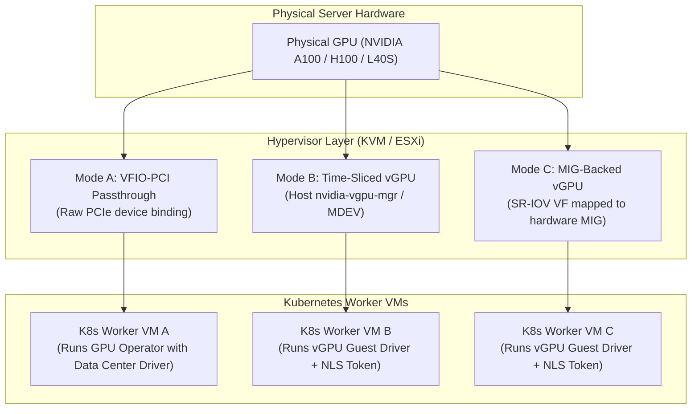
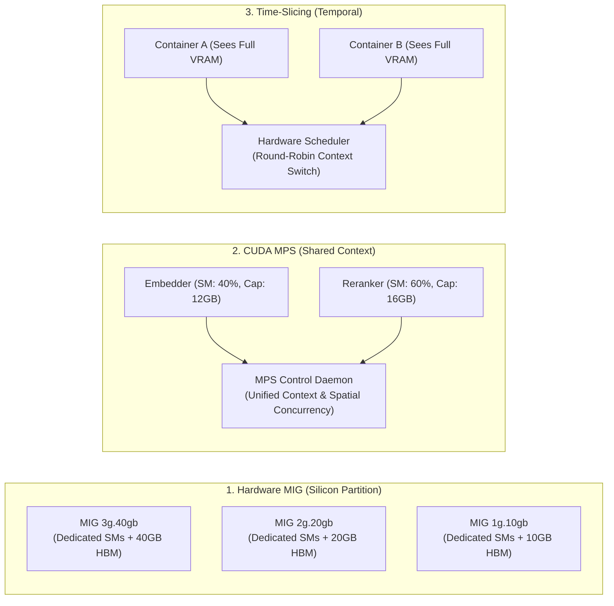
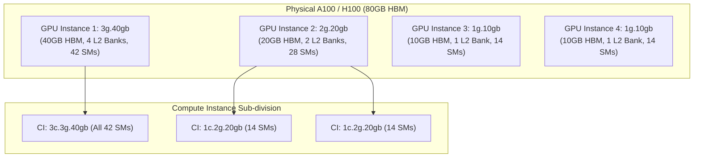
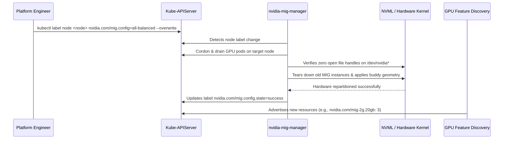
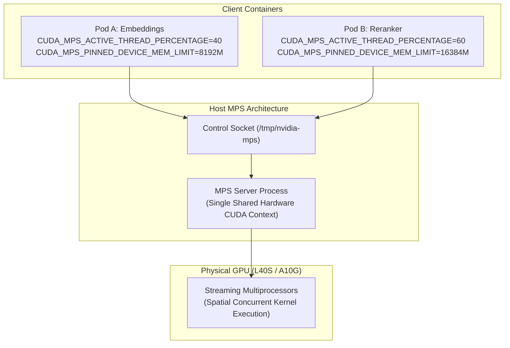

# 2. GPU Partitioning & Sharing Strategies (Hypervisor & Kubernetes)

> **Related Manifests**:
> - [`mig-parted-configmap.yaml`](../manifests/02-gpu-partitioning/mig-parted-configmap.yaml)
> - [`time-slicing-and-mps-configmap.yaml`](../manifests/02-gpu-partitioning/time-slicing-and-mps-configmap.yaml)  
>
> **Companion CLI ([`KubeVRAM`](https://github.com/xsub/KubeVRAM))**: `kubevram partition` | `kubevram bridge mig`

---

## 2.1 Sharing NVIDIA GPUs on Hypervisor Infrastructure

Enterprise AI platforms frequently run Kubernetes atop **Type-1 Hypervisors** (KVM/QEMU, Red Hat OpenShift Virtualization / KubeVirt, Proxmox VE, VMware vSphere ESXi). The hypervisor architecture dictates how physical GPUs are exposed to Guest Kubernetes Worker VMs, establishing the boundaries for what sharing mechanisms can be configured inside the cluster.



### Hypervisor Modes Compared

| Hypervisor Mode | Hardware Isolation | Interconnect Support | Licensing Overhead | Kubernetes GPU Operator Setup |
| :--- | :--- | :--- | :--- | :--- |
| **VFIO-PCI Passthrough** | 100% physical card dedicated to 1 VM. | Preserves full NVLink & GPUDirect RDMA. | **None** (Standard Data Center drivers). | `driver.enabled: true` (standard container image). Full control over MIG/MPS in K8s. |
| **Time-Sliced vGPU** | Hypervisor MMU enforces virtual VRAM limits per VF; SMs are time-sliced. | NVLink disabled; RDMA emulated or high latency. | **Mandatory** (NVIDIA AI Enterprise NLS license per vGPU). | Requires **vGPU Guest Driver** container and NLS secret. `migManager.enabled: false`. |
| **MIG-Backed vGPU** | Silicon-level HBM and SM isolation per Virtual Function (SR-IOV). | Limited P2P; isolated memory crossbars. | **Mandatory** (NVIDIA AI Enterprise NLS license per vGPU). | Requires **vGPU Guest Driver**. Host controls MIG slicing; K8s sees 1 whole GPU per VM. |

#### vGPU Profiles: C-Series vs. Q-Series vs. B-Series
When deploying virtualized nodes:
- **C-Series (Compute / AI)**: Headless, optimized for CUDA computing, model inference, and deep learning training. Memory ECC is enabled by default. Example: `A100-4C` or `H100-20C`.
- **Q-Series (Virtual Workstation)**: Designed for CAD, 3D visualization, and workstation rendering with full DirectX/OpenGL support alongside CUDA.
- **B-Series (Virtual PC)**: Tailored for standard enterprise VDI desktop acceleration, lacking compute optimization.

> [!IMPORTANT]
> When a single Kubernetes cluster manages the entire physical host, **always deploy VFIO-PCI Passthrough**. Managing MIG, MPS, and Time-Slicing natively inside Kubernetes avoids hypervisor licensing fees, eliminates guest/host driver version lockstep, and preserves NVLink line-rate transfers. Reserve **MIG-Backed vGPU** strictly for multi-tenant private clouds where separate, untrusted Kubernetes clusters share a physical machine.

---

## 2.2 The Kubernetes Fractional GPU Dilemma

Core Kubernetes advertises GPUs as indivisible integer units (`nvidia.com/gpu: 1`). Requesting fractional limits (`nvidia.com/gpu: 0.25`) fails Kubernetes API admission validation. 

In production environments, modern AI platforms host a heterogeneous mix of models alongside frontier LLMs:

| Workload Category | Typical Architecture | Required VRAM | Target GPU Footprint |
| :--- | :--- | :--- | :--- |
| **Frontier LLMs** | `Llama-3.1-70B`, `Qwen-2.5-72B` (FP8) | `70–80 GiB` | 1x Dedicated H100 or 2x L40S |
| **Mid-Size LLMs** | `Mistral-Small-24B`, `Qwen-2.5-14B` (FP8) | `24–36 GiB` | 1x MIG `3g.40gb` or 1x L40S |
| **Small Task Models** | `Llama-3.1-8B-Instruct`, `Gemma-2-9B` | `14–18 GiB` | 1x MIG `2g.20gb` |
| **Embeddings & Rerankers** | `BGE-M3`, `E5-Mistral-7B`, `NV-Embed` | `4–12 GiB` | 1x MIG `1g.10gb` or CUDA MPS |
| **Audio & OCR Services** | `Whisper-large-v3`, `PaddleOCR`, `YOLOv10` | `2–6 GiB` | 1x MIG `1g.10gb` or CUDA MPS |

Binding an entire \$30,000+ 80GB H100 to a 4GB embedding service wastes **95% of HBM3 memory** and **>85% of compute capacity**. Kubernetes engineers must deploy one of three partitioning strategies: **MIG**, **CUDA MPS**, or **Time-Slicing**.



---

## 2.3 MIG Silicon Internals & Placement Constraints

**Multi-Instance GPU (MIG)** provides hardware-level silicon partitioning on NVIDIA Ampere (`A100`, `A30`), Hopper (`H100`, `H200`), and Blackwell (`B100`, `B200`) GPUs.

### GPU Instances (GI) vs. Compute Instances (CI)

MIG divides the physical GPU into two hierarchical layers:
1. **GPU Instance (GI)**: Partitions the physical memory subsystem, including HBM3 memory controllers, crossbar paths, L2 cache banks, and fault isolation domains. A GI represents a hardware-isolated boundary.
2. **Compute Instance (CI)**: Partitions Streaming Multiprocessors (SMs) within an existing GPU Instance. All CIs inside a single GI share that GI’s memory controller, L2 cache, and memory bandwidth.

### MIG Silicon Security Boundary vs. Confidential Computing
MIG provides silicon-enforced compute, L2 cache, memory controller, and fault isolation suitable for multi-tenant clusters:
- An unrecoverable exception or memory corruption event in one MIG instance does not propagate to adjacent instances on the same physical GPU.
- However, MIG alone is **NOT a cryptographic enclave**. It does not encrypt GPU memory buses or verify code attestation.
- True cryptographic isolation with hardware-based memory encryption and remote attestation requires enabling **NVIDIA Confidential Computing (CC) mode** on Hopper H100/H200 and Blackwell GPUs, pairing MIG with trusted execution environments (TEEs) such as AMD SEV-SNP or Intel TDX.



---

### Memory Slice Placement & Binary Buddy Alignment

A physical 80GB A100 or H100 GPU features **8 physical Memory Controllers** (0 through 7) and **7 Compute Slices** (0 through 6). Because memory channels are hard-wired across silicon crossbars, you **cannot provision arbitrary profile combinations**.

The hardware memory crossbar follows **binary buddy allocation rules**:
- Slices must be placed at contiguous physical memory address boundaries corresponding to powers of two.
- A `3g.40gb` profile requires 4 contiguous memory slices. It can only occupy Memory Slices `[0, 1, 2, 3]` or `[4, 5, 6, 7]`.
- A `2g.20gb` profile requires 2 contiguous memory slices. It can only be placed at boundaries `[0, 1]`, `[2, 3]`, `[4, 5]`, or `[6, 7]`.
- A `1g.10gb` profile requires 1 memory slice and can fit into any free slot.

#### Valid Placement Combinations on 80GB Hardware

| Valid Hardware Configuration | Slice 0–1 | Slice 2–3 | Slice 4–5 | Slice 6–7 |
| :--- | :--- | :--- | :--- | :--- |
| **Profile A: Balanced Multi-Tenant** | `2g.20gb` | `2g.20gb` | `1g.10gb` + `1g.10gb` | `1g.10gb` + `1g.10gb` |
| **Profile B: Dual Mid-Size Serving** | `3g.40gb` (Uses 0–3) | `3g.40gb` (Uses 0–3) | `3g.40gb` (Uses 4–7) | `3g.40gb` (Uses 4–7) |
| **Profile C: Uniform Microservices** | `1g.10gb` x2 | `1g.10gb` x2 | `1g.10gb` x2 | `1g.10gb` (7th slice) |
| **Invalid Combination Example** | `3g.40gb` (0–3) | *(Occupied)* | `2g.20gb` (4–5) | `2g.20gb` (Crosses boundary!) |

> [!WARNING]
> Attempting to create an unaligned combination (such as two `3g.40gb` instances and one `2g.20gb` instance) fails at the NVML level with `NVML_ERROR_INVALID_ARGUMENT`.

#### Pod Resource Requests Under `mixed` MIG Strategy

When using the `mixed` strategy (see [`mig-parted-configmap.yaml`](../manifests/02-gpu-partitioning/mig-parted-configmap.yaml)), workloads request specific slice geometries directly in `resources.limits`:

```yaml
apiVersion: v1
kind: Pod
metadata:
  name: vllm-llama8b-mig
  namespace: ai-inference
spec:
  containers:
    - name: vllm-worker
      image: vllm/vllm-openai:v0.33.0@sha256:d825baf9ce4b1b6bfc5ecc7b79880c7e6748c65a72d697ce3d47607aafa84c6e
      resources:
        limits:
          nvidia.com/mig-2g.20gb: "1"
          cpu: "8"
          memory: "32Gi"
```

---

### Dynamic Reconfiguration via `mig-parted`

The NVIDIA GPU Operator includes the **MIG Manager** (`nvidia-mig-manager`), which uses `mig-parted` to apply declarative profiles defined in a ConfigMap:



---

## 2.4 CUDA Multi-Process Service (MPS) Internals

**CUDA MPS** enables multiple Linux processes to multiplex concurrently across a single GPU by sharing a unified CUDA context.

### Control Daemon Architecture

In standard CUDA execution, every container instantiates its own CUDA context, which consumes approximately `200–500 MiB` of VRAM per process and forces the GPU hardware compute engine to time-slice between contexts.

CUDA MPS deploys an active background daemon:
1. **Control Daemon (`nvidia-cuda-mps-control`)**: Listens on a UNIX domain socket (`/tmp/nvidia-mps/control`).
2. **Server Process**: Maintains the shared CUDA context on the hardware.
3. **Client Containers**: When an application makes CUDA runtime calls, the CUDA driver passes execution commands to the MPS server over local shared memory and IPC pipes. The hardware schedules kernels from different containers **concurrently in spatial parallel** across disjoint Streaming Multiprocessors.



### Resource Enforcement in Device Plugin >= v0.15

Modern NVIDIA Device Plugins natively configure MPS resource caps per container:
- **`CUDA_MPS_ACTIVE_THREAD_PERCENTAGE`**: Restricts the maximum percentage of Streaming Multiprocessors the container's threads can occupy simultaneously (e.g., `40` limits compute to 40% of SMs).
- **`CUDA_MPS_PINNED_DEVICE_MEM_LIMIT`**: Configures a hard upper limit on pinned device VRAM allocation (e.g., `8192M` or `50%`). If the container exceeds this threshold, CUDA returns `cudaErrorMemoryAllocation`.

### Blast-Radius Analysis & Security Boundaries

Despite fine-grained memory limits, MPS presents distinct architectural security and fault characteristics:
- **Virtual Address Space vs. Compute Context**: Pre-Volta MPS shared a single GPU address space; starting with NVIDIA Volta (Compute Capability 7.0+) through Ampere, Hopper, and Blackwell, each MPS client process receives an **isolated GPU virtual address space**, while sharing the hardware compute scheduling context.
- **Zero Hardware Fault Containment**: Because all client processes execute within a shared hardware compute scheduling context on the physical GPU, an uncontained fatal GPU exception (such as an illegal memory access `XID 31`, kernel MMU fault, or uncontained ECC error) forces the GPU to reset the hardware context.
- **Result**: The MPS server terminates, crashing Container A **and all other co-located containers on that physical GPU simultaneously** (`CUDA error: an illegal memory access was encountered`).

> [!CAUTION]
> Deploy CUDA MPS **only within trusted, cooperative microservice pipelines** (such as an embedding model and a reranker managed by the same team). Never deploy MPS across untrusted multi-tenant workloads.

---

## 2.5 Time-Slicing & The Failure Math of LLM Serving

GPU **Time-Slicing** multiplexes workloads temporally using the GPU's hardware context scheduler. The Device Plugin simply multiplies the advertised GPU count by a replication factor:

```yaml
# Extract from manifests/02-gpu-partitioning/time-slicing-and-mps-configmap.yaml
sharing:
  timeSlicing:
    resources:
      - name: nvidia.com/gpu
        replicas: 4
```

Under this configuration, a 48GB L40S advertises `4` virtual GPUs (`gpu-0::0` through `gpu-0::3`). However, **no memory isolation or limits are enforced**.

### The Mathematical Breakdown of vLLM / TGI Crashes

Modern LLM serving engines (`vLLM`, `TGI`, `SGLang`) allocate GPU memory according to the following equation:

$$VRAM_{\text{allocated}} = VRAM_{\text{weights}} + VRAM_{\text{KV-cache}} + VRAM_{\text{activations}}$$

By default, `vLLM` computes available memory via `nvmlDeviceGetMemoryInfo()` and pre-allocates a continuous block:

$$VRAM_{\text{target}} = VRAM_{\text{total}} \times \text{gpu\_memory\_utilization} \quad (\text{default} = 0.90)$$

```mermaid
sequenceDiagram
    participant NVML as Physical GPU (80GB VRAM)
    participant Pod1 as vLLM Pod 1 (gpu-0::0)
    participant Pod2 as vLLM Pod 2 (gpu-0::1)

    Pod1->>NVML: nvmlDeviceGetMemoryInfo() -> 80GB Total, 80GB Free
    Pod1->>NVML: Pre-allocates 80GB * 0.90 = 72GB for Weights & KV Cache
    Note over NVML: Available VRAM drops from 80GB to 8GB
    Pod2->>NVML: nvmlDeviceGetMemoryInfo() -> 80GB Total, 8GB Free
    Pod2->>Pod2: Attempts to allocate 72GB (0.90 * 80GB)
    Pod2-->>Pod2: torch.cuda.OutOfMemoryError: Tried to allocate 72.00 GiB (GPU 0; 80.00 GiB total capacity; 8.00 GiB free)
    Note over Pod2: CRASH: Exit Code 1 (CrashLoopBackOff)
```

1. Pod 1 starts on `gpu-0::0`. It inspects the physical GPU, sees `80 GiB` total, and claims `72 GiB` ($0.90 \times 80$) for model weights and PagedAttention KV-cache pools.
2. Pod 2 schedules on `gpu-0::1`. It queries NVML, sees `80 GiB` total capacity with only `8 GiB` free, and immediately attempts to allocate `72 GiB`.
3. Pod 2 crashes instantly with `torch.cuda.OutOfMemoryError: Tried to allocate 72.00 GiB (8.00 GiB free)`.

### When Time-Slicing IS Appropriate
Time-Slicing should be deployed strictly when:
1. Workloads are stateless and do not pre-allocate VRAM pools (e.g., standard PyTorch/ONNX models using dynamic batching).
2. Development and staging environments where idle engineers share expensive GPUs.
3. Compute utilization is low and bursty, and memory consumption across all co-tenants satisfies:

$$\sum_{i=1}^{N} VRAM_{\text{peak}}^{(i)} < 0.85 \times VRAM_{\text{total}}$$

---

## 2.6 Decision Matrix & Day-2 Verification

| Partitioning Strategy | Full GPU (`none`) | Hardware **MIG** | **CUDA MPS** | **Time-Slicing** |
| :--- | :--- | :--- | :--- | :--- |
| **Supported Hardware** | All NVIDIA GPUs | A30, A100, H100, H200, B200 | Volta, Turing, Ampere, Ada, Hopper | All NVIDIA GPUs |
| **Compute Execution** | Dedicated (100% SMs) | Spatial (Hardware-isolated SMs) | Spatial (Concurrent kernel execution) | Temporal (Context switching) |
| **VRAM Isolation** | 100% Dedicated | **Hardware HBM Controller Isolation** | Pinned Memory Cap (Device Plugin >= v0.15) | **None** (Shared full VRAM) |
| **Memory Bandwidth QoS** | Dedicated | Dedicated crossbars & L2 banks | Shared crossbar & L2 cache | Shared crossbar & L2 cache |
| **Fault Isolation** | Physical GPU boundary | **Complete hardware fault containment** | **None** (Context crash kills all clients) | Partial (Process crash, OOM risk) |
| **NVLink / P2P Support** | Full line rate | Disabled across slices | Single GPU scope | Single GPU scope |
| **Production vLLM Safe?** | **Yes** | **Yes** (Engine sizes to slice VRAM) | Cautious (Strict mem caps + single tenant) | **NO** (Deterministic OOM crash) |

### Day-2 Verification Commands

```bash
# 1. Inspect allocated MIG slices across all cluster nodes
kubectl get nodes -l nvidia.com/gpu.present=true \
  -o custom-columns=NODE:.metadata.name,MODEL:.metadata.labels.'nvidia\.com/gpu\.product',MIG_STRATEGY:.metadata.labels.'nvidia\.com/mig\.strategy',MIG_1G:.status.allocatable.'nvidia\.com/mig-1g\.10gb',MIG_2G:.status.allocatable.'nvidia\.com/mig-2g\.20gb',MIG_3G:.status.allocatable.'nvidia\.com/mig-3g\.40gb'

# 2. Inspect physical MIG instances directly via NVML on a worker node
kubectl exec -n gpu-operator ds/nvidia-device-plugin-daemonset -- nvidia-smi mig -lgi

# 3. Companion KubeVRAM CLI commands for partitioning validation
kubevram partition --gpu H100-80GB --workload vllm --tenants multi --emit-configmap
kubevram bridge mig
```

---

## References

1. NVIDIA Multi-Instance GPU (MIG) User Guide: <https://docs.nvidia.com/datacenter/tesla/mig-user-guide/>
2. NVIDIA Multi-Process Service (MPS) Overview & Architecture: <https://docs.nvidia.com/deploy/mps/index.html>
3. NVIDIA Confidential Computing on Hopper H100 Architecture: <https://www.nvidia.com/en-us/data-center/solutions/confidential-computing/>
4. NVIDIA Device Plugin GPU Sharing (Time-Slicing & MPS): <https://github.com/NVIDIA/k8s-device-plugin#shared-access-to-gpus>
5. NVIDIA MIG-Parted Configuration & Dynamic Reconfiguration: <https://github.com/NVIDIA/mig-parted>

