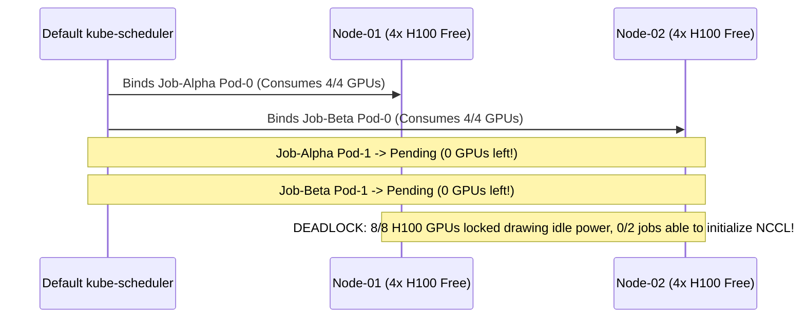
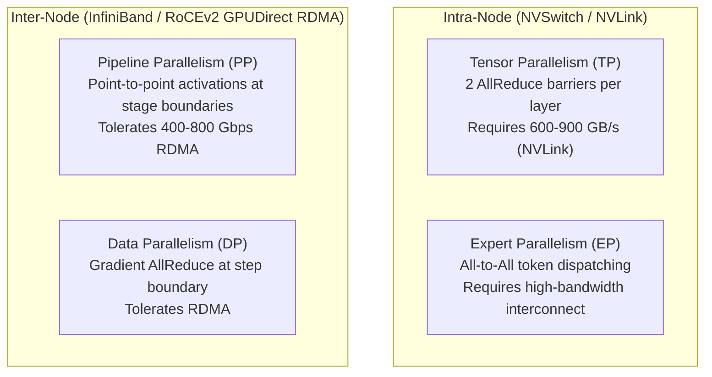
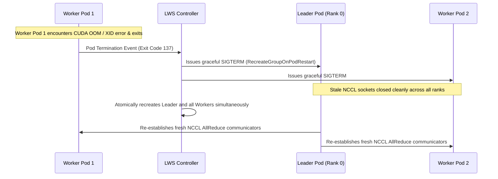
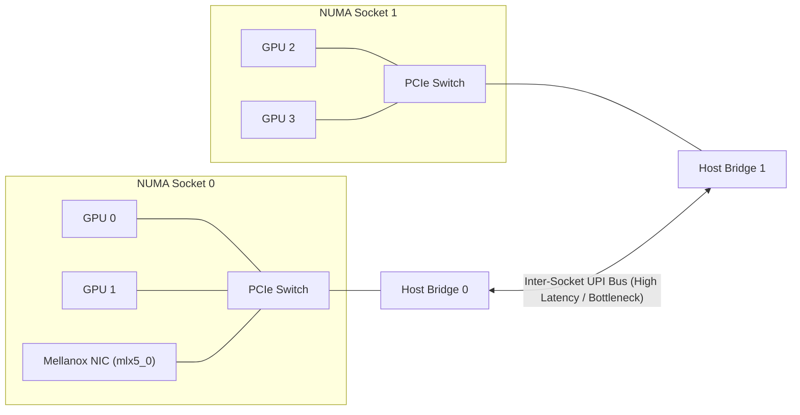
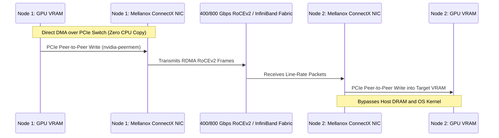

# 3. Advanced Workload Scheduling & Hardware Topology

> **Related Manifests**:
> - [`volcano-gang-distributed-vllm.yaml`](../manifests/03-scheduling/volcano-gang-distributed-vllm.yaml)
> - [`leaderworkerset-multinode-vllm.yaml`](../manifests/03-scheduling/leaderworkerset-multinode-vllm.yaml)  
>
> **Companion CLI ([`KubeVRAM`](https://github.com/xsub/KubeVRAM))**: `kubevram topology --fabric` | `kubevram bridge topo` | `kubevram bridge shm`

---

## 3.1 The Limits of Default `kube-scheduler` for Distributed AI

The upstream Kubernetes `kube-scheduler` was architected for decoupled, stateless microservices. It operates on two core assumptions that break down when orchestrating distributed AI workloads (`70B–405B+` LLMs, Mixture-of-Experts, and multi-node inference pipelines):
1. **Sequential Pod Evaluation**: Workloads are scheduled one pod at a time. The scheduler cannot evaluate gang-atomic constraints where a set of $N$ pods must bind simultaneously or none at all.
2. **Anonymous Scalar Counters**: Compute accelerators are treated as interchangeable, scalar integer counters (`nvidia.com/gpu: 8`). The scheduler possesses no awareness of whether two assigned GPUs reside on the same high-speed NVLink bus or cross a high-latency CPU inter-socket link.

### Failure Mode A: Partial-Allocation Deadlock (Gang Starvation)

Consider a cluster with **8 available H100 GPUs** split equally across two 4-GPU nodes (`node-01` and `node-02`). Two separate distributed inference deployments (`Job-Alpha` and `Job-Beta`) each require **2 Pods x 4 GPUs = 8 GPUs** to establish an all-reduce communication group:



Because neither rank can initialize `torch.distributed` without its peer, both pods sit hung in initialization, drawing idle power while locking 100% of cluster accelerators indefinitely.

---

### Failure Mode B: Interconnect Topology Mismatch

Transformer parallelism strategies have drastically different bandwidth sensitivities:



#### Why Tensor Parallelism Demands NVLink

In **Tensor Parallelism (TP)**, the linear projection matrices of the Multi-Head Attention (`QKV`) and Feed-Forward (`MLP`) blocks are sharded across participating GPUs. Executing a single forward pass through a transformer layer requires **two `NCCL AllReduce` synchronization barriers** (one after attention, one after MLP):

$$\text{AllReduce Barriers per Generated Token} = 2 \times N_{\text{layers}}$$

For a 70B model with 80 transformer layers, each generated token executes **160 AllReduce barriers**. If any participating GPU communicates over a degraded link, the entire token generation pipeline stalls waiting for that barrier.

#### Hardware Interconnect Bandwidth Comparison

| Interconnect Generation | Physical Bus Medium | Raw Bidirectional Bandwidth | Typical Use Case |
| :--- | :--- | :--- | :--- |
| **NVSwitch Gen5 (Blackwell)** | 5th-Gen NVLink Silicon Fabric | **1,800 GB/s** (1.8 TB/s) | Full 72-GPU NVLink Rack (GB200 NVL72) |
| **NVSwitch Gen4 (Hopper)** | 4th-Gen NVLink Silicon Fabric | **900 GB/s** | 8x H100 SXM5 DGX / HGX Nodes (`TP=8`) |
| **NVSwitch Gen3 (Ampere)** | 3rd-Gen NVLink Silicon Fabric | **600 GB/s** | 8x A100 SXM4 DGX / HGX Nodes (`TP=8`) |
| **NVLink Bridge (PCIe Cards)** | PCB Bridge Connector | **112–256 GB/s** | 2-GPU or 4-GPU PCIe pairs (`TP=2`) |
| **PCIe Gen5 x16** | Motherboard PCIe Slot / Switch | **64 GB/s** | Single-node pipeline parallelism, Host-to-Device |
| **PCIe Gen4 x16** | Motherboard PCIe Slot / Switch | **32 GB/s** | Legacy GPU nodes; unsuitable for high-QPS TP |
| **Inter-Socket UPI / xGMI** | CPU Interconnect Bus | **16–25 GB/s** | Severe bottleneck for cross-socket GPU communications |

---

## 3.2 Distributed Inference Orchestration & Gang Primitives

Distributed model serving across multiple nodes requires orchestration primitives that guarantee atomic admission, coupled lifecycle management, and deterministic networking.

### Comparing Distributed AI Orchestration Engines

| Architectural Feature | Volcano (`scheduling.volcano.sh`) | KubeRay (`ray.io/v1`) | LeaderWorkerSet (`lws.x-k8s.io/v1`) |
| :--- | :--- | :--- | :--- |
| **Primary Domain** | Batch HPC & Training Jobs | Python-centric Ray Actor Workloads | **Production Multi-Node LLM Serving** |
| **Scheduler Dependency** | Custom replacement scheduler (`volcano-scheduler`) | Upstream `kube-scheduler` or Volcano | Upstream `kube-scheduler` (native) |
| **Gang Rollout Semantics** | `PodGroup` (`minMember`, `minTaskMember`) | RayCluster lifecycle management | Native gang admission across worker groups |
| **Failure Domain Coupling** | Job-level retry logic | Head pod restarts entire cluster | **Strict Coupled Domain: `RecreateGroupOnPodRestart`** |
| **Headless Networking** | User-managed Headless Services | Ray GCS internal service routing | **Built-in indexed subdomain DNS & `LWS_LEADER_ADDRESS`** |
| **Rolling Upgrade Handling** | All-or-nothing rebuild | Cluster rebuild | Partitioned, rolling multi-node replica updates |

---

### Why `LeaderWorkerSet` (LWS) Is the Standard for Multi-Node Serving

While Volcano excels at batch jobs and KubeRay provides a general distributed compute framework, **`LeaderWorkerSet` (SIG-Apps)** is engineered specifically for multi-node LLM serving (e.g., `vLLM`, `TensorRT-LLM`, `TGI`):

1. **Coupled Pod Failure Domain (`restartPolicy: RecreateGroupOnPodRestart`)**:
   Distributed NCCL communication rings cannot recover gracefully if a single worker pod crashes or experiences an unrecoverable CUDA kernel error. In standard StatefulSets or Deployments, Kubernetes restarts only the failed pod; the remaining surviving pods hang indefinitely inside stale NCCL communication sockets. 
   
   With LWS, if any worker pod in the group crashes, **the controller immediately terminates and recreates the entire leader-worker group atomically**, resetting the network state.

2. **Deterministic Indexed Topology & Subdomain DNS**:
   LWS establishes an indexed network topology. Each group member receives a deterministic DNS record under a shared headless service:
   - Leader: `<lws-name>-0` (e.g., `vllm-llama3-405b-0`)
   - Workers: `<lws-name>-0-1`, `<lws-name>-0-2`, ...
   
   The controller automatically injects the leader's network identity into all worker containers via the `LWS_LEADER_ADDRESS` environment variable, eliminating custom discovery scripts (see [`leaderworkerset-multinode-vllm.yaml`](../manifests/03-scheduling/leaderworkerset-multinode-vllm.yaml)).



---

## 3.3 Intra-Node Hardware Topology & NUMA Alignment

To prevent severe latency degradation from cross-socket communication, node-level hardware topology must be aligned across CPU, memory, and PCIe devices.

### Kubelet `TopologyManager` Policy

Configure `/var/lib/kubelet/config.yaml` on all GPU worker nodes with **Guaranteed QoS** (`requests == limits`):

```yaml
apiVersion: kubelet.config.k8s.io/v1beta1
kind: KubeletConfiguration
cpuManagerPolicy: static
cpuManagerReconcilePeriod: 5s
memoryManagerPolicy: Static
topologyManagerPolicy: single-numa-node
topologyManagerScope: pod
reservedSystemCPUs: "0,1,64,65"
```

- **`cpuManagerPolicy: static`**: Pins container CPU requests exclusively to specific physical CPU cores via Linux `cpuset.cpus`.
- **`memoryManagerPolicy: Static`**: Binds host memory allocations to the local NUMA memory node via `numactl` / `mbind()`.
- **`topologyManagerPolicy: single-numa-node`**: Kubelet queries the CPU Manager, Memory Manager, and Device Plugins. If a container cannot acquire CPU cores, host memory, PCIe GPUs, and RDMA HCAs from **a single NUMA socket**, the pod is rejected (`TopologyAffinityError`) rather than running across the CPU interconnect.

---

### Reading the `nvidia-smi topo -m` Interconnect Matrix

Running `nvidia-smi topo -m` on a multi-GPU host prints a matrix detailing the physical path between every device pair:



| Path Code | Physical Route Description | Bidirectional Bandwidth | Parallelism Suitability |
| :--- | :--- | :--- | :--- |
| **`NV18` / `NV12`** | Hardware **NVSwitch fabric** | `900 GB/s` (H100) / `600 GB/s` (A100) | **Tensor Parallelism (`TP=2,4,8`)**, **EP** |
| **`NV2` / `NV4`** | NVLink bridge pairs across PCIe slots | `112–256 GB/s` | **Tensor Parallelism (`TP=2`)** |
| **`PIX`** | Connection traverses a **single PCIe switch** | `64 GB/s` (PCIe Gen5 x16) | Small **TP=2** (with P2P) or **PP** |
| **`PXB`** | Traverses multiple PCIe switches without crossing Host Bridge | `32–64 GB/s` | **Pipeline Parallelism (`PP`)** |
| **`PHB` / `NODE`** | Traverses the **PCIe Host Bridge** within same NUMA socket | `16–32 GB/s` (traverses host DRAM) | **PP** only (Severe TP latency penalty) |
| **`SYS`** | Crosses **CPU sockets** over Intel UPI / AMD xGMI bus | `12–25 GB/s` + latency jitter | **Avoid for TP!** Degrades token latency by 200–500% |

---

## 3.4 Inter-Node GPUDirect RDMA & NCCL Hardening

When scaling LLMs across multiple physical nodes, standard TCP/IP networking degrades throughput:
- Packets are copied multiple times through OS kernel socket buffers.
- CPU interrupts handle packet serialization and reassembly.
- TCP flow control induces latency spikes.

**GPUDirect RDMA (Remote Direct Memory Access)** enables network adapters to read and write GPU memory directly across the network fabric (InfiniBand or RoCEv2) with zero CPU intervention.



### The Role of `nvidia-peermem`

Standard Linux InfiniBand drivers (`ib_core`) manage host physical memory pages. GPU memory, however, is controlled by the proprietary NVIDIA driver (`nvidia.ko`). The **`nvidia-peermem`** kernel module implements the peer memory client interface:
- It allows the Mellanox OpenFabrics driver (`mlx5_ib`) to query, lock, and map GPU HBM physical address ranges directly for DMA transfers.
- Without `nvidia-peermem`, GPUDirect RDMA falls back to staging buffers in host DRAM, cutting multi-node throughput in half.

### NIC-to-GPU PCIe Switch Co-Location

To achieve optimal line rate, network adapters must be co-located with their corresponding GPU on the **same upstream PCIe switch**:
- In an 8-GPU server with 8 Mellanox ConnectX-7 adapters (`mlx5_0` through `mlx5_7`), `mlx5_0` shares a PCIe switch with `GPU 0`.
- Data moving between `GPU 0` and the network flows entirely across the local PCIe Gen5 switch, with **zero traversal of the CPU host root complex or inter-socket UPI link**.
- Verify PCIe switch grouping via:
  ```bash
  lspci -tv | grep -E "(NVIDIA|Mellanox)"
  ```

---

### Critical Production Hardening Parameters

#### 1. Linux Shared Memory (`/dev/shm`) Configuration
By default, Docker and Kubernetes mount `/dev/shm` as a **`64 MiB` tmpfs**.
- **The Crash Mechanism**: NCCL's intra-node shared memory transport (`NCCL_P2P_LEVEL=NVL` or `SHM`) allocates multi-gigabyte shared memory buffers using `posix_fallocate()`. As soon as allocation crosses 64 MiB, Linux terminates the process with **`SIGBUS` (Exit Code `135`)**.
- **The Fix**: Always mount a memory-backed `emptyDir` sized to **`16Gi–64Gi`** at `/dev/shm`:

```yaml
volumeMounts:
  - name: dshm
    mountPath: /dev/shm
volumes:
  - name: dshm
    emptyDir:
      medium: Memory
      sizeLimit: 32Gi
```

#### 2. Memory Locking Limits (`RLIMIT_MEMLOCK`)
RDMA transfers require pinned (locked) memory pages to ensure the OS virtual memory subsystem does not swap out physical buffers during DMA transactions. Grant the `IPC_LOCK` capability in the pod's `securityContext`:

```yaml
securityContext:
  capabilities:
    add: ["IPC_LOCK"]
```

---

### NCCL Production Tuning Environment Variables

Configure these variables across all distributed inference pods:

| Environment Variable | Production Value | Architectural Rationale |
| :--- | :--- | :--- |
| **`NCCL_DEBUG`** | `INFO` | Emits detailed NCCL initialization logs, network interface selection, and peer transport mapping. |
| **`NCCL_IB_DISABLE`** | `0` | Explicitly enables InfiniBand / RoCEv2 hardware adapters. |
| **`NCCL_IB_HCA`** | `mlx5_0,mlx5_1,mlx5_2,mlx5_3` | Restricts NCCL to dedicated high-speed RDMA NICs; excludes management interfaces. |
| **`NCCL_IB_GID_INDEX`** | `3` (for RoCEv2) | Selects the RoCEv2 GID index (typically GID 3 for IPv4 UDP encapsulation; verify via `ibv_devinfo -v`). |
| **`NCCL_IB_TC`** | `106` | Sets the DiffServ / Traffic Class byte for Differentiated Services Code Point (DSCP) Priority-Flow-Control (PFC). |
| **`NCCL_P2P_LEVEL`** | `NVL` | Enforces intra-node peer-to-peer communication over NVLink; disables degraded PCIe fallbacks. |
| **`NCCL_NET_GDR_LEVEL`** | `5` | Enables GPUDirect RDMA across all paths through the PCIe root complex (`NVL`, `PIX`, `PXB`). |
| **`NCCL_BUFFSIZE`** | `8388608` (8 MiB) | Increases NCCL ring buffer size (default is 4 MiB) to maximize pipe utilization on 400G+ networks. |
| **`VLLM_WORKER_MULTIPROC_METHOD`** | `spawn` | Forces Python multiprocessing to use `spawn` rather than `fork`, preventing CUDA runtime re-initialization crashes. |

---

## 3.5 Day-2 Topology & Verification Commands

```bash
# 1. Inspect Volcano PodGroups to identify hung or deadlocked gang workloads
kubectl get podgroups.scheduling.volcano.sh -A

# 2. Inspect active LeaderWorkerSets across namespaces
kubectl get leaderworkersets.leaderworkerset.x-k8s.io -A

# 3. Verify Kubelet TopologyManager policy on worker nodes via the Kubelet proxy API
kubectl get --raw "/api/v1/nodes/<gpu-node-name>/proxy/configz" | jq '.kubeletconfig | {topologyManagerPolicy, topologyManagerScope, cpuManagerPolicy}'

# 4. Audit all multi-GPU pods missing a memory-backed /dev/shm volume (SIGBUS Exit 135 hazard)
kubectl get pods -A -o json | jq -r '
  .items[]
  | select((.spec.containers[].resources.limits."nvidia.com/gpu" // "0" | tonumber) >= 2)
  | select(([.spec.volumes[]? | select(.emptyDir.medium == "Memory")] | length) == 0)
  | "HAZARD (Missing memory /dev/shm): \(.metadata.namespace)/\(.metadata.name)"
'

# 5. Companion KubeVRAM CLI topology and fabric verification shortcuts
kubevram topology --fabric
kubevram bridge topo
kubevram bridge shm
```
