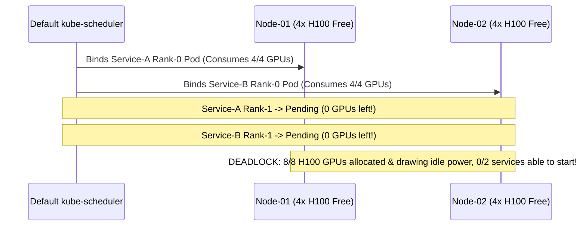
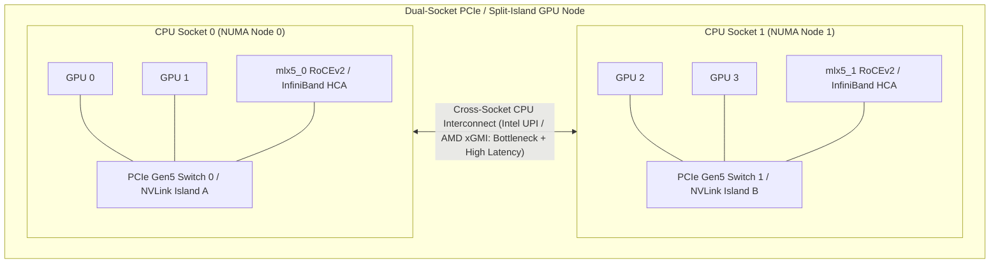

# 3. Advanced Workload Scheduling

> **Related Manifests**: [`volcano-gang-distributed-vllm.yaml`](../manifests/03-scheduling/volcano-gang-distributed-vllm.yaml)  
> **Companion CLI ([`KubeVRAM`](https://github.com/xsub/KubeVRAM))**: `kubevram topology --fabric` | `kubevram bridge topo` | `kubevram bridge shm`

---

## 3.1 Why Default `kube-scheduler` Fails for Distributed AI

The default Kubernetes `kube-scheduler` evaluates a **queue of individual Pods one at a time** and models GPUs as **anonymous node-level integer counters** (`nvidia.com/gpu: 8`). While ideal for stateless web servers, this causes two severe production failure modes for distributed LLM serving (`70B–405B+` models, Mixture-of-Experts, and multi-node Ray/vLLM pipelines):

### Failure Mode A: Partial-Allocation Resource Deadlock
Consider a cluster with **8 free H100 GPUs** split across two 4-GPU nodes (`node-01` and `node-02`). Two teams simultaneously deploy distributed `Llama-3.1-405B-FP8` services, each requiring `2 Pods x 4 GPUs = 8 GPUs` to form an NCCL communication ring:



Without atomic group admission, neither Rank-0 container can complete `torch.distributed.init_process_group()`, locking 100% of cluster GPUs indefinitely.

---

### Failure Mode B: Topology-Blind Interconnect Placement
Not all GPU pairs inside an 8-GPU server have equal bandwidth. Depending on chassis design (SXM NVSwitch vs. dual-socket PCIe Gen4/Gen5 vs. 2x4 NVLink islands), intra-node interconnect bandwidth varies by **more than an order of magnitude**:



### Reading `nvidia-smi topo -m` & Mapping Parallelism Strategies

When a Linux engineer runs `nvidia-smi topo -m`, NVML reports the exact physical path between every GPU and NIC pair:

| `topo -m` Code | Physical Path Description | Typical Unidirectional/Bidirectional Bandwidth | Suitable LLM Parallelism Mode |
| :--- | :--- | :--- | :--- |
| **`NV18` / `NV12`** | Full **NVSwitch / NVLink** fabric (H100 SXM5 = `900 GB/s`, A100 SXM4 = `600 GB/s`) | `600–900 GB/s` (Bidir) | **Tensor Parallelism (`TP = 2, 4, 8`)** & **Expert Parallelism (`EP`)** |
| **`NV2` / `NV4`** | 2-way / 4-way NVLink bridge pair (e.g., dual-card H100 PCIe NVLink) | `112–256 GB/s` | **TP = 2** |
| **`PIX`** | Connection traversing at most a **single PCIe bridge/switch** | `32–64 GB/s` (PCIe Gen4/Gen5 x16) | Small **TP = 2** (with P2P) or **Pipeline Parallelism (`PP`)** |
| **`PXB`** | Multiple PCIe bridges without crossing the CPU Host Bridge | `32–64 GB/s` | **Pipeline Parallelism (`PP`)** |
| **`PHB` / `NODE`** | Traverses CPU PCIe Host Bridge within the **same NUMA node** (often disables PCIe P2P) | `16–32 GB/s` (bounce via DRAM) | **PP** only; severe TP penalty |
| **`SYS`** | Crosses **CPU NUMA sockets** via UPI / QPI / xGMI | `12–25 GB/s` + high latency jitter | **Avoid for TP!** Degrades TPOT latency by `200%–500%` |

#### Why Tensor Parallelism (`TP`) Demands NVLink, While Pipeline Parallelism (`PP`) Tolerates PCIe/RDMA
- **Tensor Parallelism (`TP`)** shards weight matrices inside every Transformer block (`QKV` & `MLP`) and executes **2 `NCCL AllReduce` synchronization barriers per layer** (`160 AllReduces` per generated token on an 80-layer `Llama-3.1-70B`!). Latency is completely bound by GPU-to-GPU link latency and bandwidth.
- **Pipeline Parallelism (`PP`)** assigns contiguous blocks of layers to each GPU/node (e.g., Layers `0–39` on Node 1, Layers `40–79` on Node 2), transmitting only a single activation tensor at stage boundaries—making `PP` suitable across multi-node InfiniBand/RoCEv2 links (`tp=8` intra-node over NVSwitch + `pp=2` inter-node over RDMA).

---

## 3.2 Production Engineering Practices

### Practice 1: Atomic Gang Scheduling with Volcano & KubeRay

Deploy **Volcano** (`scheduling.volcano.sh/v1beta1`) or **Kueue / Coscheduling** to enforce **all-or-nothing (`Gang`) scheduling** via `PodGroup` (see [`manifests/03-scheduling/volcano-gang-distributed-vllm.yaml`](../manifests/03-scheduling/volcano-gang-distributed-vllm.yaml)):

1. **`PodGroup` Specification**:
   - `minMember`: Minimum number of pods that must be simultaneously bindable (e.g., `2` for a `2 x 4-GPU` distributed vLLM deployment).
   - `minTaskMember`: Role-specific counts (`head: 1`, `worker: 1`) so a Ray cluster never starts workers without a head pod.
   - `minResources`: Aggregate cluster resources (`nvidia.com/gpu: "8"`, `cpu: "64"`, `memory: "512Gi"`) checked atomically before binding any single pod.
2. **KubeRay + vLLM Distributed Serving Integration**:
   When serving `Llama-3.1-405B` or `DeepSeek-V3/R1` across multiple nodes using **KubeRay** (`RayService`), enable gang scheduling annotations so KubeRay automatically synthesizes a Volcano `PodGroup`:
   ```yaml
   apiVersion: ray.io/v1
   kind: RayCluster
   metadata:
     name: vllm-deepseek-multinode
     labels:
       ray.io/scheduler-name: volcano
     annotations:
       ray.io/gang-scheduling-enabled: "true"
   ```

---

### Practice 2: Kubelet `TopologyManager` & Single-NUMA Alignment

To prevent `kubelet` from handing a pod `GPU 0` (on NUMA 0), `GPU 2` (on NUMA 1), and CPU cores on Socket 1:

1. **Harden `/var/lib/kubelet/config.yaml` on all GPU Worker Nodes**:
   ```yaml
   apiVersion: kubelet.config.k8s.io/v1beta1
   kind: KubeletConfiguration
   cpuManagerPolicy: static
   cpuManagerReconcilePeriod: 5s
   memoryManagerPolicy: Static
   topologyManagerPolicy: single-numa-node   # Rejects cross-NUMA GPU+CPU+NIC allocations!
   topologyManagerScope: pod                 # Aligns all containers in the pod to the same NUMA socket
   systemReserved:
     cpu: "2"
     memory: "8Gi"
   ```
   - With `topologyManagerPolicy: single-numa-node` and Guaranteed QoS (`requests == limits` for integer CPUs and memory), `kubelet` intersects topology bitmasks from the CPU Manager, Memory Manager, NVIDIA Device Plugin, and SR-IOV Network Device Plugin (`mlx5` RDMA NICs). If a single NUMA domain cannot satisfy the pod, `kubelet` cleanly rejects placement (`TopologyAffinityError`) rather than running degraded across UPI!
   - *(Note: For `8-GPU` pods on dual-socket nodes where 4 GPUs sit on NUMA 0 and 4 GPUs sit on NUMA 1 connected via full NVSwitch, use `topologyManagerPolicy: best-effort` or `restricted` on that dedicated 8-GPU node pool so full-node 8-GPU pods are permitted.)*

2. **Separate SXM/NVSwitch Pools from PCIe Pools via Node Selectors**:
   - **Multi-GPU `TP >= 2` Pods**: Pin to NVSwitch/NVLink nodes (`nvidia.com/gpu.product: NVIDIA-H100-80GB-HBM3`).
   - **Single-GPU `TP = 1` Pods**: Route to lower-cost PCIe nodes (`NVIDIA-L40S`, `NVIDIA-A10G`, or `MIG` slices) via preferred/required `nodeAffinity` so single-GPU workloads do not fragment contiguous 8-GPU NVSwitch nodes!

---

### Practice 3: `/dev/shm` Shared Memory Sizing & GPUDirect RDMA Hardening

One of the most frequent multi-GPU production crashes in Kubernetes has nothing to do with VRAM or host RAM limits: **Kubernetes mounts `/dev/shm` as a `64 MiB` tmpfs by default** (inherited from Docker/OCI defaults).

- **Why `64 MiB` `/dev/shm` Kills Multi-GPU vLLM / PyTorch**:
  `NCCL` (intra-node shared-memory transport `SHM`) and PyTorch multiprocessing / Ray object stores allocate multi-gigabyte POSIX shared memory segments (`/dev/shm/nccl-*`) via `posix_fallocate()`. As soon as allocations cross `64 MiB`, Linux raises **`SIGBUS` (Container Exit Code `135`)** or `NCCL WARN Call to posix_fallocate failed: No space left on device`.
- **Mandatory Multi-GPU Pod Volume Pattern**:
  Always mount a memory-backed `emptyDir` (`medium: Memory`) sized to `16Gi–32Gi` at `/dev/shm`. Note that `medium: Memory` counts toward the pod's Linux cgroup `resources.limits.memory`, so include that headroom in your pod `memory` limit!

```yaml
spec:
  containers:
    - name: vllm-worker
      env:
        - name: NCCL_P2P_LEVEL
          value: "NVL"                 # Enforce NVLink P2P path
        - name: NCCL_IB_DISABLE
          value: "0"                   # Enable InfiniBand / RoCEv2 GPUDirect RDMA across nodes
        - name: VLLM_WORKER_MULTIPROC_METHOD
          value: "spawn"               # Required for CUDA multi-GPU safety (never fork CUDA!)
      securityContext:
        capabilities:
          add: ["IPC_LOCK"]            # Required ONLY when pinning RDMA memory (mlock) for InfiniBand/RoCE
      volumeMounts:
        - name: dshm
          mountPath: /dev/shm
  volumes:
    - name: dshm
      emptyDir:
        medium: Memory
        sizeLimit: 16Gi
```

---

## 3.3 Day-2 Topology & Scheduling Verification

```bash
# 1. Inspect Volcano PodGroups to detect queued or deadlocked distributed workloads
kubectl get podgroups.scheduling.volcano.sh -A

# 2. Verify Kubelet TopologyManager policy on a GPU worker node
kubectl get --raw "/api/v1/nodes/<gpu-node-name>/proxy/configz" | jq '.kubeletconfig | {topologyManagerPolicy, topologyManagerScope, cpuManagerPolicy}'

# 3. Audit multi-GPU pods lacking an in-memory /dev/shm volume (SIGBUS Exit 135 risk)
kubectl get pods -A -o json | jq -r '
  .items[]
  | select((.spec.containers[].resources.limits."nvidia.com/gpu" // "0" | tonumber) >= 2)
  | select(([.spec.volumes[]? | select(.emptyDir.medium == "Memory")] | length) == 0)
  | "WARN missing memory /dev/shm: \(.metadata.namespace)/\(.metadata.name)"
'

# 4. Companion KubeVRAM CLI shortcuts
kubevram topology --fabric
kubevram rbac-audit
```
