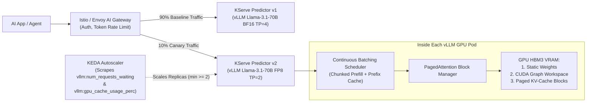

# 4. Inference Runtimes and Model Serving

> **Related Manifests**: [`kserve-vllm-canary.yaml`](../manifests/04-inference-serving/kserve-vllm-canary.yaml)  
> **Companion CLI ([`KubeVRAM`](https://github.com/xsub/KubeVRAM))**: `kubevram tune-vllm --model llama-3.1-70b --gpu H100-80GB --num-gpus 4 --dtype fp8 --kv-dtype fp8 --emit-manifest`

---

## 4.1 Architectural Separation: Inference Engine vs. Serving Control Plane

Production AI platforms cleanly decouple **GPU Kernel & Memory Execution (The Inference Engine)** from **Traffic Routing, Lifecycle, and Autoscaling (The Serving Platform)**:

| Layer | Leading Technologies | Core Engineering Responsibilities |
| :--- | :--- | :--- |
| **Inference Engine (Data Plane Runtime)** | **vLLM**, **NVIDIA Triton + TensorRT-LLM**, **SGLang**, **HuggingFace TGI** | Safetensors weight loading, CUDA/Triton kernel execution, **PagedAttention** KV-cache block tables, **continuous (in-flight) batching**, chunked prefill, prefix caching, FP8/INT4 quantization, and Tensor/Pipeline Parallelism. |
| **Serving Platform (Control Plane & Gateway)** | **KServe**, **Ray Serve**, **Istio / Envoy AI Gateway**, **KEDA** | Declarative `InferenceService` CRDs, canary/shadow traffic splitting (`90/10`), OpenAI `/v1/chat/completions` routing, token rate limiting, storage initializers, and queue/KV-cache-driven horizontal autoscaling. |



### Selecting the Right Inference Engine

| Engine | Primary Strength | Tradeoffs / Operational Cost | Best Production Use Case |
| :--- | :--- | :--- | :--- |
| **vLLM** | Day-0 model support, PagedAttention, FP8/AWQ/GPTQ, automatic prefix caching, OpenAI API parity, clean Kubernetes ergonomics. | Slightly behind hand-tuned TensorRT engines on peak batch-1 microbenchmarks (~5–12%). | **Default enterprise standard** for general LLM & VLM serving on Kubernetes. |
| **Triton + TensorRT-LLM** | Peak silicon throughput on Hopper/Blackwell; multi-model ensemble pipelines (preprocess + vision + LLM + postprocess) in C++. | Requires ahead-of-time engine compilation (`trtllm-build`) tied to **exact GPU SKU, TP size, and TensorRT version**—slowing CI/CD. | Ultra-high-QPS, fixed-architecture frontier endpoints or multi-stage CV/Audio ensembles. |
| **SGLang** | **RadixAttention** tree-based KV cache reuse and ultra-fast structured JSON / grammar-constrained decoding. | Smaller ecosystem of enterprise KServe templates than vLLM/Triton. | Multi-turn agentic loops, tool-calling workflows, and heavy shared system prompts. |

---

## 4.2 Roofline Physics & Deterministic VRAM Mathematics

### Prefill vs. Decode: Two Different Hardware Bottlenecks
Every LLM request executes in two distinct phases:
1. **Prefill Phase** (processing input prompt tokens in parallel): **Compute-Bound** (`FLOP/s` on Tensor Cores). Governs **TTFT (Time-To-First-Token)**; shows high `DCGM_FI_PROF_SM_ACTIVE`.
2. **Decode Phase** (generating output tokens autoregressively, 1 token per step): **HBM Memory-Bandwidth-Bound** (`TB/s` reading all model weights + KV cache from HBM for every generated token!). Governs **TPOT / ITL (Time-Per-Output-Token)**; shows high `DCGM_FI_PROF_DRAM_ACTIVE` even when SM compute is `< 30%`.

---

### Exact Four-Part GPU VRAM Equation

Unlike stateless CPU apps whose RAM grows gradually, `vLLM` claims almost its entire VRAM budget at startup:

$$\text{VRAM}_{\text{usable}} = \text{VRAM}_{\text{physical}} \times \mu_{\text{util}} = \text{VRAM}_{\text{weights}} + \text{VRAM}_{\text{CUDA\_overhead}} + \text{VRAM}_{\text{KV\_cache}}$$

#### 1. Static Model Weights ($\text{VRAM}_{\text{weights}}$)
$$\text{VRAM}_{\text{weights}} \approx N_{\text{params}} \times \text{Bytes}_{\text{dtype}} \times 1.04$$
*(The `1.04` multiplier accounts for embedding tables, layer norms, quantization scales, and tensor alignment.)*
- **`FP16` / `BF16`** ($2.0\text{ B/param}$): `Llama-3.1-8B` $\approx 16.70\text{ GiB}$; `Llama-3.1-70B` $\approx 146.85\text{ GiB}$ (cannot fit on 1x 80GB GPU!).
- **`FP8` / `INT8`** ($1.0\text{ B/param}$): `Llama-3.1-70B-FP8` $\approx 73.42\text{ GiB}$ (barely fits weights on 1x 80GB GPU, leaving almost zero room for KV cache at `TP=1`!).
- **`INT4` (`AWQ` / `GPTQ`)** ($\approx 0.50–0.58\text{ B/param}$): `Qwen2.5-32B-AWQ` $\approx 16.90\text{ GiB}$ (fits comfortably on `MIG 2g.20gb` or `A10G-24GB`!).

#### 2. CUDA Context, Activations & CUDA Graph Capture ($\text{VRAM}_{\text{CUDA\_overhead}}$)
PyTorch's CUDA context, NCCL ring buffers, prefill activation scratchpad, and captured CUDA graphs consume **`~2.5 to 3.2 GiB` per GPU** (`2.8 GiB` baseline in `KubeVRAM`). Passing `--enforce-eager` disables CUDA graphs and reclaims `~1.5 GiB` of VRAM, at the cost of `10%–20%` slower TPOT at small batch sizes.

#### 3. Per-Token KV Cache with Grouped-Query Attention ($\text{Bytes}_{\text{KV/token}}$)
For any Transformer with $L$ layers, $n_{\text{kv\_heads}}$ key-value heads per layer, head dimension $d_{\text{head}}$, and KV element size $\text{Bytes}_{\text{kv\_dtype}}$:

$$\text{Bytes}_{\text{KV/token}} = 2 \times L \times n_{\text{kv\_heads}} \times d_{\text{head}} \times \text{Bytes}_{\text{kv\_dtype}}$$

| Model Architecture | Layers ($L$) | KV Heads ($n_{\text{kv}}$) | Head Dim ($d$) | `BF16` KV / Token | `FP8` KV / Token | 1 Sequence @ `32k` Context (`BF16` vs `FP8`) |
| :--- | :--- | :--- | :--- | :--- | :--- | :--- |
| **`Llama-3.1-8B`** | `32` | `8` | `128` | `128 KiB` | `64 KiB` | `4.0 GiB` vs **`2.0 GiB`** |
| **`Qwen2.5-32B`** | `64` | `8` | `128` | `256 KiB` | `128 KiB` | `8.0 GiB` vs **`4.0 GiB`** |
| **`Llama-3.1-70B`** | `80` | `8` | `128` | `320 KiB` | `160 KiB` | `10.0 GiB` vs **`5.0 GiB`** |
| **`Llama-3.1-405B`** | `126` | `8` | `128` | `504 KiB` | `252 KiB` | `15.75 GiB` vs **`7.88 GiB`** |

#### 4. Maximum Token Pool & Concurrent Sequences
$$\text{Max KV Tokens} = \left\lfloor \frac{\text{VRAM}_{\text{KV\_cache}}}{\text{Bytes}_{\text{KV/token}}} \right\rfloor, \qquad \text{Max Concurrent Seqs} = \left\lfloor \frac{\text{Max KV Tokens}}{C_{\text{target}}} \right\rfloor$$

**Worked Production Failure Example (`Llama-3.1-70B-FP8` on `1x H100-80GB`)**:
- Usable VRAM at `--gpu-memory-utilization=0.92`: $80 \times 0.92 = 73.60\text{ GiB}$.
- Subtract Weights ($73.42\text{ GiB}$) + CUDA Overhead ($2.80\text{ GiB}$) $= 76.22\text{ GiB} > 73.60\text{ GiB}$!
- Even if weights are compressed to `68.5 GiB`, leaving default `--max-model-len=131072` with `BF16` KV cache demands **$40.0\text{ GiB}$ for just 1 sequence**, crashing `vLLM` at startup (`ValueError: max seq len (131072) is larger than maximum number of tokens`).
- **Fix**: Run `TP=2` or `TP=4` (or cap `--max-model-len=16384` + `--kv-cache-dtype=fp8`), verified via `kubevram tune-vllm`.

---

## 4.3 Production Engineering Practices for vLLM & KServe

### Practice 1: Deterministic vLLM Flag Tuning
1. **Always Set `--max-model-len` Explicitly**: Match your real product SLA (`8192`, `16384`, or `32768`) instead of leaving `131072`.
2. **Enable `--kv-cache-dtype=fp8` on Hopper (`H100`/`H200`) and Ada (`L40S`)**: Doubles KV-cache token capacity and doubles concurrent request batching before preemption (`SWAP`/`RECOMPUTE`) occurs.
3. **Enable `--enable-prefix-caching` and Chunked Prefill**:
   - **Automatic Prefix Caching (APC)** hashes KV blocks of shared system prompts, tool definitions, and multi-turn chat histories—cutting TTFT by `50%–85%` on agentic workloads.
   - **Chunked Prefill** splits long incoming `16k`-token prompts into smaller chunks batched alongside ongoing decode steps, preventing long prompts from stalling token streaming for active users (protecting p99 TPOT).
4. **Right-Size Host System RAM (`resources.limits.memory`)**: Set pod host memory limits to at least `64Gi–128Gi` (or $\ge 1.5\times$ per-GPU weight shard + `/dev/shm` size) so `safetensors` deserialization and Ray/PyTorch workers never hit Linux cgroup `OOMKilled` (`Exit 137`).

---

### Practice 2: KServe `RawDeployment`, Canary Rollouts & Cold-Start Elimination

See [`manifests/04-inference-serving/kserve-vllm-canary.yaml`](../manifests/04-inference-serving/kserve-vllm-canary.yaml) for a complete production blueprint:

1. **Prefer KServe `RawDeployment` Mode + KEDA over Knative `Serverless` for Large LLMs**:
   - Knative `Serverless` injects `queue-proxy` sidecars designed around HTTP concurrency and `scale-to-zero`.
   - **`scale-to-zero` is an anti-pattern for production LLMs**: Booting a cold 70B LLM pod requires GPU node scheduling (`5–180s`), pulling a `15 GB` CUDA image (`20–60s`), loading `70–140 GB` of weights into HBM (`20–90s`), and capturing PyTorch CUDA graphs (`15–30s`). Users will never wait `2–5 minutes` for their first chat token.
   - Enforce **`minReplicas: 2`** for HA production endpoints and store pre-downloaded `safetensors` shards on a high-throughput **ReadWriteMany (RWX) NVMe filesystem** (FSx for Lustre / Weka / CephFS / local NVMe cache) mounted `readOnly: true`.
2. **90/10 Canary Validation with Istio**:
   When rolling out a quantized candidate (e.g., migrating `BF16` to `FP8` or upgrading `vLLM` versions), set `canaryTrafficPercent: 10` and evaluate both **accuracy/evals** and **tail latency (`p99 TTFT` / `p99 TPOT`)** under real prompt distributions before promoting to 100%.
3. **Autoscale on KV-Cache & Waiting Queue—NEVER on CPU**:
   A GPU pod completely saturated at 99% KV-cache utilization uses `< 15%` host CPU, so standard Kubernetes CPU `HorizontalPodAutoscaler` will never scale out! Configure **KEDA `ScaledObject`** using Prometheus triggers on vLLM runtime metrics:
   ```yaml
   triggers:
     - type: prometheus
       metadata:
         serverAddress: http://prometheus-operated.monitoring.svc:9090
         metricName: vllm_waiting_requests
         query: sum(vllm:num_requests_waiting{model_name="llama-3.1-70b-instruct"}) / count(up{job="llama3-70b"})
         threshold: "5"
     - type: prometheus
       metadata:
         serverAddress: http://prometheus-operated.monitoring.svc:9090
         metricName: vllm_kv_cache_perc
         query: avg(vllm:gpu_cache_usage_perc{model_name="llama-3.1-70b-instruct"}) * 100
         threshold: "80"
   ```

---

## 4.4 Day-2 Verification & Deterministic Sizing ([`KubeVRAM`](https://github.com/xsub/KubeVRAM))

```bash
# 1. Inspect KServe InferenceService rollout status & Istio canary traffic split
kubectl get inferenceservices.serving.kserve.io -n ai-inference

# 2. Companion KubeVRAM CLI: Evaluate Llama-3.1-70B FP8 on 1x vs 4x H100-80GB & emit K8s YAML
kubevram tune-vllm --model llama-3.1-70b --gpu H100-80GB --num-gpus 1 --dtype fp8 --kv-dtype fp8
kubevram tune-vllm --model llama-3.1-70b --gpu H100-80GB --num-gpus 4 --dtype fp8 --kv-dtype fp8 --target-context 16384 --concurrency 32 --emit-manifest

# 3. Size Llama-3.1-8B on a hardware-isolated MIG-2g.20gb slice
kubevram tune-vllm --model llama-3.1-8b --gpu MIG-2g.20gb --num-gpus 1 --dtype fp8 --kv-dtype fp8 --target-context 8192
```
