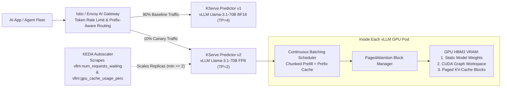
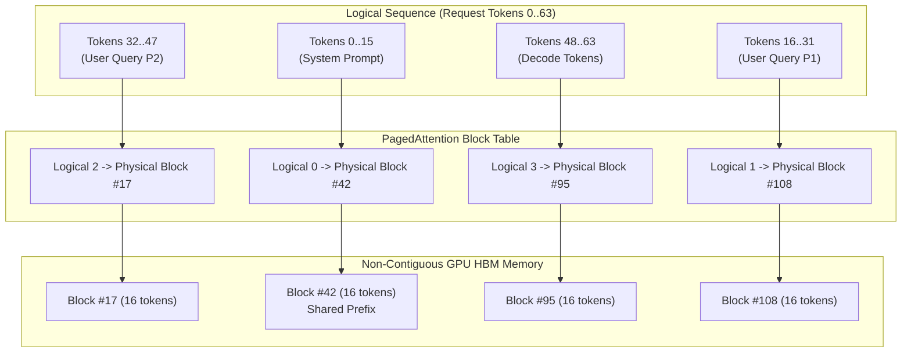
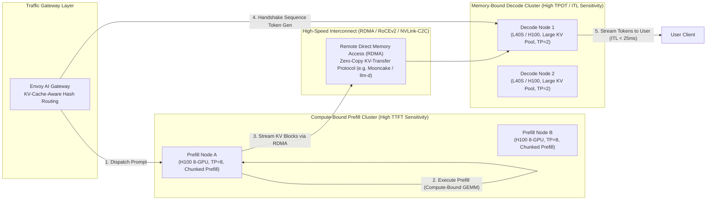
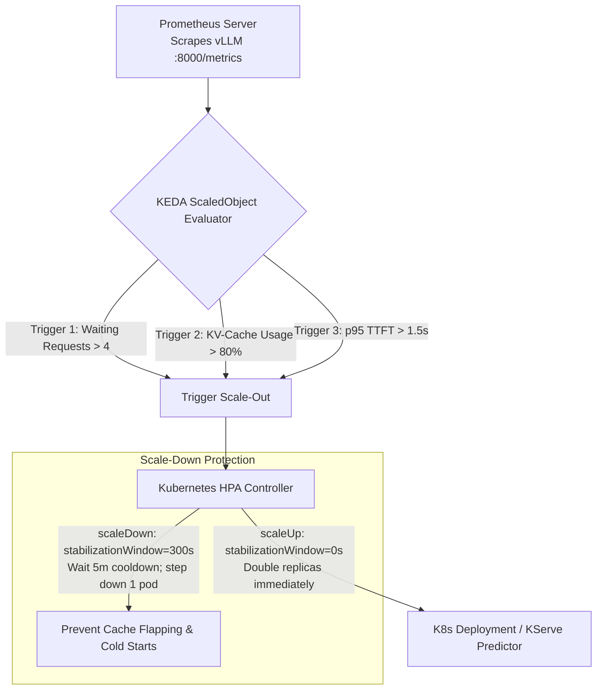

# 4. Inference Runtimes and Model Serving

> **Related Manifests**: [`kserve-vllm-canary.yaml`](../manifests/04-inference-serving/kserve-vllm-canary.yaml) | [`keda-vllm-autoscaler.yaml`](../manifests/04-inference-serving/keda-vllm-autoscaler.yaml)  
> **Companion CLI ([`KubeVRAM`](https://github.com/xsub/KubeVRAM))**: `kubevram tune-vllm --model llama-3.1-70b --gpu H100-80GB --num-gpus 4 --dtype fp8 --kv-dtype fp8 --emit-manifest`

---

## 4.1 Architectural Separation: Inference Engine vs. Serving Control Plane

Production Kubernetes AI platforms cleanly decouple **GPU Kernel & Memory Execution (The Inference Engine Data Plane)** from **Traffic Routing, Canary Rollouts, and Autoscaling (The Serving Control Plane)**:

| Layer | Leading Technologies | Core Engineering Responsibilities |
| :--- | :--- | :--- |
| **Inference Engine (Data Plane Runtime)** | **vLLM**, **NVIDIA Triton + TensorRT-LLM**, **SGLang**, **HuggingFace TGI** | Safetensors weight loading, CUDA/Triton kernel execution, **PagedAttention** KV-cache block tables, **continuous (in-flight) batching**, chunked prefill, prefix caching, speculative decoding, FP8/INT4 quantization kernels (`Marlin`, `AWQ`, `GPTQ`), and Tensor/Pipeline Parallelism. |
| **Serving Platform (Control Plane & Gateway)** | **KServe**, **Ray Serve**, **Istio / Envoy AI Gateway**, **KEDA** | Declarative `InferenceService` CRDs, canary/shadow traffic splitting (`90/10`), OpenAI `/v1/chat/completions` protocol routing, token-bucket rate limiting, KV-cache-aware routing, distributed storage initializers, and queue/KV-cache-driven horizontal autoscaling. |



---

## 4.2 Inference Engine Comparison Matrix

Selecting the optimal inference runtime requires balancing peak raw silicon throughput, compilation overhead, day-0 open-source model compatibility, and Day-2 operational ergonomics:

| Dimension | **vLLM** | **NVIDIA Triton + TensorRT-LLM** | **SGLang** | **HuggingFace TGI** |
| :--- | :--- | :--- | :--- | :--- |
| **Primary Architectural Paradigm** | Dynamic PagedAttention & modular Python/C++/CUDA runtime. | Ahead-of-Time (AOT) graph-compiled C++ tensor execution engine. | **RadixAttention** tree-structured KV cache reuse & multi-call runtimes. | Rust web server + Python tokenizers + PyTorch/FlashAttention runtime. |
| **Strengths** | Day-0 architecture support (Llama, Qwen, DeepSeek, Mistral, Nemotron); first-class OpenAI API; native Chunked Prefill & Prefix Caching. | Maximum peak hardware FLOPS on Hopper/Blackwell; low-latency multi-model C++ ensembles (Audio + Vision + LLM). | Unmatched KV-cache hit rates for multi-turn agent loops and complex structured/grammar JSON outputs. | Tight integration with HuggingFace Hub; enterprise support from HuggingFace; built-in token watermarking. |
| **Compilation Requirements** | **Zero AOT compilation** (JIT Triton/CUDA kernels on boot). Instant model swap from storage. | **Mandatory AOT engine build** (`trtllm-build`). Engines are pinned to exact GPU SKU, driver, SM count, and TP size. | **Zero AOT compilation**. Fast startup using Triton JIT kernels and PyTorch 2.x CudaGraphs. | **Zero AOT compilation**. Standard PyTorch/CUDA runtime with pre-compiled FlashAttention extensions. |
| **Quantization Ecosystem** | `FP8` (E4M3, E5M2), `AWQ`, `GPTQ`, `Marlin` (FP16xINT4, FP8xINT4, unpadded GEMM), `BitsAndBytes`. | `FP8`, `INT4 AWQ`, `INT8 SQ` (SmoothQuant), `FP4` (Blackwell native), specialized TensorRT plugins. | `FP8`, `AWQ`, `GPTQ`, `Marlin`, `SGLang` flashinfer FP8 kernels. | `FP8`, `AWQ`, `GPTQ`, `EETQ`, `BitsAndBytes`. |
| **Prefix / Prompt Caching** | Automatic Prefix Caching (APC) via LRU hash table of physical block IDs. | KV cache reuse supported via session cache and explicit prompt table caching. | **RadixAttention**: Radix tree over token IDs supporting arbitrary prefix inserts, forks, and evictions. | Prompt caching supported for static prefixes via explicit cache hash tables. |
| **Kubernetes Ergonomics** | **Native container standard**; simple CLI flags; exposed Prometheus endpoint (`/metrics`); KServe native. | High complexity; requires multi-container Triton layout or complex C++ Helm configurations. | Highly container-friendly; drop-in OpenAI API server; lightweight runtime footprint. | Single container deployment; opinionated env-var configuration; native Prometheus metrics. |

### Quantization & Optimized Kernel Ecosystem
Modern inference runtimes rely on specialized mixed-precision GEMM (General Matrix Multiply) kernels to break memory-bandwidth bottlenecks:
- **FP8 (E4M3 vs. E5M2)**: Hopper (`H100`/`H200`) and Ada Lovelace (`L40S`) GPUs feature fourth-generation Tensor Cores with native FP8 arithmetic. `E4M3` (1 sign bit, 4 exponent bits, 3 mantissa bits) provides higher precision for forward-pass activations and weights, preserving perplexity. `E5M2` (1 sign bit, 5 exponent bits, 2 mantissa bits) matches FP16 dynamic range and is primarily used for gradients and selective KV caches.
- **AWQ (Activation-aware Weight Quantization)**: Compresses weights to 4 bits while keeping the top 1% salient activation channels in FP16, preventing accuracy collapse without requiring per-tensor retraining.
- **GPTQ**: Uses second-order Taylor expansion (Hessian matrix inversion) to quantize layer weights column-by-column into 4-bit or 8-bit integers.
- **Marlin Kernels**: Highly optimized CUDA kernels designed specifically for 4-bit and 8-bit quantized LLM inference. Marlin executes unpadded GEMM operations at near-theoretical peak memory bandwidth (up to $4\times$ speedup over FP16 for batch sizes $N \le 16$), eliminating quantization dequantization overhead on modern Tensor Cores.

---

## 4.3 vLLM Memory & Latency Internals

### Exact Four-Part GPU VRAM Equation
Unlike traditional stateless applications whose memory consumption scales dynamically with traffic, `vLLM` reserves almost its entire memory budget at boot to guarantee deterministic allocation:

$$\text{VRAM}_{\text{usable}} = \text{VRAM}_{\text{physical}} \times \mu_{\text{util}} = \text{VRAM}_{\text{weights}} + \text{VRAM}_{\text{CUDA\_overhead}} + \text{VRAM}_{\text{KV\_cache}}$$

1. **Static Weights ($\text{VRAM}_{\text{weights}}$)**:
   $$\text{VRAM}_{\text{weights}} \approx N_{\text{params}} \times \text{Bytes}_{\text{dtype}} \times 1.04$$
   The $1.04$ multiplier accounts for embedding tables, layer normalization parameters, quantization scaling factors, and 256-byte tensor memory alignment.
2. **CUDA Runtime, Workspace & Graphs ($\text{VRAM}_{\text{CUDA\_overhead}}$)**:
   PyTorch context, NCCL communication buffers for Tensor Parallelism, activation buffers, and CUDA Graph memory pools consume **$2.5\text{ GiB}$ to $3.5\text{ GiB}$ per GPU**.
3. **KV-Cache Dynamic Block Pool ($\text{VRAM}_{\text{KV\_cache}}$)**:
   All remaining usable VRAM is formatted into fixed-size PagedAttention blocks (typically 16 tokens per block) managed by a page table.

---

### KV-Cache Mathematics: MHA vs. GQA vs. MLA
In autoregressive decoding, every generated token attends to the Key and Value states of all prior tokens in the sequence. The memory footprint of the KV cache is governed by the model's attention architecture:

#### 1. Multi-Head Attention (MHA) vs. Grouped-Query Attention (GQA)
For a model with $L$ transformer layers, $n_{\text{kv\_heads}}$ key-value heads per layer, head dimension $d_{\text{head}}$, and KV precision $\text{Bytes}_{\text{kv\_dtype}}$ ($2\text{ bytes}$ for `FP16`/`BF16`, $1\text{ byte}$ for `FP8`):

$$\text{Bytes}_{\text{KV/token}} = 2 \times L \times n_{\text{kv\_heads}} \times d_{\text{head}} \times \text{Bytes}_{\text{kv\_dtype}}$$

In standard MHA, $n_{\text{kv\_heads}} = n_{\text{q\_heads}}$ (e.g., 32 heads). Under Grouped-Query Attention (GQA), multiple query heads share a single KV head (typically $n_{\text{kv\_heads}} = 8$), reducing KV-cache VRAM consumption by $4\times$ to $8\times$.

#### 2. Multi-Head Latent Attention (MLA) — DeepSeek Architecture
Frontier models such as DeepSeek-V2 and DeepSeek-V3 introduce **Multi-Head Latent Attention (MLA)**. Instead of caching uncompressed key and value vectors for each head, MLA projects the KV states into a low-dimensional compressed latent vector of dimension $d_c$ alongside a decoupled rotary position embedding (RoPE) key $d_R$:

$$\text{Bytes}_{\text{KV/token (MLA)}} = L \times (d_c + d_R) \times \text{Bytes}_{\text{kv\_dtype}}$$

For DeepSeek-V3 ($L = 61$, $d_c = 512$, $d_R = 64$):
$$\text{Bytes}_{\text{KV/token (MLA)}} = 61 \times (512 + 64) \times 1\text{ byte (FP8)} \approx 35.13\text{ KiB/token}$$
This represents an **$\approx 85\%$ memory reduction** compared to an equivalent 70B–400B model utilizing standard GQA ($160\text{–}320\text{ KiB/token}$), allowing a single node to support over $10\times$ more concurrent sequences.

| Model Architecture | Layers ($L$) | KV Heads ($n_{\text{kv}}$) | Latent / Head Dim | `BF16` KV / Token | `FP8` KV / Token | $1$ Seq @ $32\text{k}$ Context (`BF16` vs. `FP8`) |
| :--- | :--- | :--- | :--- | :--- | :--- | :--- |
| **`Llama-3.1-8B` (GQA)** | $32$ | $8$ | $d_{\text{head}} = 128$ | $128\text{ KiB}$ | $64\text{ KiB}$ | $4.0\text{ GiB}$ vs. **$2.0\text{ GiB}$** |
| **`Qwen2.5-32B` (GQA)** | $64$ | $8$ | $d_{\text{head}} = 128$ | $256\text{ KiB}$ | $128\text{ KiB}$ | $8.0\text{ GiB}$ vs. **$4.0\text{ GiB}$** |
| **`Llama-3.1-70B` (GQA)** | $80$ | $8$ | $d_{\text{head}} = 128$ | $320\text{ KiB}$ | $160\text{ KiB}$ | $10.0\text{ GiB}$ vs. **$5.0\text{ GiB}$** |
| **`DeepSeek-V3` (MLA)** | $61$ | MLA Latent | $d_c = 512, d_R = 64$ | $70.26\text{ KiB}$ | **$35.13\text{ KiB}$** | $2.20\text{ GiB}$ vs. **$1.10\text{ GiB}$** |

---

### Step-by-Step Sizing & Production Failure Case Study

Consider deploying **`Llama-3.1-70B-FP8`** on a single **`1x H100-80GB`** GPU:
1. Physical VRAM: $80.0\text{ GiB}$.
2. Allocated at `--gpu-memory-utilization=0.92`: $80 \times 0.92 = 73.60\text{ GiB}$.
3. Static FP8 weights: $70 \times 10^9 \times 1\text{ byte} \times 1.04 \approx 73.42\text{ GiB}$.
4. CUDA runtime overhead + NCCL + PyTorch scratchpad: $\approx 2.80\text{ GiB}$.
5. Total mandatory overhead: $73.42 + 2.80 = 76.22\text{ GiB} > 73.60\text{ GiB}$ usable VRAM.

**Outcome**: vLLM immediately terminates on boot with `ValueError: No available memory for the cache blocks`.  
Even if weights are heavily trimmed to fit, leaving the default `--max-model-len=131072` with BF16 KV cache demands $131072 \times 320\text{ KiB} \approx 40.0\text{ GiB}$ for just a single concurrent stream!  
**Remediation**:
- Shard model weights across multiple GPUs: `--tensor-parallel-size=2` ($36.7\text{ GiB}$ weights/GPU) or `--tensor-parallel-size=4` ($18.35\text{ GiB}$ weights/GPU).
- Enforce explicit context ceilings: `--max-model-len=16384`.
- Compress KV cache: `--kv-cache-dtype=fp8` (halves per-token KV bytes to $160\text{ KiB/token}$).
- On 4 GPUs at `TP=4`, available KV cache per GPU is $\approx 50.5\text{ GiB}$, accommodating over $323,000$ active tokens or $\approx 20$ concurrent $16\text{k}$-token requests in flight.

---

### PagedAttention, Chunked Prefill & Prefix Caching



1. **PagedAttention Block Tables**:
   Traditional systems allocate contiguous VRAM for each request up to `--max-model-len`. Because actual request lengths vary wildly, this causes severe external memory fragmentation (wasting $60\text{–}80\%$ of KV VRAM). PagedAttention partitions KV states into fixed-size virtual memory blocks (e.g., 16 tokens). Physical blocks are allocated on-demand in non-contiguous HBM. Internal fragmentation is strictly bounded to $< \frac{16}{\text{SeqLen}}$, driving memory waste below $4\%$. PagedAttention also implements **Copy-on-Write (CoW)**: when parallel sampling forks multiple output candidates from the same prompt prefix, child sequences share physical KV blocks until they generate diverging tokens.
2. **Chunked Prefill (`--enable-chunked-prefill`)**:
   Standard continuous batching prioritizes prefill requests ahead of decode iterations. When a long prompt ($8\text{k}$ tokens) arrives, executing its prefill in a single monolithic pass monopolizes Tensor Cores for $300\text{–}600\text{ ms}$, stalling token generation for all active streaming users and causing severe TPOT (Time-Per-Output-Token) jitter. Chunked Prefill chops large prompts into discrete chunks (e.g., 512 tokens configured via `--max-num-batched-tokens=512`) and batches them alongside ongoing decode steps, flattening p99 latency spikes.
3. **Automatic Prefix Caching (`--enable-prefix-caching`)**:
   In multi-turn chatbots and agentic tool-use loops, consecutive requests share identical system instructions and chat history. Automatic Prefix Caching maintains a hash-indexed radix tree over existing KV blocks in HBM. Subsequent requests reuse previously computed KV blocks without executing prefill forward passes, cutting TTFT by $50\%\text{ to }90\%$.
4. **Speculative Decoding (`--speculative-model`)**:
   Decode operations are memory-bandwidth bound because weights must be read from HBM for every single generated token. Speculative decoding pairs a small, fast draft model (e.g., Llama-3.2-1B) with the primary target model (Llama-3.1-70B). The draft model generates $K$ candidate tokens autoregressively. The target model evaluates all $K$ tokens in a single forward prefill pass (compute-bound, high arithmetic intensity). If $\alpha$ tokens are accepted, the system achieves an effective decode speedup:
   $$S = \frac{1 + \alpha K}{1 + c K}$$
   where $c$ is the ratio of draft latency to target validation latency.

### CUDA Graphs vs. `--enforce-eager` Tradeoffs
PyTorch CPU launch overhead (kernel enqueueing, Python interpreter loops) adds $15\text{–}30\text{ }\mu\text{s}$ per kernel. For small batch decode passes running hundreds of small operations, CPU overhead can exceed GPU execution time.
- **CUDA Graphs Enabled (Default)**: Pre-captures the entire sequence of GPU kernel launches for fixed batch sizes (e.g., $1, 2, 4, 8, 16, 32, 64$). This eliminates CPU dispatch latency, yielding $15\%\text{ to }25\%$ faster decode throughput. However, each captured graph requires dedicated static workspace memory, consuming **$1.5\text{–}3.0\text{ GiB}$ of HBM per GPU**.
- **Eager Mode (`--enforce-eager`)**: Disables graph capture and launches kernels dynamically. Reclaims $\approx 2.0\text{ GiB}$ of VRAM for the KV cache (critical when packing large models onto tight MIG slices or smaller GPUs), but introduces CPU dispatch jitter at low batch sizes.

---

## 4.4 Next-Gen Architecture: Disaggregated Prefill & Decode Serving

Co-locating Prefill and Decode phases on the same physical GPUs creates a fundamental architectural contradiction governed by roofline physics:



### The Physical Conflict Between Prefill and Decode
1. **Prefill Bottleneck**: Parallel processing of prompt tokens ($N > 1000$). Highly **compute-bound** ($\text{FLOP/s}$ on Tensor Cores). Saturates SMs ($> 90\%$ SM active), generating intense thermal and power spikes. Governs **Time To First Token (TTFT)**.
2. **Decode Bottleneck**: Autoregressive generation of single tokens ($N = 1$). Highly **memory-bandwidth bound** ($\text{TB/s}$ from HBM). SM compute utilization remains low ($< 25\%$), while DRAM bandwidth is saturated reading all model weights and KV blocks. Governs **Time Per Output Token (TPOT / Inter-Token Latency)**.
3. **Co-location Interference**: When an ongoing batch of 64 decode streams is interrupted by an incoming $16\text{k}$-token prefill request, the prefill computation blocks the GPU pipeline for hundreds of milliseconds. This manifests as severe **tail latency spikes (p99 ITL)**, breaking real-time voice and streaming chat SLAs.

### Disaggregated Serving Stacks
Next-generation Kubernetes inference frameworks split serving into decoupled, independently scaled clusters:
- **NVIDIA Dynamo**: Dynamically schedules prefill jobs to specialized compute-dense nodes and dispatches the resulting KV cache states to decode-dense nodes across NVLink or InfiniBand fabrics.
- **KServe `LLMInferenceService` (v0.14+)**: Provides native Kubernetes primitives to declare independent `prefill` and `decode` predictor pools under a unified gateway endpoint.
- **Mooncake & llm-d**: Distributed KV-cache store architectures developed for massive production frontier models. Mooncake uses client-side RDMA (`IBV_WR_RDMA_WRITE` over 400Gbps RoCEv2/InfiniBand) to stream newly materialized PagedAttention KV blocks directly from prefill GPU HBM into decode GPU HBM in tens of milliseconds, bypassing CPU host memory bounce buffers.
- **Envoy AI Gateway KV-Aware Routing**: Routes user prompts whose prefix hashes match warm KV-cache blocks already held in a specific prefill/decode worker, maximizing global cache hit ratios.

---

## 4.5 Token- & Queue-Aware Autoscaling with KEDA

Standard Kubernetes Horizontal Pod Autoscaler (HPA) using CPU or host memory metrics fails catastrophically for LLM serving:
1. **Host CPU is Idle Under Load**: A vLLM pod serving 32 concurrent streams with $100\%$ Tensor Core saturation frequently consumes $< 0.4\text{ vCPU}$ on the Linux host. CPU-based HPA will never scale out.
2. **VRAM is Pre-Allocated at Boot**: Because vLLM pre-allocates $\approx 90\%$ of HBM on startup for its block pool, `DCGM_FI_DEV_FB_USED` remains pinned at $90\%$ regardless of whether $0$ or $100$ requests are active.



### KEDA Production Trigger Configuration
See [`manifests/04-inference-serving/keda-vllm-autoscaler.yaml`](../manifests/04-inference-serving/keda-vllm-autoscaler.yaml) for the full declarative specification.

```yaml
apiVersion: keda.sh/v1alpha1
kind: ScaledObject
metadata:
  name: vllm-llama3-70b-keda-autoscaler
  namespace: ai-inference
spec:
  scaleTargetRef:
    apiVersion: apps/v1
    kind: Deployment
    name: llama3-1-70b-instruct-predictor-default
  minReplicaCount: 2          # Prevents catastrophic cold-start latency penalties
  maxReplicaCount: 8
  pollingInterval: 5          # Rapid 5s evaluation cycle
  cooldownPeriod: 300         # 5-minute cooldown before terminating warm instances
  advanced:
    horizontalPodAutoscalerConfig:
      behavior:
        scaleUp:
          stabilizationWindowSeconds: 0   # React instantly to queue spikes
          policies:
            - type: Percent
              value: 100                  # Double capacity under burst
              periodSeconds: 15
            - type: Pods
              value: 2
              periodSeconds: 15
          selectPolicy: Max
        scaleDown:
          stabilizationWindowSeconds: 300 # Prevent flapping & cache eviction
          policies:
            - type: Pods
              value: 1                    # Gracefully decommission one replica at a time
              periodSeconds: 60
          selectPolicy: Min
  triggers:
    - type: prometheus
      metadata:
        serverAddress: http://prometheus-operated.monitoring.svc:9090
        metricName: vllm_num_requests_waiting_per_replica
        query: sum(vllm:num_requests_waiting{model_name="llama-3.1-70b-instruct"}) / count(up{job="vllm-llama3-70b"} == 1)
        threshold: "4"
    - type: prometheus
      metadata:
        serverAddress: http://prometheus-operated.monitoring.svc:9090
        metricName: vllm_gpu_cache_usage_perc_avg
        query: avg(vllm:gpu_cache_usage_perc{model_name="llama-3.1-70b-instruct"}) * 100
        threshold: "80"
```

### Key Scaling Parameters & Cold-Start Avoidance
- **`vllm:num_requests_waiting`**: Indicates that all PagedAttention KV blocks are occupied and incoming requests cannot allocate KV space. Queue buildup degrades TTFT linearly. Scaling triggers when average queue depth exceeds 4 requests per replica.
- **`vllm:gpu_cache_usage_perc`**: Sustained KV cache usage above $80\%\text{–}85\%$ leaves inadequate headroom for dynamic sequence expansion, risking preemptions (`SWAP` or `RECOMPUTE`).
- **Asymmetric Stabilization**: Setting `stabilizationWindowSeconds: 0` for `scaleUp` guarantees instant provisioning when traffic surges. Setting `stabilizationWindowSeconds: 300` for `scaleDown` prevents thrashing and avoids terminating warm GPU pods whose KV caches and CUDA graphs took minutes to initialize.
- **Why Scale-To-Zero Fails**: Scaling an LLM inference service to zero replicas introduces an unbearable $2\text{–}5\text{ minute}$ cold start. A newly scheduled pod must acquire GPU nodes ($5\text{–}60\text{ s}$), pull images ($20\text{–}60\text{ s}$), deserialize $70\text{–}140\text{ GB}$ of model weights from storage into GPU HBM ($30\text{–}90\text{ s}$), and capture CUDA graphs across multiple batch sizes ($15\text{–}30\text{ s}$). Enforcing `minReplicaCount: 2` guarantees high availability and immediate responsiveness for active traffic.

---

## 4.6 Day-2 Verification & Operations

```bash
# 1. Verify KServe InferenceService status, routing revisions, and URL endpoints
kubectl get inferenceservices.serving.kserve.io -n ai-inference

# 2. Inspect active KEDA ScaledObject metrics evaluation and replica targets
kubectl get scaledobjects.keda.sh -n ai-inference -o wide

# 3. Stream real-time vLLM continuous batching and PagedAttention metrics
kubectl exec -it deploy/llama3-1-70b-instruct-predictor-default -n ai-inference -c kserve-container -- \
  curl -s http://localhost:8000/metrics | grep -E "vllm:num_requests|vllm:gpu_cache_usage"

# 4. Sizing and profiling via companion KubeVRAM CLI:
# Validate exact VRAM allocation and generate production Kubernetes manifests
kubevram tune-vllm --model llama-3.1-70b --gpu H100-80GB --num-gpus 4 --dtype fp8 --kv-dtype fp8 --target-context 16384 --concurrency 32 --emit-manifest
```
