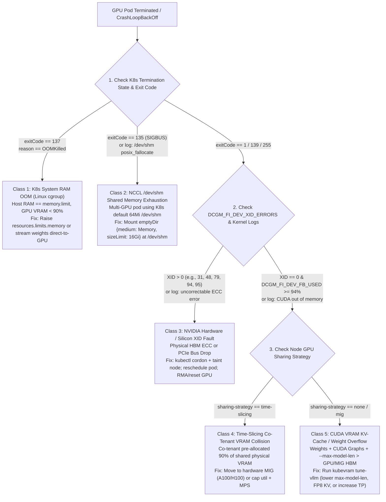

# 5. Observability, Telemetry & OOM Correlation

> **Related Manifests**: [`prometheus-gpu-oom-alerts.yaml`](../manifests/05-observability/prometheus-gpu-oom-alerts.yaml)  
> **Companion CLI ([`KubeVRAM`](https://github.com/xsub/KubeVRAM))**: `kubevram triage` | `kubevram triage --pod vllm-mistral-7b-tenant-b` | `kubevram bridge xid`

---

## 5.1 The cAdvisor & `metrics-server` Blind Spot

Standard Kubernetes observability (`kubectl top node`, `kubectl top pod`, `cAdvisor`, `kube-state-metrics`) inspects **Linux kernel cgroups (`cpu.stat`, `memory.current`)**. For AI inference workloads, this creates a dangerous illusion of health:
1. **GPU VRAM is Invisible to Linux cgroups**: `cudaMalloc()` and PagedAttention KV-cache allocations reside inside GPU High Bandwidth Memory (HBM) managed by `nvidia.ko`. A pod can show `4.2 GiB / 64 GiB` (`6.5%`) in `kubectl top pod` while its H100 GPU is at **`99.9%` VRAM saturation** and seconds away from crashing.
2. **CPU Idle != GPU Idle**: Because CUDA kernels execute asynchronously on GPU Streaming Multiprocessors (SMs), an LLM pod at 100% Tensor Core saturation frequently consumes `< 0.3 vCPU` on the host.
3. **Coarse `GPU_UTIL` Lies About Bottlenecks**: Even basic `nvidia-smi` `GPU-Util %` (`DCGM_FI_DEV_GPU_UTIL`) merely reports the percentage of sample intervals during which *at least one* warp ran on *any* SM—a single tiny kernel running on 1 out of 132 H100 SMs reports `100% GPU-Util`!

---

## 5.2 Two-Plane Telemetry Architecture: Hardware (DCGM) + Runtime (vLLM/Triton)

Production GPU observability correlates **DCGM Exporter** (silicon telemetry) with **Inference Engine `/metrics`** (request & KV-cache telemetry):

### Plane 1: NVIDIA DCGM Exporter Hardware Counters (`:9400/metrics`)

DCGM Exporter attaches Kubernetes labels (`exported_namespace`, `exported_pod`, `exported_container`, `Hostname`, `gpu`, `UUID`, and `GPU_I_ID` for MIG slices) to every metric:

| DCGM Metric | Unit | What It Actually Measures | Day-2 Operational Action |
| :--- | :--- | :--- | :--- |
| **`DCGM_FI_DEV_FB_USED`** | `MiB` | Allocated GPU framebuffer (VRAM) | Primary signal for VRAM pressure; correlate with pod crashes at `> 95%`. |
| **`DCGM_FI_DEV_FB_FREE`** | `MiB` | Unallocated GPU framebuffer | Alert during startup or dynamic workloads if `< 1024 MiB`. |
| **`DCGM_FI_PROF_SM_ACTIVE`** | `0.0–1.0` | Ratio of cycles SMs have $\ge 1$ active warp | **True compute utilization** (high during compute-bound prompt prefill). |
| **`DCGM_FI_PROF_TENSOR_ACTIVE`** | `0.0–1.0` | Ratio of cycles Tensor Cores are active | Verifies FP16/BF16/FP8 GEMM kernels are actually hitting Tensor Cores. |
| **`DCGM_FI_PROF_DRAM_ACTIVE`** | `0.0–1.0` | Fraction of peak HBM memory bandwidth used | **Primary LLM decode bottleneck** (`> 0.75` means HBM bandwidth saturated). |
| **`DCGM_FI_DEV_NVLINK_BANDWIDTH_TOTAL`** / **`PROF_NVLINK_TX_BYTES`** | `KiB/s` / `B/s` | Aggregate NVLink data transfer rate | Confirms `TP >= 2` `AllReduce` uses NVLink instead of falling back to PCIe/TCP. |
| **`DCGM_FI_DEV_PCIE_REPLAY_COUNTER`** | `count` | PCIe link CRC/ACK retry counter | Rising values indicate faulty PCIe riser/slot or signal integrity degradation. |
| **`DCGM_FI_DEV_POWER_USAGE`** & **`THERMAL_VIOLATION`** | `Watts` / `us` | Board power draw & thermal clock throttling | Explains sudden cluster-wide TPOT latency spikes when datacenter cooling degrades. |
| **`DCGM_FI_DEV_XID_ERRORS`** | `XID code` | Most recent NVIDIA driver/silicon XID fault | Triggers immediate automated node cordon/taint for fatal codes (`48, 79, 95`). |
| **`DCGM_FI_DEV_UNCORRECTABLE_REMAPPED_ROWS`** | `count` | HBM uncorrectable ECC row remap failures | Hardware RMA indicator when HBM spare rows are exhausted. |

---

### Plane 2: Inference Engine Runtime Metrics (`vLLM` `:8000/metrics`)

Because `vLLM` pre-allocates `90%` of GPU VRAM into its PagedAttention pool on startup, `DCGM_FI_DEV_FB_USED` stays flat at `~90%` whether `0` users or `200` users are active! To see **actual KV-cache saturation inside vLLM's pool**, scrape vLLM's Prometheus endpoint:

| vLLM Prometheus Metric | Meaning | Early Warning Threshold |
| :--- | :--- | :--- |
| **`vllm:gpu_cache_usage_perc`** | Fraction (`0.0–1.0`) of pre-allocated PagedAttention KV blocks currently occupied | **`> 0.85`** (Scale out via KEDA before hitting `1.0`!) |
| **`vllm:num_requests_waiting`** | Requests queued waiting for free KV-cache blocks | **`> 5–10`** sustained for `30s` (TTFT is degrading!) |
| **`vllm:num_preemptions_total`** | Cumulative count of in-flight sequences evicted/recomputed due to KV exhaustion | **`rate(...[5m]) > 0`** (**KV-Cache Thrashing Storm!** Lower `--max-num-seqs` or scale out) |
| **`vllm:time_to_first_token_seconds`** | Histogram of TTFT (Prefill + Queueing latency) | Track `p50`, `p95`, `p99` against SLA |
| **`vllm:time_per_output_token_seconds`** | Histogram of TPOT / Inter-Token Latency (Decode speed) | Spikes indicate cross-NUMA placement, Time-Slicing contention, or thermal throttling |

---

## 5.3 The 5-Way Crash & OOM Correlation Framework

When an AI engineer sees a GPU pod in `CrashLoopBackOff` or `OOMKilled`, guessing the fix wastes hours and causes repeat outages (e.g., bumping K8s `resources.limits.memory` when CUDA VRAM ran out, or lowering `--max-model-len` when `/dev/shm` hit `64 MiB`).

**KubeVRAM (`kubevram triage`)** deterministically separates **five distinct failure signatures**:



### Master Diagnostic Signature Matrix

| Failure Class | K8s `reason` & `exitCode` | cAdvisor Host RAM | `DCGM_FI_DEV_FB_USED` | Key Log / `dmesg` Signature | Exact Engineering Remediation |
| :--- | :--- | :--- | :--- | :--- | :--- |
| **1. K8s Host RAM OOM** | `OOMKilled` / `137` (`SIGKILL`) | `100%` of `limits.memory` | Normal (`10%–85%`) | Host `dmesg`: `Memory cgroup out of memory: Killed process`; container log ends abruptly with `Killed` during `safetensors` load. | Increase `resources.limits.memory` ($\ge 64\text{–}128\text{Gi}$) and ensure `safetensors` loads directly onto device rather than staging duplicate copies in CPU RAM. |
| **2. NCCL `/dev/shm` `SIGBUS`** | `Error` / `135` (`128 + 7 SIGBUS`) or `1` | Healthy | Normal | `NCCL WARN Call to posix_fallocate failed : No space left on device (/dev/shm/nccl-...)` or `DataLoader worker killed by signal: Bus error`. | Mount `emptyDir: { medium: Memory, sizeLimit: 16Gi }` at `/dev/shm` on every multi-GPU (`TP >= 2`) pod. |
| **3. Time-Slicing VRAM Collision** | `Error` / `1` | Healthy | `95%–100%` (held by another pod!) | `torch.cuda.OutOfMemoryError: Tried to allocate ... GPU 0 has 43.67 GiB allocated by other processes!` on node with `sharing-strategy=time-slicing`. | Evacuate `vLLM` from Time-Sliced nodes! Use **MIG** (`nvidia.com/mig-2g.20gb`) on A100/H100, or dedicate Full GPUs on L40S. |
| **4. CUDA VRAM / KV Overflow** | `Error` / `1` | Healthy | Spikes to `96%–100%` at init or peak batch | `torch.cuda.OutOfMemoryError` or `ValueError: max seq len (131072) is larger than maximum number of tokens in KV cache`. | Right-size `--max-model-len` (`16384`), set `--kv-cache-dtype=fp8`, tune `--gpu-memory-utilization=0.92`, or shard across higher `--tensor-parallel-size`. |
| **5. NVIDIA Silicon XID Fault** | `Error` / `1` or `139` | Healthy | Drops to `0` or metric scrape stalls | `NVRM: Xid (PCI:0000:81:00): 95, Uncontained ECC error` or `Xid 79: GPU has fallen off the bus`. | **Never just restart the pod on the same node!** Cordon & taint the node (`nvidia.com/gpu-xid-fault:NoSchedule`), drain healthy pods, reset GPU or RMA hardware. |

---

## 5.4 Production NVIDIA XID Error Reference Catalog

Not every XID error means dead silicon—some indicate application bugs while others mandate immediate node isolation:

| XID Code | Official Name | Root Cause Domain | Operational Severity & Playbook Action |
| :--- | :--- | :--- | :--- |
| **`XID 13`** | Graphics Engine Exception | Application / Kernel Bug (out-of-bounds tensor index, illegal instruction in custom Triton/CUDA kernel). | **Medium (App Bug)**: Node hardware is healthy; inspect custom CUDA/FlashAttention kernel versions. |
| **`XID 31`** | GPU Memory Page Fault | Application MMU fault (illegal GPU pointer dereference) or CUDA MPS co-tenant fault. | **Medium–High**: Usually software pointer bug or driver mismatch; if under MPS, resets all MPS clients on that GPU. |
| **`XID 43`** | GPU Stopped Processing | Hung CUDA kernel / TDR timeout or driver hang. | **Medium**: Pod restart usually recovers; check for infinite loops in custom kernels or NCCL deadlocks (`NCCL_ASYNC_ERROR_HANDLING=1`). |
| **`XID 48`** | Double-Bit ECC Error (DBE) | **Hardware HBM Memory Fault** (uncorrectable 2-bit flip). | **CRITICAL (Hardware)**: Cordon node immediately; check `nvidia-smi -q -d RETIRED_PAGES,REMAPPED_ROWS`; reboot node to apply row remapping or RMA. |
| **`XID 63` / `64`** | Row Remapping Record / Failure | HBM silicon aging (`63` = spare row scheduled; `64` = **remap table full / failed**). | **`63`: Drain & Reboot** at maintenance window. **`64`: CRITICAL — Cordon & RMA GPU** immediately. |
| **`XID 74`** | NVLink Error | Physical NVLink/NVSwitch lane CRC/training failure between GPUs. | **CRITICAL for `TP >= 2`**: Cordon node; run `nvidia-smi nvlink -e` and `dcgmi diag -r 3`. |
| **`XID 79`** | **GPU Has Fallen Off the Bus** | PCIe bus disconnect, PSU power transient, thermal shutdown, or motherboard riser failure. | **CRITICAL (Node Dead for GPU)**: `nvidia-smi` hangs or loses GPU completely. Cordon node, force-delete stuck pods after drain, hard power-cycle host VM/bare-metal. |
| **`XID 94`** | Contained ECC Error | Uncorrectable HBM ECC error **isolated to a single process/MIG slice** by hardware poisoning. | **High**: Affected container is killed safely; monitor `REMAPPED_ROWS` and schedule node reboot if recurring. |
| **`XID 95`** | **Uncontained ECC Error** | Uncorrectable HBM ECC error impacting shared GPU state across processes. | **CRITICAL (Hardware)**: GPU requires reset/reboot; **cordon node immediately** (`kubevram triage` flags `XID 95` at 99% confidence). |

---

## 5.5 Essential PromQL Library & Automated Triage

See [`manifests/05-observability/prometheus-gpu-oom-alerts.yaml`](../manifests/05-observability/prometheus-gpu-oom-alerts.yaml) for ready-to-apply `PrometheusRule` alerts. Useful Day-2 PromQL queries:

```promql
# 1. Per-Pod GPU Framebuffer Saturation (%)
100 * DCGM_FI_DEV_FB_USED / (DCGM_FI_DEV_FB_USED + DCGM_FI_DEV_FB_FREE)

# 2. Identify Underutilized "Zombie" Full-GPU Allocations (< 15% VRAM & < 5% SM Active over 6h)
(avg_over_time(DCGM_FI_DEV_FB_USED[6h]) / (avg_over_time(DCGM_FI_DEV_FB_USED[6h]) + avg_over_time(DCGM_FI_DEV_FB_FREE[6h])) < 0.15)
  and (avg_over_time(DCGM_FI_PROF_SM_ACTIVE[6h]) < 0.05)

# 3. Detect Decode HBM Bandwidth Bottleneck (High DRAM Active, Low SM Compute Active)
(DCGM_FI_PROF_DRAM_ACTIVE > 0.75) and (DCGM_FI_PROF_SM_ACTIVE < 0.35)

# 4. Detect vLLM KV-Cache Preemption / Thrashing Storm
rate(vllm:num_preemptions_total[5m]) > 0
```

Run standalone `kubectl` checks or the companion [`KubeVRAM`](https://github.com/xsub/KubeVRAM) CLI to correlate pod crashes across exit codes, DCGM VRAM counters, and XID faults:
```bash
# Pure kubectl: List crashed GPU pods with their last exit code (137 = Host RAM OOM, 135 = /dev/shm SIGBUS, 1 = Runtime/CUDA Error)
kubectl get pods -A -o json | jq -r '
  .items[]
  | select(.status.containerStatuses[]?.lastState.terminated != null)
  | "\(.metadata.namespace)/\(.metadata.name) node=\(.spec.nodeName) reason=\(.status.containerStatuses[0].lastState.terminated.reason) exitCode=\(.status.containerStatuses[0].lastState.terminated.exitCode)"
'

# Companion KubeVRAM CLI: Multi-signal correlation with YAML remediation patches & JSON export
kubevram triage
kubevram triage --format json
```
