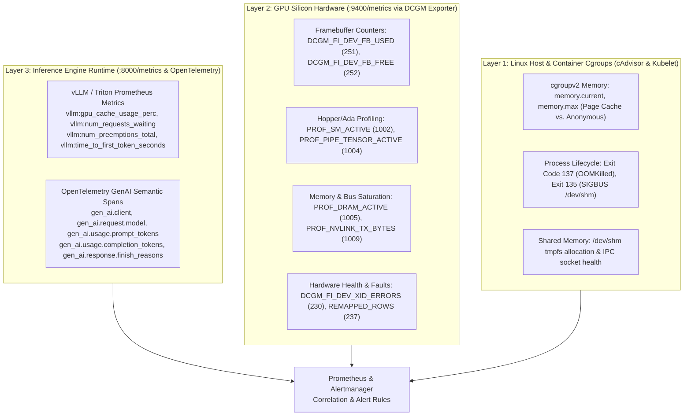
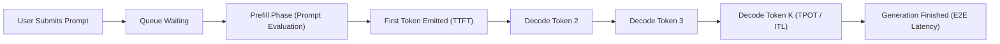
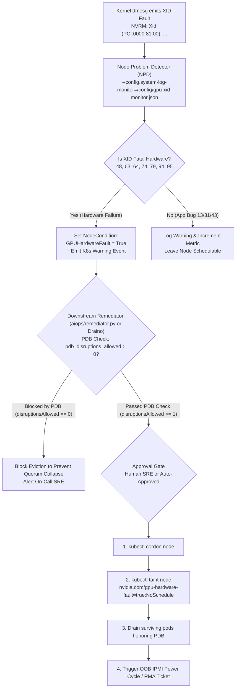
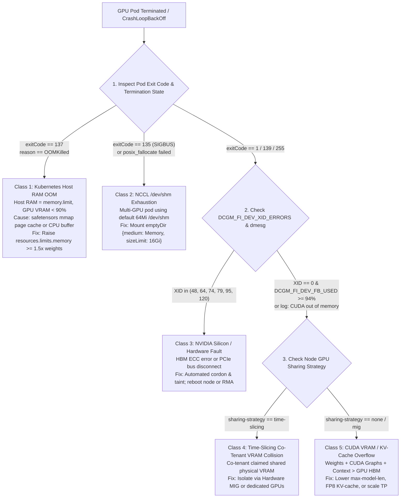

# 5. Observability, Telemetry & OOM Correlation

> **Related Manifests**: [`prometheus-gpu-oom-alerts.yaml`](../manifests/05-observability/prometheus-gpu-oom-alerts.yaml) | [`dcgm-custom-metrics-configmap.yaml`](../manifests/05-observability/dcgm-custom-metrics-configmap.yaml) | [`gpu-node-problem-detector.yaml`](../manifests/05-observability/gpu-node-problem-detector.yaml)  
> **Companion CLI ([`KubeVRAM`](https://github.com/xsub/KubeVRAM))**: `kubevram triage` | `kubevram triage --pod vllm-mistral-7b-tenant-b` | `kubevram bridge xid`

---

## 5.1 The cAdvisor & `metrics-server` Blind Spot

Standard Kubernetes observability (`kubectl top node`, `kubectl top pod`, `cAdvisor`, `kube-state-metrics`) inspects **Linux kernel cgroups (`cpu.stat`, `memory.current`)**. For AI inference workloads, this creates a dangerous illusion of system health:
1. **GPU VRAM is Completely Invisible to Linux cgroups**: `cudaMalloc()` and PagedAttention KV-cache allocations reside inside GPU High Bandwidth Memory (HBM) managed directly by the NVIDIA kernel driver (`nvidia.ko`). A container can report `4.2 GiB / 64 GiB` (`6.5%`) in `kubectl top pod` while its physical H100 GPU is at **`99.9%` VRAM saturation** and milliseconds away from a catastrophic runtime crash.
2. **Host CPU Idle Does Not Equal GPU Idle**: Because CUDA kernels execute asynchronously on GPU Streaming Multiprocessors (SMs), an LLM pod running at 100% Tensor Core saturation frequently consumes $< 0.3\text{ vCPU}$ on the Linux host. A cluster auto-scaler or HPA relying on host CPU will erroneously mark the node underutilized or scale in replicas.
3. **Coarse `GPU_UTIL` Conceals Hardware Bottlenecks**: Basic `nvidia-smi` `GPU-Util %` (`DCGM_FI_DEV_GPU_UTIL`) merely samples whether *at least one* warp was active on *any* SM during the sample window. A single non-vectorized thread running on 1 of 132 SMs reports `100% GPU-Util`, providing zero insight into whether Tensor Cores, memory controllers, or NVLink buses are saturated.

---

## 5.2 Three-Layer Telemetry Stack

Production GPU observability correlates signals across three distinct architectural planes:



### Layer 1: Linux Host & Container Cgroups (`cAdvisor`)
- **`memory.current` vs. `memory.max`**: Measures host RAM consumption. Crucially, Linux cgroups bundle both anonymous application memory (Python heap, CUDA driver context) and **file page cache** (created when reading or `mmap()`-ing safetensors weights). If `limits.memory` is smaller than the model file size, page-cache growth triggers Kubernetes `OOMKilled`.
- **Termination Reason & Exit Codes**: Distinguishes Kubernetes-enforced terminations (`OOMKilled`, Exit Code 137) from application crashes (`Error`, Exit Code 1) and bus errors (Exit Code 135).
- **`/dev/shm` Allocation**: Multi-GPU tensor parallelism relies on POSIX shared memory for NCCL rings; exhaustion of `/dev/shm` crashes PyTorch with `SIGBUS`.

### Layer 2: GPU Silicon Hardware Telemetry (`DCGM Exporter`)
NVIDIA Data Center GPU Manager (DCGM) collects silicon performance counters via Field IDs (100–1012), exported to Prometheus with native Kubernetes metadata (`pod`, `namespace`, `container`, `Hostname`, `gpu`, `GPU_I_ID`):

> [!IMPORTANT]
> **Prometheus `honorLabels: true` Requirement**:  
> By default, Prometheus overwrites target labels with its own scrape target labels. If `honorLabels: true` is omitted from the Prometheus Operator `ServiceMonitor`, Prometheus detects that `dcgm-exporter` is advertising `pod` and `namespace` labels and renames them to `exported_pod` and `exported_namespace`!  
> In this architecture, `honorLabels: true` is enforced in the GPU Operator `ClusterPolicy` and Prometheus manifests, preserving native `pod` and `namespace` labels across all alerts, dashboards, and correlation queries.

| DCGM Metric | Field ID | Unit | What It Measures | Day-2 Production Action |
| :--- | :--- | :--- | :--- | :--- |
| **`DCGM_FI_DEV_FB_USED`** | 251 | `MiB` | Framebuffer (VRAM) allocated | Primary VRAM gauge; alert if sustained $> 96\%$. |
| **`DCGM_FI_DEV_FB_FREE`** | 252 | `MiB` | Unallocated Framebuffer | Alert during container startup if $< 1024\text{ MiB}$. |
| **`DCGM_FI_PROF_SM_ACTIVE`** | 1002 | Ratio `0.0–1.0` | Fraction of cycles SMs have $\ge 1$ active warp | **True compute utilization**; high during prompt prefill. |
| **`DCGM_FI_PROF_SM_OCCUPANCY`** | 1003 | Ratio `0.0–1.0` | Resident warps divided by theoretical maximum | Measures kernel launch efficiency and register spilling. |
| **`DCGM_FI_PROF_PIPE_TENSOR_ACTIVE`** | 1004 | Ratio `0.0–1.0` | Cycles Tensor Cores execute GEMM instructions | Verifies FP8/FP16 kernels are utilizing Tensor Cores. |
| **`DCGM_FI_PROF_DRAM_ACTIVE`** | 1005 | Ratio `0.0–1.0` | Fraction of peak HBM memory bandwidth utilized | **Primary LLM decode bottleneck**; values $> 0.75$ indicate memory-bandwidth saturation. |
| **`DCGM_FI_PROF_NVLINK_TX_BYTES`** | 1009 | `B/s` | NVLink outbound throughput per second | Verifies `AllReduce` in `TP >= 2` uses NVLink over PCIe. |
| **`DCGM_FI_DEV_PCIE_REPLAY_COUNTER`** | 202 | `count` | PCIe transaction retry counter | Rising counter indicates failing PCIe riser or slot. |
| **`DCGM_FI_DEV_POWER_USAGE`** | 155 | `Watts` | Instantaneous board power consumption | Correlate with power throttling and PSU degradation. |
| **`DCGM_FI_DEV_THERMAL_VIOLATION`** | 160 | `us` | Duration clocks throttled by temperature | Pinpoints datacenter cooling failures causing TPOT spikes. |
| **`DCGM_FI_DEV_XID_ERRORS`** | 230 | `code` | Most recent NVIDIA driver/hardware XID fault | Triggers automated node cordon/taint for fatal hardware codes. |
| **`DCGM_FI_DEV_UNCORRECTABLE_REMAPPED_ROWS`** | 237 | `count` | HBM uncorrectable row remap count | Hardware RMA trigger when remap table exhausts spare rows. |

See [`manifests/05-observability/dcgm-custom-metrics-configmap.yaml`](../manifests/05-observability/dcgm-custom-metrics-configmap.yaml) for enabling profiling Field IDs 1002–1010 in production.

#### Hopper & Ada Hardware Profiling Mechanics
Unlike traditional polling metrics that sample GPU registers at coarse $1\text{ Hz}$ intervals, DCGM profiling metrics (Field IDs 1002–1012) tap into on-chip hardware performance counters.
- **`PROF_SM_ACTIVE` vs. `PROF_SM_OCCUPANCY`**: An SM is considered active if at least one warp is executing. However, each Hopper SM can host up to 64 active warps (2048 threads). If a kernel launches with low thread concurrency, `PROF_SM_ACTIVE` may report $0.90$ while `PROF_SM_OCCUPANCY` is only $0.15$, indicating suboptimal thread block sizing.
- **`PROF_PIPE_TENSOR_ACTIVE`**: Isolates dedicated Tensor Core execution units from standard integer and floating-point ALUs. In an FP8/BF16 continuous batching deployment, this metric directly confirms that GEMM operations are offloaded to Tensor hardware rather than falling back to slower CUDA core paths.

### Layer 3: Inference Engine Runtime & OpenTelemetry Spans
- **Prometheus Runtime Metrics (`:8000/metrics`)**:
  - `vllm:gpu_cache_usage_perc`: Fraction ($0.0\text{–}1.0$) of pre-allocated PagedAttention blocks occupied. Early warning trigger for scaling.
  - `vllm:num_requests_waiting`: Requests queued waiting for free KV-cache blocks. Indicates TTFT latency degradation.
  - `vllm:num_preemptions_total`: Cumulative count of in-flight sequences aborted or recomputed due to KV-cache exhaustion.
  - `vllm:time_to_first_token_seconds`: Histogram measuring prefill and queueing latency.
  - `vllm:time_per_output_token_seconds`: Histogram measuring autoregressive token generation latency.
- **OpenTelemetry GenAI Semantic Conventions**:
  Standardized distributed tracing spans connect API gateways to model workers. A trace captures end-to-end request lifecycle:
  ```json
  {
    "trace_id": "4bf92f3577b34da6a3ce929d0e0e4736",
    "span_id": "00f067aa0ba902b7",
    "name": "chat llama-3.1-70b-instruct",
    "attributes": {
      "gen_ai.system": "vllm",
      "gen_ai.request.model": "llama-3.1-70b-instruct",
      "gen_ai.usage.prompt_tokens": 1540,
      "gen_ai.usage.completion_tokens": 285,
      "gen_ai.response.finish_reasons": ["stop"],
      "llm.time_to_first_token_ms": 312.4,
      "llm.inter_token_latency_p95_ms": 28.2
    }
  }
  ```

---

## 5.3 LLM Service Level Objectives (SLO) Engineering

Traditional web service SLOs (p99 HTTP latency $< 200\text{ ms}$) cannot be applied directly to streaming generative AI. LLM user experience is governed by five decoupled metrics:



### 1. Time To First Token (TTFT)
The duration between request receipt and emission of the first completion token:
$$\text{TTFT} = T_{\text{queue}} + T_{\text{prefill}} = T_{\text{queue}} + \frac{N_{\text{prompt\_tokens}} - N_{\text{cached\_prefix}}}{\text{Throughput}_{\text{prefill}}}$$
- **User Impact**: Governs perceived system responsiveness.
- **SLO Target**: $p95 < 800\text{ ms}$ (interactive chat); $p95 < 2.5\text{ s}$ (agentic batch).
- **Degradation Root Cause**: High `vllm:num_requests_waiting`, disabled Chunked Prefill, or low Automatic Prefix Cache hit rate.

### 2. Time Per Output Token (TPOT) / Inter-Token Latency (ITL)
The time required to generate each subsequent token during the autoregressive decode phase:
$$\text{TPOT} = \frac{T_{\text{E2E}} - \text{TTFT}}{N_{\text{completion\_tokens}} - 1}$$
- **User Impact**: Governs streaming readability. Human reading speed is $\approx 4\text{–}8\text{ tokens/sec}$ ($125\text{–}250\text{ ms/token}$). Any TPOT $> 100\text{ ms}$ feels noticeably sluggish.
- **SLO Target**: $p99 < 35\text{ ms/token}$ for real-time voice/conversational agents; $p95 < 50\text{ ms/token}$ for streaming UI.
- **Degradation Root Cause**: DRAM bandwidth saturation (`DCGM_FI_PROF_DRAM_ACTIVE > 0.85`), NUMA cross-socket memory traversal, or prefill bursts interrupting decode iterations.

### 3. End-to-End (E2E) Latency
$$\text{E2E Latency} = \text{TTFT} + (N_{\text{output}} - 1) \times \text{TPOT}$$

### 4. KV-Cache Preemption Rate (`vllm:num_preemptions_total`)
When a burst of concurrent requests causes aggregate KV block demand to exceed available physical HBM, the scheduler must **preempt** active sequences:
- **Recomputation Mode (Default)**: Discards the sequence's KV cache entirely and reschedules the request to rerun prefill when memory frees up.
- **CPU Swap Mode**: Copies KV blocks over PCIe to host RAM (`--swap-space=16`), incurring severe PCIe latency penalties.
- **Operational Rule**: Any `rate(vllm:num_preemptions_total[5m]) > 0` indicates a **KV-Cache Thrashing Storm**. Preempted requests repeatedly consume prefill FLOPs, driving TTFT toward infinity.

### 5. Goodput
Raw throughput ($\text{tokens/second}$) is misleading if delivered after an SLA breach. **Goodput** measures the percentage of completed requests that simultaneously satisfy both TTFT and TPOT SLO thresholds:
$$\text{Goodput} = \frac{\sum \text{Requests satisfying } (\text{TTFT} \le T_{\text{target}} \land \text{TPOT} \le t_{\text{target}})}{N_{\text{total\_requests}}} \times 100\%$$

---

## 5.4 Comprehensive NVIDIA XID Fault Reference

When NVIDIA kernel drivers encounter abnormal hardware or software states, they write an **XID error** to kernel logs (`/dev/kmsg`) and increment `DCGM_FI_DEV_XID_ERRORS`. Distinguishing user-space bugs from catastrophic hardware failures is essential for automated remediation:

| XID Code | Name & Subsystem | Root Cause Classification | Operational Severity | Kubernetes Remediation Action |
| :--- | :--- | :--- | :--- | :--- |
| **`13`** | Graphics Engine Exception | **Application Bug** | Medium | Illegal instruction or out-of-bounds tensor access in custom CUDA/Triton kernel. Node is healthy; do **not** cordon node. |
| **`31`** | GPU Memory Page Fault | **Application / MMU Bug** | Medium–High | Illegal GPU pointer dereference or CUDA MPS client fault. Under MPS, resets all co-tenants on that GPU. Node silicon is healthy. |
| **`43`** | GPU Stopped Processing | Driver / Kernel Hang | Medium | Kernel hang or TDR timeout. Pod restart usually recovers. If recurrent, restart NVIDIA driver daemon. |
| **`48`** | Double-Bit ECC Error (DBE) | **Hardware Silicon Fault** | **CRITICAL** | Uncorrectable 2-bit flip in HBM. Cordon and taint node (`gpu-xid-fault:NoSchedule`). Trigger node reboot to remap row, or RMA. |
| **`63`** | Row Remap Pending | Hardware Maintenance | Low–Medium | Dynamic HBM row retirement scheduled. Drain and reboot node during scheduled maintenance window. |
| **`64`** | **Row Remap Table Full** | **Hardware Silicon Failure** | **FATAL** | Spare HBM rows exhausted. Remapping failed. **Immediate automated cordon & hardware RMA**. |
| **`74`** | NVLink Error | **Hardware Interconnect Fault**| **CRITICAL** | NVLink lane training or CRC transmission failure. Cordon node; break multi-GPU jobs; execute `dcgmi diag -r 3`. |
| **`79`** | **GPU Fallen Off Bus** | **Hardware / PCIe Failure** | **FATAL** | PCIe bus drop, thermal shutdown, or power trip. `nvidia-smi` hangs. Node dead for GPU workloads. Hard reboot required. |
| **`92`** | High Thermal Event | Datacenter Facility / Fan | High | Critical GPU temperature exceeded. Clocks forced to minimum. Inspect chassis airflow and node fans. |
| **`94`** | Contained ECC Error | Hardware Silicon Fault | High | Uncorrectable ECC error isolated to a single process/MIG slice via memory poisoning. Pod is killed safely; monitor `REMAPPED_ROWS`. |
| **`95`** | **Uncontained ECC Error**| **Hardware Silicon Failure** | **CRITICAL** | Uncorrectable ECC error impacting shared memory structures across processes. Cordon node immediately; reboot host. |
| **`119`** | GSP RPC Timeout | NVIDIA GSP Firmware | High | GPU System Processor (GSP) firmware hung. Drain node, unload `nvidia_modeset` / `nvidia`, or reboot host. |
| **`120`** | GSP Uncontained Fault | NVIDIA GSP Firmware | **CRITICAL** | GSP firmware crashed unrecoverably. Cordon node and power-cycle host machine. |



> [!IMPORTANT]
> **Node Problem Detector Architecture & Remediation Boundaries**:  
> Node Problem Detector is purely a **detection and condition publishing daemon**. It operates with `--config.system-log-monitor` to parse `/dev/kmsg` and write `NodeCondition: GPUHardwareFault` and Kubernetes `Event`s into the API server.  
> **NPD does NOT execute node cordoning, tainting, or draining directly!** Automated remediation must be executed by downstream remediation controllers (such as the repository's `aiops/remediator.py` engine or Draino/NHC). Downstream controllers must verify that `pdb_disruptions_allowed > 0` before initiating any pod evictions, preventing automated cascading outages across multi-node LLM serving groups.

### Deep Dive: Hardware Diagnostics & Remediation
1. **XID 48 / 64 (Row Remapping Table Exhaustion)**:
   High Bandwidth Memory (HBM2e/HBM3) stacks incorporate reserved physical rows to replace silicon memory cells that develop electrical degradation. When a double-bit ECC error occurs (XID 48), the hardware driver schedules a row retirement (XID 63). If all spare rows are exhausted, the driver issues **XID 64**. Check row retirement status:
   ```bash
   nvidia-smi -q -d RETIRED_PAGES,REMAPPED_ROWS
   ```
   If `Remapping Failure Occurred: Yes` or `Pending: Yes`, the GPU module has suffered permanent physical degradation and must be decommissioned via RMA.
2. **XID 79 (GPU Has Fallen Off the Bus)**:
   Triggered when the host PCIe root complex loses communication with the GPU device endpoint. Common causes include PCIe link width down-training (from x16 to x1), power supply bus dropouts during high dynamic load transitions (di/dt spikes), or thermal trip. When XID 79 fires, `nvidia-smi` hangs indefinitely in D-state (uninterruptible sleep). A software reboot command (`shutdown -r now`) will typically hang; node remediation controllers must trigger an Out-of-Band (OOB) IPMI/BMC power cycle:
   ```bash
   ipmitool -H bmc-node04.dc -U admin -P secret chassis power reset
   ```

See [`manifests/05-observability/gpu-node-problem-detector.yaml`](../manifests/05-observability/gpu-node-problem-detector.yaml) for automated detection rules using Node Problem Detector.

---

## 5.5 The 5-Way Crash & OOM Correlation Framework

When an AI engineer observes a terminated GPU pod, guessing the root cause wastes critical recovery hours. The following decision tree deterministically isolates the failure:



### Master Diagnostic Signature Matrix

| Failure Class | K8s Reason & Exit Code | cAdvisor Host RAM | DCGM VRAM (`FB_USED`) | Key Log Signature | Exact Engineering Playbook |
| :--- | :--- | :--- | :--- | :--- | :--- |
| **1. K8s Host RAM OOM** | `OOMKilled` / Exit `137` | $100\%$ of `limits.memory` | Normal ($10\%\text{–}85\%$) | `Memory cgroup out of memory: Killed process`; container terminates during `safetensors` loading. | Right-size `resources.limits.memory` ($\ge 1.5\times$ weights). Configure direct-to-GPU weight streaming. |
| **2. NCCL `/dev/shm` `SIGBUS`** | `Error` / Exit `135` (`SIGBUS`) | Normal | Normal | `NCCL WARN Call to posix_fallocate failed: No space left on device` or `Bus error`. | Mount `emptyDir: { medium: Memory, sizeLimit: 16Gi }` at `/dev/shm` on all multi-GPU pods. |
| **3. Hardware XID Fault** | `Error` / Exit `1` or `139` | Normal | Drops to `0` or scrape fails | `NVRM: Xid (PCI:0000:81:00): 95, Uncontained ECC error` or `Xid 79: GPU fallen off bus`. | **Do not restart pod on same node!** Cordon and taint node (`nvidia.com/gpu-xid-fault:NoSchedule`), drain pods, reboot or RMA. |
| **4. Time-Slicing Collision** | `Error` / Exit `1` | Normal | $95\%\text{–}100\%$ (held by co-tenant) | `torch.cuda.OutOfMemoryError: GPU 0 has 42 GiB allocated by other processes!` on time-sliced node. | Evacuate inference from time-slicing nodes. Use hardware MIG slices (`mig-2g.20gb`) or dedicated full GPUs. |
| **5. CUDA VRAM / KV Overflow** | `Error` / Exit `1` | Normal | Spikes to $96\%\text{–}100\%$ at boot or peak batch | `torch.cuda.OutOfMemoryError` or `ValueError: max seq len is larger than maximum number of tokens in KV cache`. | Lower `--max-model-len`, enable `--kv-cache-dtype=fp8`, adjust `--gpu-memory-utilization=0.92`, or increase `--tensor-parallel-size`. |

### Detailed Failure Scenario Signatures

#### Scenario 1: Linux cgroup `OOMKilled` (`Exit Code 137`)
```text
# Host dmesg:
[31821.412] memory: usage 33554432kB, limit 33554432kB, failcnt 12841
[31821.413] Memory cgroup out of memory: Killed process 81920 (python3) total-vm:84128412kB, anon-rss:2104800kB, file-rss:31449632kB
# Container termination:
lastState:
  terminated:
    exitCode: 137
    reason: OOMKilled
```
*Diagnosis*: Notice `file-rss` is $31.4\text{ GiB}$ while `anon-rss` is only $2.1\text{ GiB}$. The Linux page cache consumed the entire container cgroup memory limit while loading safetensors files.

#### Scenario 2: NCCL Shared Memory `SIGBUS` (`Exit Code 135`)
```text
# Pod stdout/stderr:
[rank0]: NCCL WARN Call to posix_fallocate failed : No space left on device
[rank0]: NCCL WARN Failed to allocate shared memory for ring buffer /dev/shm/nccl-ring-0
terminate called after throwing an instance of 'c10::DistBackendError'
Command exited with signal 7 (SIGBUS)
```
*Diagnosis*: Kubernetes assigns a default $64\text{ MiB}$ tmpfs mount at `/dev/shm` if not explicitly mounted. Multi-GPU NCCL ring buffers exceed this immediately.

#### Scenario 3: CUDA VRAM OOM (`Exit Code 1`)
```text
# Pod stdout/stderr:
torch.cuda.OutOfMemoryError: CUDA out of memory. Tried to allocate 512.00 MiB (GPU 0; 79.15 GiB total capacity; 74.20 GiB already allocated; 210.00 MiB free; 2.80 GiB reserved in total by PyTorch)
```
*Diagnosis*: VRAM exhaustion occurred inside GPU HBM. Container exit code is `1` (normal Python exception), not `137`.

---

## 5.6 Essential PromQL Alerting Library & Triage Playbook

See [`manifests/05-observability/prometheus-gpu-oom-alerts.yaml`](../manifests/05-observability/prometheus-gpu-oom-alerts.yaml) for deployment-ready `PrometheusRule` definitions.

```promql
# 1. Real-Time Framebuffer VRAM Saturation (%)
100 * DCGM_FI_DEV_FB_USED / clamp_min(DCGM_FI_DEV_FB_USED + DCGM_FI_DEV_FB_FREE, 1)

# 2. Decode Memory-Bandwidth Saturation (High DRAM Active, Low SM Compute Active)
(DCGM_FI_PROF_DRAM_ACTIVE > 0.75) and (DCGM_FI_PROF_SM_ACTIVE < 0.30)

# 3. KV-Cache Preemption Thrashing Storm (Preemptions occurring in flight)
rate(vllm:num_preemptions_total[5m]) > 0

# 4. Underutilized "Zombie" GPU Allocation (< 15% VRAM and < 5% SM Active for > 4h)
(avg_over_time(DCGM_FI_DEV_FB_USED[4h]) / clamp_min(avg_over_time(DCGM_FI_DEV_FB_USED[4h]) + avg_over_time(DCGM_FI_DEV_FB_FREE[4h]), 1) < 0.15)
  and (avg_over_time(DCGM_FI_PROF_SM_ACTIVE[4h]) < 0.05)

# 5. Immediate Correlation: CUDA VRAM OOM Crash (Native pod/namespace labels via honorLabels: true)
(increase(kube_pod_container_status_restarts_total[5m]) > 0)
  and on(namespace, pod) (kube_pod_container_status_last_terminated_reason{reason="Error"} == 1)
  and on(namespace, pod) (max by (namespace, pod) (max_over_time(DCGM_FI_DEV_FB_USED[5m]) / clamp_min(max_over_time(DCGM_FI_DEV_FB_USED[5m]) + min_over_time(DCGM_FI_DEV_FB_FREE[5m]), 1)) > 0.94)

# 6. Critical Silicon Hardware Fault Alert (XID 48, 63, 64, 74, 79, 94, 95)
(
  DCGM_FI_DEV_XID_ERRORS == 48 or
  DCGM_FI_DEV_XID_ERRORS == 63 or
  DCGM_FI_DEV_XID_ERRORS == 64 or
  DCGM_FI_DEV_XID_ERRORS == 74 or
  DCGM_FI_DEV_XID_ERRORS == 79 or
  DCGM_FI_DEV_XID_ERRORS == 94 or
  DCGM_FI_DEV_XID_ERRORS == 95
)

# 7. Non-Fatal User-Space MMU / Application Driver Warning (XID 13, 31, 43 - DO NOT CORDON)
(
  DCGM_FI_DEV_XID_ERRORS == 13 or
  DCGM_FI_DEV_XID_ERRORS == 31 or
  DCGM_FI_DEV_XID_ERRORS == 43
)
```

### Day-2 Command-Line Triage
```bash
# 1. Pure kubectl: List crashed pods with last termination reason and exit codes
kubectl get pods -A -o json | jq -r '
  .items[]
  | select(.status.containerStatuses[]?.lastState.terminated != null)
  | "\(.metadata.namespace)/\(.metadata.name) node=\(.spec.nodeName) reason=\(.status.containerStatuses[0].lastState.terminated.reason) exitCode=\(.status.containerStatuses[0].lastState.terminated.exitCode)"
'

# 2. Inspect active Node Conditions set by Node Problem Detector
kubectl get nodes -o custom-columns=NAME:.metadata.name,GPU_FAULT:.status.conditions[?(@.type==\"GPUHardwareFault\")].status,REASON:.status.conditions[?(@.type==\"GPUHardwareFault\")].reason

# 3. Companion KubeVRAM CLI: Automatic 5-way crash correlation with remediation patch emission
kubevram triage
kubevram triage --pod vllm-llama3-70b-6f8d9b-c4x9z
kubevram bridge xid
```

---

## References

1. NVIDIA Data Center GPU Manager (DCGM) Architecture & User Guide: <https://docs.nvidia.com/datacenter/dcgm/latest/user-guide/index.html>
2. NVIDIA DCGM Exporter Configuration & Metric Field IDs: <https://github.com/NVIDIA/dcgm-exporter>
3. NVIDIA Driver XID Error Codes Catalog: <https://docs.nvidia.com/deploy/xid-errors/index.html>
4. Kubernetes Node Problem Detector: <https://github.com/kubernetes/node-problem-detector>
5. Prometheus Operator ServiceMonitor & `honorLabels`: <https://prometheus-operator.dev/docs/operator/api/#monitoring.coreos.com/v1.Endpoint>
6. OpenTelemetry Semantic Conventions for Generative AI Systems: <https://opentelemetry.io/docs/specs/semconv/gen-ai/>

