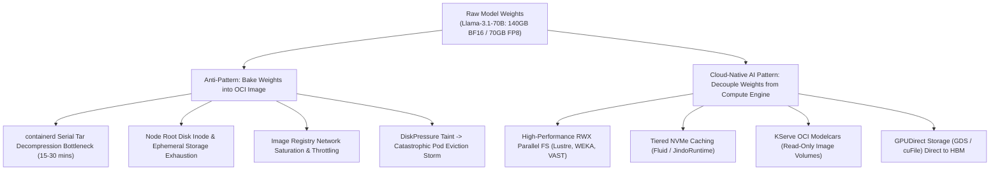
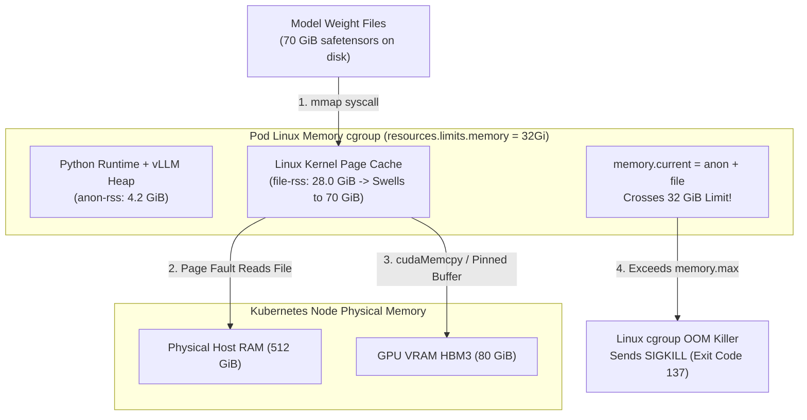
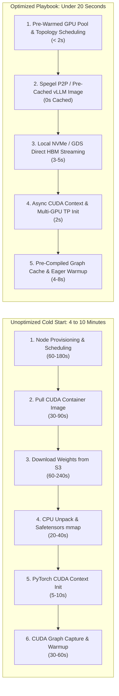
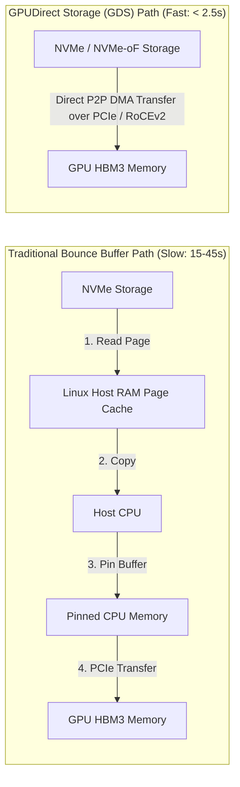

# 6. Model Storage Architecture & Cold-Start Optimization

> **Related Manifests**: [`fluid-s3-accelerator.yaml`](../manifests/06-model-storage/fluid-s3-accelerator.yaml) | [`kserve-vllm-canary.yaml`](../manifests/04-inference-serving/kserve-vllm-canary.yaml)  
> **Companion CLI ([`KubeVRAM`](https://github.com/xsub/KubeVRAM))**: `kubevram triage` | `kubevram tune-vllm`

---

## 6.1 The Weight Distribution Problem in Cloud-Native AI

Deploying large foundation models ($15\text{ GB}$ to $800\text{ GB}$ per model) on Kubernetes breaks traditional container storage and distribution assumptions. Unlike typical microservices whose container images measure $100\text{ MB}$ to $1\text{ GB}$, modern Large Language Models and Vision-Language Models present severe storage challenges:



### Why Baking Weights into Container Images Fails Catastrophically
1. **Containerd Serial Decompression Bottleneck**: Standard OCI images package filesystem layers as compressed tarballs (`tar.gz` or `tar.zstd`). The Kubernetes CRI runtime (`containerd`) unpacks layers serially on a single host CPU thread. Unpacking a $70\text{ GB}$ model layer consumes $10\text{ to }25\text{ minutes}$, during which the node's host CPU and root disk I/O are completely saturated.
2. **OverlayFS Copy-on-Write Overhead & Whiteouts**: Container engines utilize `overlayfs` to create container root filesystems. When a container writes or touches large files in an image layer, `overlayfs` triggers expensive copy-up operations. If a process inadvertently deletes or modifies a weight file, `overlayfs` creates a whiteout marker without releasing the underlying physical disk space on the host, causing silent disk leaks.
3. **Ephemeral Storage & Node Disk Pressure**: Node root volumes (`/var/lib/containerd`) are typically sized between $100\text{ GB}$ and $500\text{ GB}$. Storing multiple model revisions or large uncompressed layers rapidly trips kubelet's `imageGCHighThresholdPercent` ($80\%$) or triggers a `DiskPressure` node condition, causing kubelet to evict critical co-located inference pods.
4. **Registry Egress & Concurrency Limits**: When a traffic spike triggers horizontal autoscaling across 20 GPU nodes, all nodes simultaneously request $70\text{ GB}$ image layers from the container registry. This creates massive network egress congestion ($1.4\text{ TB}$ aggregate pull), tripping registry rate limits or causing HTTP 504 timeouts.
5. **CI/CD Pipeline Gridlock**: Embedding model weights into OCI images forces CI/CD runners to spend hours building, pushing, and scanning multi-gigabyte layers, destroying deployment velocity.

---

## 6.2 The `safetensors` `mmap` Linux Page-Cache Trap

The Hugging Face `safetensors` format is the industry standard for neural network weight distribution. Designed to replace unsafe Python `pickle` archives, `safetensors` stores tensor metadata in a JSON header followed by raw, unaligned binary buffers. It allows inference runtimes like `vLLM` and `TensorRT-LLM` to load weights using memory-mapped I/O (`mmap`).

However, on Kubernetes, naive `mmap` usage creates one of the most insidious production failure modes: **The Page-Cache OOM Trap**.



### The Mechanism of the Page-Cache Trap
1. **The `mmap()` System Call**: When `vLLM` loads a model, Python invokes `mmap.mmap()` on the `.safetensors` files. At call time, no memory is allocated; virtual address space is merely reserved.
2. **Sequential Page Faults**: As the weight loader iterates through model layers and calls `tensor.to("cuda")` or `cudaMemcpyAsync()`, the CPU touches each memory page. The Linux kernel generates page faults and reads the underlying file chunks from disk into the host **kernel page cache**.
3. **Cgroup Accounting Mechanics**: Under both Linux cgroups v1 (`memory.usage_in_bytes`) and cgroups v2 (`memory.current`), memory usage is calculated as:
   $$\text{cgroup\_memory} = \text{memory.anon} + \text{memory.file} + \text{memory.sock}$$
   Even though page cache memory is clean (unmodified and eligible for eviction), the Linux kernel does not synchronously evict file cache pages when page allocations occur within the same cgroup if reclamation pressure is misaligned.
4. **The Fatal `OOMKilled` (Exit Code 137)**:
   If an engineer sizes `resources.limits.memory: 32Gi` for a pod serving a $70\text{ GB}$ model (reasoning that weights live in GPU VRAM, not CPU RAM), the page cache rapidly expands beyond $32\text{ GiB}$. Kubelet and the Linux kernel cgroup controller detect that `memory.current > memory.max`, invoke the kernel OOM Killer, and terminate the container with **`Exit Code 137 (OOMKilled)`**.
   Crucially, this occurs even when the host node has hundreds of gigabytes of unallocated RAM and the GPU has ample free VRAM!

### Kernel Call Stack During Cgroup OOM
When memory pressure builds within the container cgroup, the Linux kernel executes:
```text
alloc_pages()
  -> mem_cgroup_charge()
    -> try_charge()
      -> mem_cgroup_out_of_memory()
        -> oom_kill_process()
```
The kernel identifies the parent Python process as the largest consumer of virtual memory and dispatches an uncatchable `SIGKILL`.

### Engineering Remediation Strategies
- **Cgroup Memory Sizing Rule**: Always provision container host memory limits to at least:
  $$\text{resources.limits.memory} \ge 1.5 \times \text{Size}_{\text{weights}} + \text{Size}_{\text{/dev/shm}}$$
  For a $70\text{ GB}$ FP8 model, allocate at least `96Gi` to `128Gi` of host memory.
- **Direct I/O (`O_DIRECT`)**: Open model files with `O_DIRECT`, instructing the kernel to stream data directly between disk controllers and user space buffers, completely bypassing the Linux page cache.
- **Programmatic Page Cache Eviction (`posix_fadvise`)**:
  In custom loaders, call `posix_fadvise` after copying each tensor to GPU memory to immediately release page-cache pages:
  ```python
  import os

  def drop_file_cache(fd: int, offset: int, length: int):
      # Advise kernel that these pages are no longer needed
      os.posix_fadvise(fd, offset, length, os.POSIX_FADV_DONTNEED)
  ```
- **GPUDirect Storage (GDS)**: Utilize NVIDIA `cuFile` APIs (`nvidia-fs.ko`) to execute direct peer-to-peer DMA transfers from NVMe storage over the PCIe bus straight into GPU High Bandwidth Memory, bypassing both the Linux page cache and CPU host memory bounce buffers.

---

## 6.3 Model Storage Architecture Comparison

Production AI platforms employ a combination of object storage, distributed parallel filesystems, and node-local caching to balance throughput, cost, and operational complexity:

| Storage Architecture | Peak Read Throughput / Node | 70B Model Load Latency | POSIX Compliant | Storage Cost / GB-mo | Operational Overhead & Scaling Complexity | Best Kubernetes Production Use Case |
| :--- | :--- | :--- | :--- | :--- | :--- | :--- |
| **Object Storage (S3 / GCS) + `s5cmd`** | $1.5\text{–}3.5\text{ GB/s}$ | $30\text{–}60\text{ s}$ | No (HTTP/REST) | **Lowest** ($\approx \$0.02$) | Low; infinite scalability; requires init-container or volume initializers. | Primary source of truth model registry; batch pipelines; cold model catalog. |
| **Parallel Filesystem (FSx Lustre / WEKA / VAST)** | **$10\text{–}40\text{ GB/s}$** | **$3\text{–}8\text{ s}$** | **Yes (Full POSIX)** | High ($\approx \$0.15\text{–}\$0.40$) | High; requires dedicated storage VPC peering, specialized CSI drivers, and kernel modules. | Enterprise frontier inference clusters; large-scale distributed pretraining and checkpointing. |
| **Node-Local NVMe RAID-0 + Fluid / Jindo** | **$12\text{–}25\text{ GB/s}$** | **$4\text{–}10\text{ s}$** | Yes (Read-Only) | Low (Node ephemeral) | Medium; requires CSI hostPath or Fluid DaemonSet operators managing local NVMe cache eviction. | High-QPS production serving endpoints with fixed models on GPU worker nodes. |
| **KServe OCI Modelcars (Image Volumes)** | $2.0\text{–}6.0\text{ GB/s}$ | $15\text{–}30\text{ s}$ | Yes (Read-Only Mount) | Medium (Registry cost) | Low; leverages standard OCI container registries without external CSI dependencies. | Teams prioritizing GitOps simplicity and unified container security scanning. |
| **GPUDirect Storage (GDS / `cuFile`)** | **$25\text{–}60\text{ GB/s}$** | **$< 2.5\text{ s}$** | Specialized API (`cufile.h`) | High (NVMe-oF / NVMe) | High; requires `nvidia-fs` driver module, MOFED, and NVMe-oF/RoCEv2 fabrics. | Extreme low-latency autoscaling and real-time checkpoint loading for frontier models. |

### Deep Dive: OCI Modelcars & Kubernetes Native Image Volumes
Kubernetes 1.28+ and KServe v0.14+ introduce **OCI Modelcars** (using native `ImageVolumeSource` / KEP-4639). Instead of baking weights into the executable container image or using an init-container to pull from S3:
1. Model weights are packaged inside an uncompressed, single-layer scratch container image (the Modelcar).
2. The Modelcar is pushed to a standard OCI container registry (e.g., Harbor, GHCR, Artifactory).
3. Kubernetes mounts the Modelcar layer directly as a read-only volume inside the inference container:
   ```yaml
   volumes:
     - name: model-weights
       image:
         reference: ghcr.io/my-org/models/llama-3.1-70b-fp8:v1.0
         pullPolicy: IfNotPresent
   ```
4. **Why This Eliminates the Unpack Bottleneck**: The container runtime (`containerd`) mounts the underlying layer snapshot directly via overlayfs without executing serial tar decompressions or copying files to temporary directories, cutting container initialization from 15 minutes to under 25 seconds.

---

## 6.4 Distributed Dataset Caching with Fluid & JuiceFS

### Distributed Caching Architecture with Fluid
[Fluid](https://github.com/fluid-cloudnative/fluid) is an open-source Kubernetes-native distributed dataset orchestrator that bridges cloud object storage (S3/GCS) with high-speed node-local NVMe and host memory caching.

```mermaid
flowchart TD
    S3["Remote Object Store\ns3://prod-llm-models/Llama-3.1-70B/"] -->|First Load (Warmup)| FluidWorker["Fluid JindoRuntime Worker Pod (DaemonSet)"]

    subgraph NodeStorage["GPU Node Local Storage Hierarchy"]
        Tier1["Tier 1: /dev/shm (RAM / tmpfs) - 32 GiB"]
        Tier2["Tier 2: /mnt/nvme-raid0/fluid-cache (NVMe SSD) - 500 GiB"]
    end

    FluidWorker --> Tier1
    FluidWorker --> Tier2

    Tier2 -->|Direct HostPath Bind Mount| vLLMPod["vLLM Inference Pod\n/models/Meta-Llama-3.1-70B"]
    vLLMPod -->|P2P DMA Transfer| VRAM["GPU HBM3 Memory"]
```

1. **Declarative `Dataset` & `Runtime`**: S3 bucket paths are declared via custom Kubernetes CRDs (`Dataset` and `JindoRuntime`). Fluid manages caching daemons across designated GPU nodes.
2. **Tiered Storage**: Weights are cached across a two-level hierarchy:
   - **Tier 1 (RAM)**: High-speed POSIX memory (`/dev/shm`) for immediate access.
   - **Tier 2 (NVMe RAID-0)**: Node-local NVMe drives capable of delivering $> 12\text{ GB/s}$ sustained sequential read bandwidth.
3. **Pre-Warming Datasets via `DataLoad`**:
   Before routing live inference traffic to a newly provisioned GPU node pool, trigger a declarative pre-warm job:
   ```yaml
   apiVersion: data.fluid.io/v1alpha1
   kind: DataLoad
   metadata:
     name: preload-llama-70b
     namespace: ai-inference
   spec:
     dataset:
       name: llama-3-1-70b-weights
       namespace: ai-inference
     loadMetadataOnly: false
   ```
4. **Scheduling Affinity**: Fluid automatically injects node selector labels (`fluid.io/dataset-llama-3-1-70b-weights=true`), guaranteeing that inference pods are co-located strictly on nodes containing warm local caches.

### FUSE Filesystems vs. Fluid Tiered Caching
Alternative architectures deploy POSIX FUSE drivers (such as JuiceFS or `goofys`). While FUSE drivers simplify integration by mounting S3 buckets directly into pods, userspace context-switching introduces significant read latency overhead:
- **FUSE Context Switching**: Every $4\text{ KB}$ read operation traverses the VFS layer, context-switches into the FUSE user daemon, and copies data back across kernel boundaries. This limits peak single-pod sequential read throughput to $\approx 1.2\text{–}2.0\text{ GB/s}$.
- **Fluid & Direct NVMe**: Bypasses FUSE runtime translations during inference by staging raw files on high-speed NVMe filesystems (ext4/XFS), enabling full raw disk sequential throughput ($> 12\text{ GB/s}$).

See [`manifests/06-model-storage/fluid-s3-accelerator.yaml`](../manifests/06-model-storage/fluid-s3-accelerator.yaml) for the full declarative deployment.

---

## 6.5 Cold-Start Breakdown & 20-Second Optimization Playbook

Scaling an LLM inference service from zero or adding new GPU replicas under load is traditionally dominated by a multi-stage latency cascade:



### Cold-Start Latency Breakdown

| Lifecycle Phase | Unoptimized Baseline | Optimized Playbook Target | Primary Optimization Technique |
| :--- | :--- | :--- | :--- |
| **1. Node Scheduling & IPAM** | $30\text{–}180\text{ s}$ (Warm node acquisition) | **$< 2\text{ s}$** | Maintain warm GPU node pool (`minReplicas >= 2` or Karpenter NodePool headroom with low-cost pause pods). |
| **2. Container Image Pull** | $45\text{–}120\text{ s}$ ($15\text{ GB}$ CUDA image) | **$0\text{ s}$ (Pre-cached)** | Use **Spegel** peer-to-peer image distribution or DaemonSet image pre-pullers on all GPU nodes. |
| **3. Model Weight Loading** | $60\text{–}300\text{ s}$ (WAN S3 fetch) | **$3\text{–}6\text{ s}$** | High-throughput parallel RWX filesystem (WEKA/Lustre) or local NVMe RAID-0 caching via Fluid. |
| **4. Host RAM Deserialization** | $15\text{–}45\text{ s}$ (CPU copy overhead) | **$< 2\text{ s}$** | GPUDirect Storage (GDS) direct PCIe DMA transfer bypassing host CPU bounce buffers. |
| **5. CUDA Context Initialization**| $5\text{–}10\text{ s}$ (Driver context & NCCL) | **$2\text{ s}$** | Pre-initialized CUDA context pools and persistent NCCL communication rings. |
| **6. CUDA Graph Capture & Warmup**| $30\text{–}60\text{ s}$ (Iterating batch sizes) | **$5\text{–}8\text{ s}$** | Restrict graph capture to active batch sizes (`--gpu-memory-utilization=0.92`) or persist captured graph binaries. |
| **Total Cold-Start Duration** | **$185\text{–}715\text{ s}$ ($3\text{–}12\text{ min}$)** | **$< 20\text{ Seconds}$** | **$15\times\text{ to }35\times$ Latency Reduction** |

---

## 6.6 Step-by-Step Optimization Playbook

### Step 1: Eliminate Image Pull Latency via Spegel (P2P Registry)
Deploy **Spegel** as a Kubernetes DaemonSet. Spegel configures `containerd` to advertise local image layers via an internal libp2p network. When a new GPU worker node requires the `vllm/vllm-openai:v0.33.0@sha256:d825baf9ce4b1b6bfc5ecc7b79880c7e6748c65a72d697ce3d47607aafa84c6e` image ($16\text{ GB}$), it downloads layers from neighboring nodes across the local datacenter network at line rate ($100\text{ Gbps}$), completely avoiding external registry bandwidth bottlenecks.

### Step 2: Stream Weights Directly to VRAM via GPUDirect Storage (GDS)

> [!WARNING]
> **Precompiled Driver Incompatibility with GPUDirect Storage**:  
> As detailed in Chapter 01, precompiled driver containers (`driver.usePrecompiled: true`) **do NOT support GPUDirect Storage (`nvidia-fs`)**. Precompiled images lack kernel development headers and do not include the `nvidia-fs.ko` module.  
> If GPUDirect Storage is required, you **must** configure DKMS compilation in the GPU Operator (`driver.usePrecompiled: false` with `gds.enabled: true`) or install drivers and `nvidia-fs` directly on the host OS!

Configure the NVIDIA GPU Operator `ClusterPolicy` with DKMS-compiled GDS:
```yaml
apiVersion: nvidia.com/v1
kind: ClusterPolicy
metadata:
  name: gpu-cluster-policy
spec:
  gds:
    enabled: true
  driver:
    enabled: true
    usePrecompiled: false       # Mandatory: DKMS builds nvidia.ko AND nvidia-fs.ko for GDS
    version: "570"
```
GDS utilizes the `cufile` library to establish a direct DMA pathway between NVMe-oF block storage and GPU High Bandwidth Memory. By eliminating CPU buffer copies, a $70\text{ GB}$ model transfers at the maximum physical bandwidth of the PCIe Gen5 bus ($64\text{ GB/s}$), loading in less than $2.5\text{ seconds}$.



### Step 3: Fast Weight Loading & Tensor Parallel Sharding
In vLLM, configure the weight loader to load directly from local unpadded `safetensors` files across tensor-parallel workers simultaneously:
```bash
# Production launch configuration for sub-20s boot:
python3 -m vllm.entrypoints.openai.api_server \
  --model /mnt/nvme-raid0/models/Meta-Llama-3.1-70B-Instruct-FP8 \
  --served-model-name llama-3.1-70b-instruct \
  --tensor-parallel-size 4 \
  --load-format safetensors \
  --quantization fp8 \
  --kv-cache-dtype fp8 \
  --gpu-memory-utilization 0.92 \
  --max-model-len 16384 \
  --max-num-batched-tokens 512 \
  --enable-chunked-prefill \
  --enable-prefix-caching
```
Each tensor-parallel worker reads only its assigned shard ($17.5\text{ GB}$ for TP=4) concurrently, slashing deserialization latency by $4\times$.

### Step 4: CUDA Graph Pre-Capture & Serialization
Capturing CUDA graphs dynamically for batch sizes $1, 2, 4, 8, 16, 32$ during container boot incurs $30\text{–}60\text{ seconds}$ of CPU-bound forward passes. With CUDA 12.4+ and vLLM:
1. Target batch sizes can be restricted to anticipated production ranges.
2. The runtime avoids compiling eager graphs for unused batch buckets.
3. Warmup passes execute dummy tokens through the graph pipeline immediately during container initialization, ensuring that the first live user request does not absorb graph instantiate penalties.

### Step 5: Provision Headroom & Prevent Scale-to-Zero
For tier-1 production applications, never permit scale-to-zero. Configure KEDA and KServe to maintain a warm baseline:
```yaml
spec:
  minReplicas: 2
```
To minimize idle cloud spend while maintaining sub-second burst capacity, deploy lightweight "pause" pods with lower PriorityClasses (`preemptionPolicy: PreemptLowerPriority`) on reserved GPU nodes. When real LLM inference demand spikes, Kubernetes immediately preempts the pause pods, granting GPU resources to warm inference replicas in under 2 seconds.

---

## 6.7 Day-2 Storage Verification & Performance Benchmarking

```bash
# 1. Benchmark local NVMe RAID-0 sequential read bandwidth (target: > 10 GB/s)
fio --name=seqread --rw=read --direct=1 --ioengine=libaio --bs=1M --numjobs=8 \
    --size=10G --runtime=30 --group_reporting --filename=/mnt/nvme-raid0/testfile

# 2. Verify GPUDirect Storage driver (nvidia-fs) status and cuFile compatibility
cufile-check -v
lsmod | grep nvidia_fs

# 3. Inspect active Fluid Dataset status and cache utilization
kubectl get datasets.data.fluid.io -n ai-inference
kubectl get jindoruntimes.data.fluid.io -n ai-inference

# 4. Monitor real-time container page-cache vs anonymous memory via cgroupv2
POD_UID=$(kubectl get pod vllm-llama3-70b-predictor-default-0 -n ai-inference -o jsonpath='{.metadata.uid}')
cat /sys/fs/cgroup/kubepods.slice/kubepods-burstable.slice/kubepods-burstable-pod${POD_UID}.slice/memory.stat | grep -E "anon|file"
```

---

## References

1. NVIDIA Magnum IO GPUDirect Storage (GDS) Overview: <https://docs.nvidia.com/gpudirect-storage/overview-guide/index.html>
2. Hugging Face Safetensors Format: <https://github.com/huggingface/safetensors>
3. Fluid: Kubernetes-Native Distributed Dataset Orchestrator: <https://github.com/fluid-cloudnative/fluid>
4. Kubernetes KEP-4639: OCI Volume Source (Modelcars): <https://github.com/kubernetes/enhancements/tree/master/keps/sig-node/4639-oci-volume-source>
5. Spegel: P2P Container Image Distribution for Kubernetes: <https://github.com/spegel-org/spegel>
6. Linux Kernel Page Cache & Cgroups Accounting: <https://www.kernel.org/doc/html/latest/admin-guide/cgroup-v2.html#memory>

