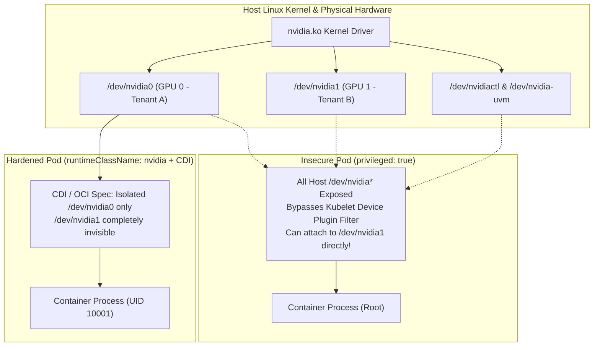
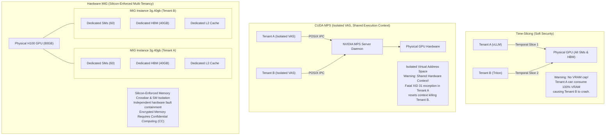
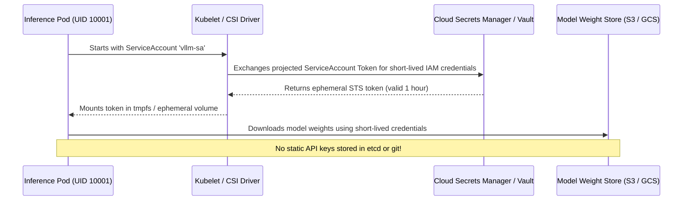

# 7. Security, Multi-Tenancy & Platform Governance

> **Related Manifests**: [`vap-gpu-inference-guardrails.yaml`](../manifests/06-security-guardrails/vap-gpu-inference-guardrails.yaml) | [`nvidia-runtimeclass.yaml`](../manifests/01-hardware-orchestration/nvidia-runtimeclass.yaml)  
> **Companion CLI ([`KubeVRAM`](https://github.com/xsub/KubeVRAM))**: `kubevram rbac-audit` | `kubevram bridge security` | `kubevram topology`

---

## 7.1 The GPU Container Privilege Isolation Breakdown

In standard Kubernetes containerization, the Linux kernel isolates workloads using namespaces (`pid`, `net`, `ipc`, `mnt`, `uts`, `user`) and control groups (`cgroup v2`). However, hardware accelerators—specifically NVIDIA GPUs—bypass traditional namespace boundaries because communication with the hardware occurs through character device files (`/dev/nvidia*`) managed directly by the NVIDIA kernel driver module (`nvidia.ko` and `nvidia-uvm.ko`).

### The Anti-Pattern: `securityContext.privileged: true`

A widespread anti-pattern in early AI/ML platform deployments is granting inference pods `securityContext.privileged: true`. Platform engineers often resort to this to quickly bypass device permission errors, CUDA driver initialization failures, or to access GPU profiling counters.



When an inference container runs in privileged mode, the container runtime:
1. **Disables the cgroup device whitelist**: The container receives unrestricted read/write access to **all** character devices on the host node (`major 195` for NVIDIA character devices and `major 511` for NVIDIA UVM).
2. **Mounts all physical `/dev/nvidia*` nodes**: Regardless of whether Kubelet scheduled the pod with `nvidia.com/gpu: 1` allocating GPU 0, a privileged container sees `/dev/nvidia0`, `/dev/nvidia1`, `/dev/nvidia2`, ..., `/dev/nvidiactl`, and `/dev/nvidia-uvm`.
3. **Enables Cross-Tenant VRAM Snooping**:
   - A rogue or compromised container process can initialize NVML (`nvmlInit()`) and query device handles for GPUs assigned to other tenant pods on the same node.
   - If the container possesses `CAP_SYS_PTRACE` or `CAP_SYS_ADMIN` (inherent in privileged mode), it can attach CUDA debuggers (`cuda-gdb`), memory inspectors, or NVIDIA System Management Interface tools (`nsys`, `ncu`) to arbitrary CUDA process contexts on the machine.
   - Memory inspection enables extraction of proprietary LLM model weights, user prompts, API keys, and sensitive token generation buffers residing unencrypted in physical High Bandwidth Memory (HBM).
4. **Hardware Tampering and DoS**:
   - Privileged containers can alter GPU clock speeds, adjust power limits via `nvidia-smi -pl`, issue GPU resets (`nvidia-smi -r`), or trigger driver unloads, causing catastrophic outages for all co-located workloads.

### Hardened Least-Privilege Architecture: `runtimeClassName: nvidia` + CDI

Zero-trust AI multi-tenancy requires eliminating `privileged: true` and configuring granular device isolation via the **Container Device Interface (CDI)** and `nvidia-container-runtime`.

```yaml
apiVersion: v1
kind: Pod
metadata:
  name: vllm-hardened-inference
  namespace: inference-prod
spec:
  # 1. Enforce explicit nvidia RuntimeClass for CDI hook execution
  runtimeClassName: nvidia
  
  # 2. Restrict Pod-level security context
  securityContext:
    runAsNonRoot: true
    runAsUser: 10001
    runAsGroup: 10001
    fsGroup: 10001
    seccompProfile:
      type: RuntimeDefault

  containers:
    - name: vllm-engine
      image: vllm/vllm-openai:v0.33.0@sha256:d825baf9ce4b1b6bfc5ecc7b79880c7e6748c65a72d697ce3d47607aafa84c6e
      # 3. Restrict Container-level security context
      securityContext:
        allowPrivilegeEscalation: false
        privileged: false
        readOnlyRootFilesystem: true
        capabilities:
          drop:
            - ALL
      resources:
        limits:
          cpu: "16"
          memory: "64Gi"
          nvidia.com/gpu: "1"   # Kubelet injects ONLY the single allocated GPU
        requests:
          cpu: "16"
          memory: "64Gi"
          nvidia.com/gpu: "1"
      volumeMounts:
        # 4. Provide writable scratch and shared memory explicitly
        - name: tmp-dir
          mountPath: /tmp
        - name: cache-dir
          mountPath: /root/.cache
        - name: dshm
          mountPath: /dev/shm
  volumes:
    - name: tmp-dir
      emptyDir: {}
    - name: cache-dir
      emptyDir: {}
    - name: dshm
      emptyDir:
        medium: Memory
        sizeLimit: 16Gi
```

Under this least-privilege specification:
- Kubelet and the NVIDIA Device Plugin allocate a specific GPU UUID via the CDI specification (`/var/run/cdi/nvidia.yaml`).
- The OCI runtime mounts **only** `/dev/nvidiactl`, `/dev/nvidia-uvm`, and the designated `/dev/nvidiaX` device node inside the container's isolated cgroup device hierarchy.
- All non-allocated GPU device nodes return `EPERM` (Operation not permitted) or simply do not exist in the container's mount namespace.
- Running as UID `10001` with `capabilities.drop: ["ALL"]` prevents the container from loading kernel modules, altering sysctl settings, or mounting arbitrary filesystems.

---

## 7.2 GPU Memory Residual Data & Hardware Isolation Boundaries

In multi-tenant SaaS environments, multiple enterprise customers frequently share a cluster of expensive GPU servers (e.g., 8-way H100 nodes). Choosing the appropriate GPU sharing strategy is not merely a FinOps or bin-packing decision—it establishes the fundamental cryptographic and architectural security boundary between tenants.

### Hardware VRAM Residual Data & Memory Scrubbing

A common security inquiry is: *Can Tenant B read leftover model weights, activations, or user prompts previously processed in VRAM by Tenant A?*

1. **CUDA Driver Memory Zeroing (`cudaMalloc`)**:
   - The NVIDIA kernel driver (`nvidia.ko`) implements physical page zeroing for HBM pages allocated to user space via `cudaMalloc()`.
   - When a process terminates, its CUDA context is destroyed. The driver unmaps the virtual address space and marks physical HBM frames as free.
   - When a subsequent process calls `cudaMalloc()`, the driver scrubs (zeros) the allocated physical memory before exposing it to the CUDA runtime virtual address space, preventing simple memory dump attacks via newly allocated buffers.
2. **Driver Persistence Mode Caveat**:
   - In production environments, NVIDIA Persistence Mode is continuously enabled (`nvidia-smi -pm 1` or via the GPU Operator driver daemon) to avoid 1–3 second context initialization latencies.
   - While persistence mode keeps the driver loaded, memory allocations across independent CUDA contexts remain strictly segregated by virtual memory page tables inside the GPU MMU.
3. **The Microarchitectural Leakage Risk**:
   - While normal memory allocations are zeroed, shared microarchitectural state—such as L2 cache lines, hardware instruction caches, and branch predictors—is not fully flushed between rapid context switches in software-based sharing modes.
   - Sophisticated timing side-channel attacks (e.g., measuring cache access latencies to infer matrix multiplication sparsity or input prompt lengths) are theoretically viable across shared execution pipelines.

### Isolation Boundary Analysis: Time-Slicing vs. CUDA MPS vs. MIG

The table below contrasts the security and operational failure domains of the three primary GPU sharing techniques:

| Architecture Dimension | Time-Slicing (Temporal Sharing) | CUDA MPS (Multi-Process Service) | MIG (Multi-Instance GPU - Hardware) |
| :--- | :--- | :--- | :--- |
| **Isolation Layer** | Software (CUDA Driver Context Scheduler) | Software / Hardware Hybrid (Isolated Client VAS, Shared Execution Context) | **Hardware Silicon (Physical HW Partitioning)** |
| **Address Space Boundary** | Separate virtual address spaces, same physical memory crossbar | **Isolated GPU virtual address spaces per client** (Volta+); shared hardware execution context | **Completely separate physical HBM memory controllers & crossbars** |
| **Fault Isolation** | Moderate (driver crash affects all; process crash is isolated) | **ZERO HARDWARE FAULT ISOLATION**: Fatal exception (`XID 31/95`) resets shared context; **ALL co-tenants crash**! | **FULL HARDWARE ISOLATION**: Fault in Slice 0 (`XID 31/48`) has zero impact on Slice 1 |
| **Memory Capacity Enforcement** | None (greedy pod triggers CUDA OOM for co-tenants) | Pinned device memory limit (`CUDA_MPS_PINNED_DEVICE_MEM_LIMIT`) | **Hardware enforced**: 10Gi, 20Gi, 40Gi physical boundaries |
| **Microarchitectural Contention** | Shared L2 cache, SM schedulers, memory bus | Shared L2 cache, unified SM pipelines | **Dedicated SM clusters, dedicated L2 slices, isolated memory crossbars** |
| **Security Suitability** | **INTERNAL TRUSTED TEAMS ONLY** | **INTERNAL HOMOGENEOUS PIPELINES ONLY** | **MULTI-TENANT CLUSTERS** (Cryptographic attestation requires CC mode) |



### Strategic Recommendation for Multi-Tenant Platforms

1. **Untrusted Multi-Tenancy (Public SaaS, External Customers)**:
   - **Mandate Hardware MIG** (`nvidia.com/mig-3g.40gb` or `1g.10gb`) on A100/H100/B200.
   - Dedicated physical compute engines and memory paths prevent noisy-neighbor performance degradation, memory starvation, and side-channel information leakage.
2. **Internal Trusted Workloads (Different Teams, Same Company)**:
   - Time-slicing or CUDA MPS is acceptable provided that tight admission limits are enforced.
   - However, Time-Slicing MUST NOT be paired with un-capped dynamic memory engines like vLLM without strict memory utilization caps (see Section 7.4).

---

## 7.3 RBAC & Secret Hardening for AI Inference Platforms

Inference platforms process high-value IP: proprietary foundation model checkpoints, domain-specific fine-tuned weights, and privileged data lake credentials. Treating AI inference pods like standard stateless web microservices introduces severe governance vulnerabilities.

### The Security Anti-Pattern: Broad Secrets and Default ServiceAccounts

Three common RBAC and credential antipatterns afflict enterprise AI clusters:
1. **Cluster-Wide Static HuggingFace Tokens**: Storing a high-privilege `HF_TOKEN` (which has write or download access to proprietary organization models) as a global Kubernetes Secret in `default` or `kube-system`, mounted across all developer pods.
2. **Long-Lived AWS/GCP Static IAM Keys**: Injecting `AWS_ACCESS_KEY_ID` and `AWS_SECRET_ACCESS_KEY` into inference containers to download model weights from Amazon S3 or Google Cloud Storage. If an attacker executes remote code via an unvalidated prompt injection or web endpoint vulnerability, the entire cloud data lake is compromised.
3. **Operator Over-Privileging**: Binding serving controllers (such as Volcano Scheduler, KubeRay Operator, or KServe) to `cluster-admin` instead of tightly scoped Custom Resource Definition (CRD) subresources.

### Production Pattern: Secrets Store CSI Driver & Short-Lived Workload Identity

Modern AI platform architecture completely eliminates static cloud credentials using **Kubernetes OIDC Federated Workload Identity** (AWS IAM Roles for Service Accounts - IRSA / EKS Pod Identity, GCP Workload Identity, or Azure Workload Identity):



#### Declarative Implementation: External Secrets Operator (ESO) + Scoped SecretStore

```yaml
apiVersion: external-secrets.io/v1beta1
kind: SecretStore
metadata:
  name: aws-secrets-manager
  namespace: inference-prod
spec:
  provider:
    aws:
      service: SecretsManager
      region: us-east-1
      auth:
        jwt:
          serviceAccountRef:
            name: vllm-secrets-reader-sa
---
apiVersion: external-secrets.io/v1beta1
kind: ExternalSecret
metadata:
  name: huggingface-token
  namespace: inference-prod
spec:
  refreshInterval: 1h
  secretStoreRef:
    name: aws-secrets-manager
    kind: SecretStore
  target:
    name: hf-token-ephemeral
    creationPolicy: Owner
  data:
    - secretKey: HF_TOKEN
      remoteRef:
        key: production/ai/huggingface
        property: read_only_token
```

### Least-Privilege RBAC for Volcano & KServe

Platform controllers must operate under strictly scoped `ClusterRole` definitions. Below is the production reference RBAC definition restricting Volcano `PodGroup` and KServe `InferenceService` controllers from privilege escalation:

```yaml
apiVersion: rbac.authorization.k8s.io/v1
kind: ClusterRole
metadata:
  name: volcano-scheduler-scoped
rules:
  # Volcano only requires access to its own scheduling primitives and pod coordination
  - apiGroups: ["scheduling.volcano.sh"]
    resources: ["podgroups", "queues"]
    verbs: ["get", "list", "watch", "update", "patch"]
  - apiGroups: [""]
    resources: ["pods"]
    verbs: ["get", "list", "watch", "update", "patch"]
  - apiGroups: [""]
    resources: ["nodes", "persistentvolumeclaims"]
    verbs: ["get", "list", "watch"]
  - apiGroups: [""]
    resources: ["events"]
    verbs: ["create", "patch", "update"]
---
apiVersion: rbac.authorization.k8s.io/v1
kind: Role
metadata:
  name: model-downloader-least-privilege
  namespace: inference-prod
rules:
  # Init containers downloading model weights require ZERO access to Kubernetes API!
  # automountServiceAccountToken: false must be set on the pod spec.
  []
```

> [!IMPORTANT]
> Always set `automountServiceAccountToken: false` on inference pod specifications unless the container explicitly interacts with the Kubernetes API. This eliminates the risk of an attacker using the in-cluster service account token (`/var/run/secrets/kubernetes.io/serviceaccount/token`) to enumerate cluster resources.

---

## 7.4 Declarative Policy Enforcement with Native CEL (`ValidatingAdmissionPolicy`)

Historically, enforcing security and orchestration guardrails required third-party admission controllers like Kyverno or OPA Gatekeeper. In production clusters with hundreds of GPUs, webhook-based admission controllers present severe reliability risks:
- Webhook network timeouts during node scaling stall critical inference deployments.
- Certificate rotation failures in `cert-manager` can take down the admission pipeline, causing cluster-wide deadlocks.
- Webhook roundtrips introduce 15–50 ms latency overhead to every API request.

### The Kubernetes 1.30+ Native Solution: In-Process CEL Policies

Kubernetes 1.30+ introduces GA support for **`ValidatingAdmissionPolicy`**, allowing platform engineers to define declarative, compile-checked guardrails evaluated **in-process directly inside `kube-apiserver`** using Common Expression Language (CEL).

The complete production policy manifest is available in [`vap-gpu-inference-guardrails.yaml`](../manifests/06-security-guardrails/vap-gpu-inference-guardrails.yaml).

### Core Guardrail Rules Implemented

#### Guardrail 1: Strictly Prohibit `privileged: true` on GPU Pods
Prevents bypassing Kubelet device plugin filters and exposes host device nodes:

```yaml
- expression: >
    !variables.isGPUPod ||
    variables.gpuContainers.all(c,
      !has(c.securityContext) ||
      !has(c.securityContext.privileged) ||
      c.securityContext.privileged == false
    )
  message: "Security Policy Violation: Privileged containers are strictly forbidden on GPU workloads. Privileged mode exposes all host /dev/nvidia* devices, bypassing Kubelet isolation and allowing cross-tenant VRAM access."
  reason: Forbidden
```

#### Guardrail 2: Enforce Explicit `runtimeClassName: nvidia`
Ensures that the NVIDIA Container Toolkit and CDI hooks configure the container environment:

```yaml
- expression: >
    !variables.isGPUPod || (
      has(object.spec.runtimeClassName) &&
      object.spec.runtimeClassName == "nvidia"
    )
  message: "Orchestration Policy Violation: GPU workloads must explicitly specify 'runtimeClassName: nvidia' to enable CDI (Container Device Interface) and nvidia-container-runtime hooks."
  reason: Invalid
```

#### Guardrail 3: Mandate `/dev/shm` Memory Volume on Multi-GPU Workloads
Multi-GPU workloads (`nvidia.com/gpu > 1`) relying on NCCL for Tensor Parallelism crash with `SIGBUS` (`Exit 135`) if run with the default 64 MiB `/dev/shm`. This admission rule blocks any multi-GPU pod missing an explicit `emptyDir` memory mount:

```yaml
- expression: >
    !variables.isMultiGPUPod || variables.hasShmMemoryMount
  message: "Reliability Policy Violation: Multi-GPU pods (nvidia.com/gpu > 1) require an emptyDir volume with medium: Memory mounted to /dev/shm. The default K8s 64MiB shm triggers fatal NCCL SIGBUS / watchdog timeouts."
  reason: Invalid
```

#### Guardrail 4: Block Un-Capped vLLM Deployments on Time-Slicing Nodes
vLLM pre-allocates 90% of GPU VRAM on startup by default. If a developer schedules an un-capped vLLM pod onto a node configured for time-slicing (`sharing-strategy: time-slicing`), the first replica consumes the entire physical framebuffer, causing all subsequent co-tenants to fail immediately with `torch.cuda.OutOfMemoryError`.

This policy requires explicit memory capping (`--gpu-memory-utilization <= 0.45`) whenever time-sliced nodes are targeted:

```yaml
- expression: >
    !(
      has(object.spec.nodeSelector) &&
      has(object.spec.nodeSelector["nvidia.com/gpu.sharing-strategy"]) &&
      object.spec.nodeSelector["nvidia.com/gpu.sharing-strategy"] == "time-slicing"
    ) || (
      variables.gpuContainers.all(c,
        (has(c.args) && c.args.exists(a, a.startsWith("--gpu-memory-utilization") || a.startsWith("--gpu-memory-utilization="))) ||
        (has(c.command) && c.command.exists(cmd, cmd.contains("--gpu-memory-utilization")))
      )
    )
  message: "FinOps/Stability Violation: Deploying vLLM to a node with sharing-strategy=time-slicing requires an explicit --gpu-memory-utilization flag (<= 0.45) to prevent immediate co-tenant VRAM collision crashes."
  reason: Forbidden
```

### Deploying & Testing the Admission Policies

Apply the guardrails to your cluster:

```bash
kubectl apply -f manifests/06-security-guardrails/vap-gpu-inference-guardrails.yaml
```

Verify that an insecure GPU pod is immediately rejected by `kube-apiserver`:

```bash
kubectl run test-insecure-gpu \
  --image=vllm/vllm-openai:latest \
  --privileged \
  --overrides='{"spec":{"containers":[{"name":"test","image":"vllm/vllm-openai:latest","resources":{"limits":{"nvidia.com/gpu":"1"}}}]}}'
```

**Output**:
```text
The Pod "test-insecure-gpu" is invalid: : ValidatingAdmissionPolicy 'gpu-inference-security-guardrails' with binding 'gpu-inference-security-guardrails-binding' denied request: Security Policy Violation: Privileged containers are strictly forbidden on GPU workloads. Privileged mode exposes all host /dev/nvidia* devices, bypassing Kubelet isolation and allowing cross-tenant VRAM access.
```

---

## 7.5 Supply-Chain Hardening, Image Digest Pinning & NetworkPolicy Isolation

Deploying foundation model inference engines exposes unique software supply-chain and network attack surfaces. Historical vulnerabilities in early serving versions illustrate the threat landscape:
- **`GHSA-9pcc-gvx5-r5wm`**: Unauthenticated model downloading and weight execution vulnerability in vLLM versions prior to v0.6.4, permitting arbitrary code execution via malicious serialized tensor checkpoints.
- **`CVE-2026-22773`**: Unauthenticated command execution and state corruption across distributed Ray and ZMQ IPC ports (`6379`), allowing lateral traversal between inference nodes.

### Mandatory Supply-Chain Hardening Architecture
To protect against supply-chain injection and lateral container escapes:

1. **Immutable Image Digest Pinning**:
   Never deploy floating tags like `:latest` or `:v0.33.0`. Enforce immutable sha256 digests in production pod specs:
   ```yaml
   image: vllm/vllm-openai:v0.33.0@sha256:d825baf9ce4b1b6bfc5ecc7b79880c7e6748c65a72d697ce3d47607aafa84c6e
   ```
2. **API Authentication (`--api-key`)**:
   Always launch the inference engine with explicit API key authentication:
   ```bash
   python3 -m vllm.entrypoints.openai.api_server \
     --api-key "$VLLM_API_KEY" \
     --model meta-llama/Meta-Llama-3.1-70B-Instruct-FP8
   ```
3. **East-West NetworkPolicy Isolation**:
   Multi-node distributed serving uses Ray (`6379`) and NCCL socket rings. Apply strict Kubernetes `NetworkPolicy` to block cross-namespace access to internal orchestration ports:
   ```yaml
   apiVersion: networking.k8s.io/v1
   kind: NetworkPolicy
   metadata:
     name: isolate-vllm-distributed-ports
     namespace: ai-inference
   spec:
     podSelector:
       matchLabels:
         app.kubernetes.io/name: vllm-llama3-405b
     policyTypes:
       - Ingress
     ingress:
       - from:
           - podSelector:
               matchLabels:
                 app.kubernetes.io/name: vllm-llama3-405b
         ports:
           - protocol: TCP
             port: 6379     # Ray GCS
           - protocol: TCP
             port: 8000     # HTTP API
   ```

---

## 7.6 Governance Verification Checklist

Before certifying an inference namespace for production multi-tenant workloads:

- [ ] **Admission Guardrails Active**: `ValidatingAdmissionPolicy` and its binding are active and denying non-compliant pods across all tenant namespaces.
- [ ] **No Privileged Workloads**: `kubectl get pods -A -o jsonpath='{range .items[?(@.spec.containers[*].securityContext.privileged==true)]}{.metadata.namespace}{"/"}{.metadata.name}{"\n"}{end}'` returns zero pods in AI namespaces.
- [ ] **Runtime Class Explicit**: All GPU workloads specify `runtimeClassName: nvidia`.
- [ ] **Image Digests Pinned**: All model serving pods reference pinned `@sha256:...` digests scanned via Trivy or Clair.
- [ ] **Secret Hardening**: Cloud IAM credentials use OIDC Workload Identity (AWS IRSA, GCP Workload Identity); no static credentials exist in container environment variables.
- [ ] **Default Tokens Disabled**: `automountServiceAccountToken: false` is configured on all model-serving pod templates.
- [ ] **MIG for Multi-Tenancy**: Nodes hosting multi-tenant workloads run hardware MIG profiles; hardware memory encryption utilizes NVIDIA Confidential Computing (CC) mode.

---

## References

1. Kubernetes ValidatingAdmissionPolicy: <https://kubernetes.io/docs/reference/access-authn-authz/validating-admission-policy/>
2. NVIDIA Confidential Computing on Hopper H100 Architecture: <https://www.nvidia.com/en-us/data-center/solutions/confidential-computing/>
3. External Secrets Operator (ESO) Documentation: <https://external-secrets.io/latest/>
4. vLLM Security Advisories & Vulnerability Notices: <https://github.com/vllm-project/vllm/security/advisories>
5. Container Device Interface (CDI) Security Model: <https://github.com/container-orchestrated-devices/container-device-interface>
6. Kubernetes Network Policies: <https://kubernetes.io/docs/concepts/services-networking/network-policies/>

