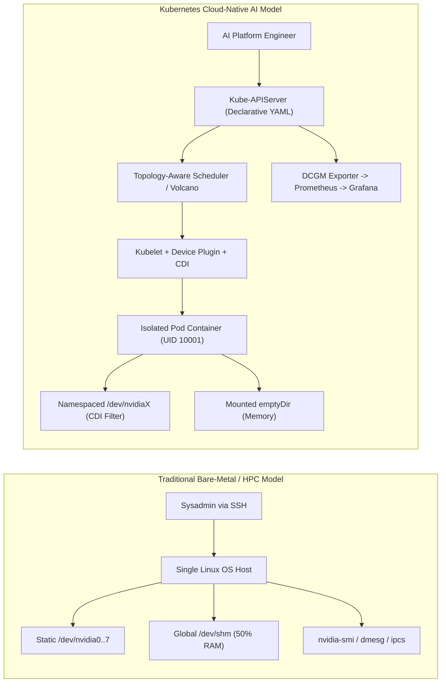
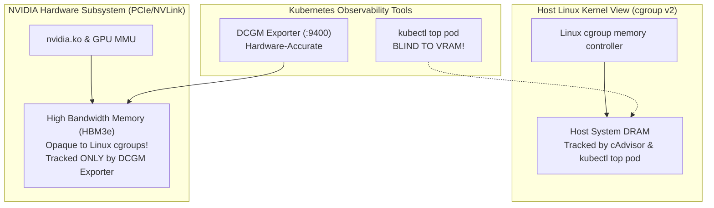

# 8. Linux Sysadmin to Kubernetes AI Platform Bridge

> **Target Audience**: HPC cluster administrators, Linux systems engineers, bare-metal GPU operators, and ML infrastructure engineers transitioning to Kubernetes AI operations.  
> **Companion CLI ([`KubeVRAM`](https://github.com/xsub/KubeVRAM))**: `kubevram bridge` | `kubevram topology` | `kubevram triage`

---

## 8.1 The Mental Model Shift: Bare-Metal vs. Kubernetes Orchestration

For decades, High Performance Computing (HPC) and deep learning infrastructure relied on static bare-metal nodes: administrators configured fixed device paths (`/dev/nvidia0`), tuned global `/dev/shm` memory mounts, monitored GPUs via cron-driven `nvidia-smi` queries, and managed jobs via Slurm or direct SSH access.

In Kubernetes, **the entire compute stack is virtualized, declarative, and ephemeral**:
- **Static devices become dynamic allocations**: Device nodes are injected on-demand into container cgroups via Container Device Interface (CDI) hooks.
- **Global host resources become isolated namespaces**: Host `/dev/shm` (often hundreds of gigabytes on bare metal) shrinks to a restrictive 64 MiB container tmpfs default unless explicitly overridden.
- **Root terminal debugging becomes API-driven telemetry**: Direct SSH commands are replaced by Prometheus DCGM metric streams, ephemeral debug containers (`kubectl debug`), and admission controller guardrails.



The sections below provide an exhaustive translation manual across all primary operational domains.

---

## 8.2 Hardware & PCIe Bus Discovery

In bare-metal Linux, discovering GPUs involves inspecting PCIe root complexes via `lspci` and querying NVML. In Kubernetes, this discovery is executed asynchronously by **Node Feature Discovery (NFD)** and **GPU Feature Discovery (GFD)**, publishing findings as searchable node labels and allocatable capacity.

| Bare-Metal Linux / CUDA Command | Kubernetes API / `kubectl` Equivalent | DCGM / Prometheus PromQL Equivalent | Architectural Difference & Pitfall |
| :--- | :--- | :--- | :--- |
| `lspci \| grep -i nvidia` | `kubectl get nodes -l feature.node.kubernetes.io/pci-10de.present=true` | `count(DCGM_FI_DEV_GPU_UTIL) by (Hostname)` | Bare-metal admins verify physical PCIe enumeration (`0000:81:00.0`). In K8s, pods do not see PCIe bus IDs unless granted raw sysfs mounts. Target nodes via NFD vendor labels (`0x10de` = NVIDIA). |
| `nvidia-smi -L` (List GPUs & UUIDs) | `kubectl get nodes -o custom-columns=NAME:.metadata.name,GPUS:.status.allocatable.'nvidia\.com/gpu'` | `count by (modelName, Hostname) (DCGM_FI_DEV_BRAND)` | `nvidia-smi -L` outputs global host indices (`GPU 0`, `GPU 1`). In K8s, GPU indices are localized per container: a pod requesting 1 GPU always sees its allocated device as `GPU 0` inside the container regardless of physical slot! |
| `nvidia-smi -q -d MEMORY` | `kubectl get node <node> -o jsonpath='{.metadata.labels.nvidia\.com/gpu\.memory}'` | `DCGM_FI_DEV_FB_TOTAL` | GFD labels memory in megabytes (e.g., `81920` for H100). Do not use `kubectl describe node` for real-time memory usage—K8s tracks GPU capacity as integer units, not bytes. |
| `ls -la /dev/nvidia*` | `kubectl get pods <pod> -o jsonpath='{.spec.containers[*].resources.limits}'` | `DCGM_FI_DEV_GPU_UTIL{exported_pod="<pod>"}` | In bare metal, all `/dev/nvidia*` nodes are visible to all users. In K8s with CDI, only allocated devices are injected into the container's device cgroup. |

### KubeVRAM Command Equivalent
```bash
# Bare-metal: nvidia-smi -L && lspci -tv
kubevram topology --nodes
```

---

## 8.3 Driver & Runtime Verification

Sysadmins accustomed to checking kernel modules via `lsmod` and inspecting system logs via `dmesg` must shift their attention to the **GPU Operator DaemonSet pods**.

| Bare-Metal Linux / CUDA Command | Kubernetes API / `kubectl` Equivalent | DCGM / Prometheus PromQL Equivalent | Architectural Difference & Pitfall |
| :--- | :--- | :--- | :--- |
| `lsmod \| grep nvidia` | `kubectl get pods -n gpu-operator -l app=nvidia-driver-daemonset` | `DCGM_FI_DRIVER_VERSION` | In containerized driver deployments, kernel modules are loaded by the privileged driver DaemonSet container. If modules fail to compile or load, inspect the driver pod logs. |
| `modinfo nvidia` | `kubectl describe daemonset -n gpu-operator nvidia-driver-daemonset \| grep Image:` | `DCGM_FI_DRIVER_VERSION{Hostname="<node>"}` | Driver version is determined by the container image tag in the GPU Operator `ClusterPolicy`, not host package managers (`apt`/`yum`). |
| `nvidia-container-cli info` | `kubectl get runtimeclasses` | `up{job="nvidia-operator-validator"}` | Validates that `nvidia-container-runtime` and CDI spec files (`/var/run/cdi/nvidia.yaml`) are correctly registered in containerd. Pods will fail to start if `runtimeClassName: nvidia` is missing. |
| `cat /etc/nvidia-container-runtime/config.toml` | `kubectl logs -n gpu-operator -l app=nvidia-container-toolkit-daemonset` | N/A | In K8s, container toolkit configuration is injected directly into containerd's `/etc/containerd/config.toml` via DaemonSet hooks, triggering a SIGHUP reload of the runtime. |

### KubeVRAM Command Equivalent
```bash
# Bare-metal: nvidia-smi && nvidia-container-cli info
kubevram bridge driver
```

---

## 8.4 GPU Compute & VRAM Telemetry

The most dangerous pitfall for Linux sysadmins transitioning to Kubernetes is relying on `kubectl top` or standard monitoring agents (like cAdvisor) for GPU metrics. **Linux cgroups cannot measure GPU High Bandwidth Memory (HBM).**

| Bare-Metal Linux / CUDA Command | Kubernetes API / `kubectl` Equivalent | DCGM / Prometheus PromQL Equivalent | Architectural Difference & Pitfall |
| :--- | :--- | :--- | :--- |
| `nvidia-smi` (Current VRAM & Util) | **NO NATIVE K8S COMMAND!** (`kubectl top pod` only shows host CPU/RAM) | `DCGM_FI_DEV_FB_USED` and `DCGM_FI_DEV_FB_FREE` | **CRITICAL PITFALL**: `kubectl top pod` showing `4GiB / 64GiB` does NOT mean the GPU is healthy. The GPU VRAM could be 99.9% full inside the hardware framebuffer! Always check DCGM. |
| `nvidia-smi dmon -s u` (SM Activity) | N/A | `DCGM_FI_PROF_SM_ACTIVE` | Bare-metal `GPU-Util %` is misleading for LLMs. An SM is marked "active" if even one thread executes. `DCGM_FI_PROF_SM_ACTIVE` measures the true fraction of cycles warps are active. |
| `nvidia-smi dmon -s m` (Memory Bandwidth) | N/A | `DCGM_FI_PROF_DRAM_ACTIVE` | Measures HBM3/HBM3e read/write saturation. In LLM autoregressive token decode, memory bandwidth saturation (`DRAM_ACTIVE > 0.80`) is the true throughput bottleneck. |
| `nvtop` / `gpustat` (Interactive Process Monitor) | `kubectl exec -it <pod> -- nvidia-smi` (if present) or `kubevram top` | `DCGM_FI_DEV_FB_USED{exported_pod=~".+"}` | Containers rarely bundle interactive tools like `nvtop`. Use Prometheus dashboards or `kubevram top` to aggregate live pod-level VRAM telemetry. |



### KubeVRAM Command Equivalent
```bash
# Bare-metal: nvidia-smi --query-gpu=utilization.gpu,memory.used,memory.free --format=csv -l 1
kubevram top --namespace inference-prod
```

---

## 8.5 Interconnect Fabric & NUMA Topology

High-throughput distributed training and inference (e.g., Llama-3-70B running with Tensor Parallelism $TP=4$ or $TP=8$) demand high-bandwidth peer-to-peer communication over NVLink or NVSwitch fabrics.

| Bare-Metal Linux / CUDA Command | Kubernetes API / `kubectl` Equivalent | DCGM / Prometheus PromQL Equivalent | Architectural Difference & Pitfall |
| :--- | :--- | :--- | :--- |
| `nvidia-smi topo -m` (NUMA / NVLink Matrix) | `kubectl get node <node> -o yaml \| grep -A 20 numa` (requires NFD topology rules) | `DCGM_FI_DEV_NVLINK_BANDWIDTH_TOTAL` | In bare-metal, users select adjacent GPUs manually (`export CUDA_VISIBLE_DEVICES=0,1`). Default `kube-scheduler` is topology-blind and may assign GPUs across different NUMA nodes or non-connected PCIe switches! |
| `nvidia-smi nvlink -s` (NVLink Link Status) | N/A | `DCGM_FI_DEV_NVLINK_LINK_STATE` | Verifies that physical NVLink lanes (e.g., 18 links on H100) are trained and active. Broken links silently downgrade bandwidth to PCIe Gen5 rates. |
| `numactl --hardware` | Kubelet `TopologyManager` configured with `single-numa-node` | N/A | Standard Kubelet allows GPU pods to run on CPU cores attached to NUMA Node 0 while accessing GPUs connected to NUMA Node 1, incurring severe QPI/UPI cross-socket latency penalties. |
| `ibv_devinfo` / `rdma link` (InfiniBand/RoCE) | `kubectl describe node <node> \| grep nvidia.com/rdma` | `DCGM_FI_PROF_NVLINK_TX_BYTES` | Bare-metal InfiniBand HCAs (`mlx5_0`) must be managed via the NVIDIA Network Operator or RDMA Shared Device Plugin to be requested in pod YAML. |

### KubeVRAM Command Equivalent
```bash
# Bare-metal: nvidia-smi topo -m
kubevram topology --nvlink-mesh
```

---

## 8.6 Shared Memory (`/dev/shm`) & POSIX IPC Limits

This domain causes more unexpected Day-2 outages than almost any other when bare-metal engineers deploy PyTorch workloads to Kubernetes.

| Bare-Metal Linux / CUDA Command | Kubernetes API / `kubectl` Equivalent | DCGM / Prometheus PromQL Equivalent | Architectural Difference & Pitfall |
| :--- | :--- | :--- | :--- |
| `df -h /dev/shm` | Container volume mount: `mountPath: /dev/shm` backed by `emptyDir: { medium: Memory }` | `container_fs_usage_bytes{mountpoint="/dev/shm"}` | **THE 64 MiB TRAP**: In Linux, `/dev/shm` defaults to 50% of total host RAM (e.g., 256 GiB). In standard Docker/Kubernetes, **`/dev/shm` defaults to exactly 64 MiB**! PyTorch DataLoader workers and NCCL ring buffers will immediately crash with `SIGBUS` (`Exit 135`). |
| `ipcs -m` (POSIX Shared Memory Segments) | Pod spec: `shareProcessNamespace: true` (if sharing IPC across containers) | N/A | In bare metal, all processes under the same user share the host IPC namespace. In K8s, each container has an isolated IPC namespace by default. |
| `ulimit -l` (Locked Memory Limits) | Pod `securityContext.capabilities.add: ["IPC_LOCK"]` or container runtime limit | N/A | GPUDirect RDMA and NCCL require pinning host memory (`mlock`). On bare metal, this is configured in `/etc/security/limits.conf`. In K8s, specify memory limits and IPC capabilities declaratively. |
| `cat /proc/sys/kernel/shmmax` | Node tuning via `sysctl` in pod security context or machine daemon | N/A | Shared memory segment upper bound. Pods cannot adjust host sysctls unless granted privilege or configured through safe sysctl whitelists. |

### Remediation Blueprint: Declarative `/dev/shm` Allocation

Every multi-GPU pod specification must include an in-memory `emptyDir` mount:

```yaml
spec:
  volumes:
    - name: dshm
      emptyDir:
        medium: Memory
        sizeLimit: 16Gi     # Carved out of pod's resources.limits.memory
  containers:
    - name: vllm-worker
      volumeMounts:
        - name: dshm
          mountPath: /dev/shm
```

---

## 8.7 Fault Diagnosis, Kernel Events & OOM Triage

When a bare-metal job fails, engineers inspect `/var/log/messages`, run `dmesg -T`, or run diagnostic tools like `dcgmi diag`. In Kubernetes, logs and termination reasons are distributed across multiple control plane objects.

| Bare-Metal Linux / CUDA Command | Kubernetes API / `kubectl` Equivalent | DCGM / Prometheus PromQL Equivalent | Architectural Difference & Pitfall |
| :--- | :--- | :--- | :--- |
| `dmesg -T \| grep -E "NVRM: Xid"` | `kubectl get events --field-selector reason=Failed` and DCGM metric alerts | `DCGM_FI_DEV_XID_ERRORS` | Silicon hardware faults (e.g., XID 79, XID 95) emit kernel messages to the host kernel log. Pods do not receive kernel dmesg; platform teams must alert on `DCGM_FI_DEV_XID_ERRORS > 0`. |
| `cat /sys/fs/cgroup/memory.events` (`oom_kill`) | `kubectl describe pod <pod>` -> Look for `Last State: Terminated, Reason: OOMKilled, Exit Code: 137` | `kube_pod_container_status_last_terminated_reason{reason="OOMKilled"}` | **OOM DISAMBIGUATION**: Exit 137 indicates the **Linux cgroup killed the container due to host DRAM exhaustion** (`memory.max`). It does NOT mean the GPU ran out of VRAM! |
| PyTorch `torch.cuda.OutOfMemoryError` in logs | `kubectl logs <pod> --previous` -> Check for `CUDA out of memory` with `Exit Code: 1` | `label_replace(DCGM_FI_DEV_FB_USED, "pod", "$1", "exported_pod", "(.*)") / ... > 0.95` | CUDA VRAM exhaustion terminates PyTorch with **Exit Code 1**, NOT 137. Do not increase K8s `limits.memory` to resolve a CUDA VRAM OOM! |
| `dcgmi diag -r 3` (Comprehensive HW Diagnostic) | `kubectl run gpu-diag --image=nvidia/dcgm:latest --restart=Never -- dcgmi diag -r 3` | `DCGM_FI_DEV_DIAG_RESULT` | Bare-metal sysadmins run DCGM diagnostics directly. On K8s, run ephemeral diagnostic jobs or use the Operator Validator pod. |

### KubeVRAM Command Equivalent
```bash
# Bare-metal: dmesg -T | grep Xid && tail -n 50 /var/log/syslog
kubevram triage --pod <pod-name>
```

---

## 8.8 Process Management, Quotas & Resource Fencing

On bare metal, administrators kill hung jobs via `kill -9 <PID>`, check file descriptors via `fuser -v /dev/nvidia*`, and manage priorities with Slurm partitions. In Kubernetes, imperative process killing destabilizes Kubelet; operations must proceed through the Kubernetes API.

| Bare-Metal Linux / CUDA Command | Kubernetes API / `kubectl` Equivalent | DCGM / Prometheus PromQL Equivalent | Architectural Difference & Pitfall |
| :--- | :--- | :--- | :--- |
| `kill -9 <PID>` or `pkill -f python` | `kubectl delete pod <pod> --grace-period=30` | N/A | **DO NOT SSH AND KILL CONTAINER PROCESSES DIRECTLY!** Killing host PIDs causes container runtime state desynchronization. Delete the pod resource via the API. |
| `fuser -v /dev/nvidia*` (Find processes holding GPU) | `kubectl get pods --all-namespaces -o wide` mapped against node GPU allocatables | `DCGM_FI_DEV_COMPUTE_PIDS` | Lists PIDs holding open contexts on `/dev/nvidia*`. In K8s, use DCGM compute PID metrics to identify rogue pods blocking driver unloads or MIG re-partitioning. |
| `nvidia-smi -r` (GPU Reset) | Drain and reboot worker node, or run privileged Operator recovery container | `DCGM_FI_DEV_RESET_STATUS` | Issuing a GPU reset on a running K8s node while other containers hold GPU contexts causes kernel panics and `XID 79` crashes across co-tenants. Cordon and drain the node first! |
| Slurm Partition Quotas (`sinfo` / `sbatch`) | `ResourceQuota` / Run:ai `Queue` / Kueue `LocalQueue` | `kube_resourcequota{resource="requests.nvidia.com/gpu"}` | Kubernetes enforces GPU quotas declaratively per namespace or hierarchical fair-share queue. |

---

## 8.9 Master Translation Quick-Reference Card

| Operational Goal | Traditional Linux / HPC Command | Kubernetes Cloud-Native Command |
| :--- | :--- | :--- |
| **Inspect GPU Utilization** | `nvidia-smi` | `kubevram top` OR Query `DCGM_FI_DEV_GPU_UTIL` in Grafana |
| **Inspect VRAM Consumption** | `nvidia-smi --query-gpu=memory.used` | Query `DCGM_FI_DEV_FB_USED` in Prometheus |
| **Check Process Exit Reason** | `dmesg -T \| grep oom` OR Check exit status | `kubectl describe pod <pod>` -> `Last State` |
| **Inspect Hardware Faults** | `dmesg -T \| grep -i xid` | `kubectl get events` OR Query `DCGM_FI_DEV_XID_ERRORS` |
| **Fix Shared Memory Crashes** | Edit `/etc/fstab` (mount `-o remount,size=64G /dev/shm`) | Add `emptyDir: { medium: Memory, sizeLimit: 16Gi }` to Pod Spec |
| **Verify Driver Stack** | `lsmod \| grep nvidia && modinfo nvidia` | `kubectl get pods -n gpu-operator` |
| **Select GPU Topology** | `export CUDA_VISIBLE_DEVICES=0,1` | Configure Kubelet `TopologyManager` + Volcano `PodGroup` |
| **Evict Bad Hardware** | `scontrol drain <node>` | `kubectl cordon <node> && kubectl drain <node> --ignore-daemonsets` |
