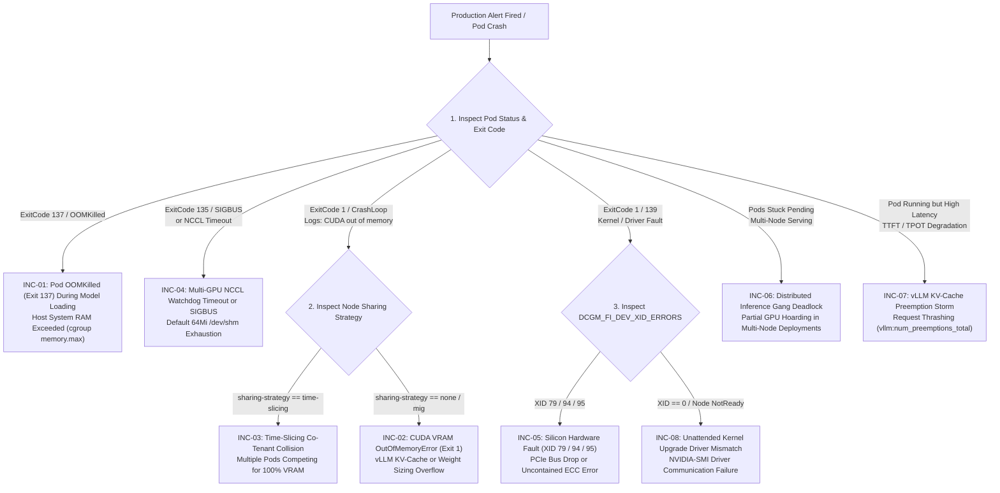

# 9. Day-2 GPU Incident Response Runbooks

> **Target Audience**: SRE On-Call Engineers, Kubernetes Platform Engineers, and AI Infrastructure Teams.  
> **Companion CLI ([`KubeVRAM`](https://github.com/xsub/KubeVRAM))**: `kubevram triage` | `kubevram top` | `kubevram bridge`  
> **Alerting Reference**: [`prometheus-gpu-oom-alerts.yaml`](../manifests/05-observability/prometheus-gpu-oom-alerts.yaml)

---

## Master Incident Triage Matrix

When a high-priority incident triggers for a GPU workload, use the master decision tree to locate the appropriate runbook immediately:



---

## INC-01: Pod `OOMKilled` (`Exit 137`) During Weight Loading (GPU VRAM < 15%)

### Symptoms
- Pod enters `CrashLoopBackOff` during container startup.
- `kubectl describe pod` displays `Last State: Terminated, Reason: OOMKilled, Exit Code: 137`.
- Container logs terminate abruptly during `safetensors` or HuggingFace checkpoint deserialization (e.g., `Loading model weights 42% ... Killed`).
- Prometheus displays GPU VRAM utilization (`DCGM_FI_DEV_FB_USED`) remained below 15% before termination.

### Telemetry Signatures
```promql
# Prometheus Rule 1: Host System RAM OOM on GPU Pod
(kube_pod_container_status_last_terminated_reason{reason="OOMKilled"} == 1)
and on(namespace, pod)
(kube_pod_container_resource_requests{resource="nvidia_com_gpu"} > 0)
```
```bash
# Node cgroup memory controller events:
cat /sys/fs/cgroup/system.slice/.../memory.events | grep oom_kill
# Shows positive count increments
```

### Diagnostic Commands
```bash
# 1. Verify container termination reason and memory limits
kubectl get pod <pod-name> -n <namespace> -o jsonpath='{range .status.containerStatuses[*]}{.name}{": lastExitCode="}{.lastState.terminated.exitCode}{" reason="}{.lastState.terminated.reason}{"\n"}{end}'

# 2. Check host RAM usage and container memory limit
kubectl get pod <pod-name> -n <namespace> -o jsonpath='{.spec.containers[*].resources.limits.memory}'

# 3. Correlate with KubeVRAM triage
kubevram triage --pod <pod-name> -n <namespace>
```

### Root Cause
When loading large LLM checkpoints (e.g. 70B parameters, $\sim 140\text{ GiB}$ unquantized or $\sim 70\text{ GiB}$ FP8), standard PyTorch loaders deserialize weights into **host system DRAM** before copying them onto the GPU. If `resources.limits.memory` is set too low (e.g., `32Gi` or `64Gi`), the Linux kernel cgroup `memory.max` threshold is breached, triggering the Linux OOM Killer (`SIGKILL` 137).

### Immediate Mitigation (Incident Run)
1. Patch the deployment to double host memory limits temporarily:
   ```bash
   kubectl patch deployment <deployment-name> -n <namespace> --type='json' -p='[
     {"op": "replace", "path": "/spec/template/spec/containers/0/resources/limits/memory", "value": "128Gi"},
     {"op": "replace", "path": "/spec/template/spec/containers/0/resources/requests/memory", "value": "128Gi"}
   ]'
   ```
2. If host node memory is saturated, schedule onto a high-memory compute pool.

### Permanent Declarative Fix
1. Configure model serving to stream weights directly into GPU memory via zero-copy safetensors memory mapping or pass `--load-format=safetensors` to vLLM.
2. In the Pod specification, ensure host DRAM limits are at least $1.5\times$ to $2.0\times$ the uncompressed model checkpoint size:
   ```yaml
   resources:
     limits:
       cpu: "16"
       memory: "128Gi"         # Sufficient host DRAM to stage model tensors
       nvidia.com/gpu: "2"
     requests:
       cpu: "16"
       memory: "128Gi"
       nvidia.com/gpu: "2"
   ```

---

## INC-02: `torch.cuda.OutOfMemoryError` (`Exit 1`) on vLLM Startup or Burst

### Symptoms
- Pod crashes with `Exit Code: 1` (Reason: `Error`, NOT `OOMKilled`).
- Log output shows Python traceback:
  ```text
  torch.cuda.OutOfMemoryError: CUDA out of memory. Tried to allocate 1.20 GiB. GPU 0 has 79.15 GiB total capacity of which 420.00 MiB is free.
  ```
  OR vLLM internal allocation error:
  ```text
  ValueError: The model's max seq len (131072) is larger than the maximum number of tokens that can be stored in KV cache (49152).
  ```

### Telemetry Signatures
```promql
# GPU Framebuffer Saturation Alert
(DCGM_FI_DEV_FB_USED / (DCGM_FI_DEV_FB_USED + DCGM_FI_DEV_FB_FREE)) * 100 > 98
```
```promql
# vLLM KV Cache Usage Saturation
vllm:gpu_cache_usage_perc{namespace="<namespace>"} >= 1.0
```

### Diagnostic Commands
```bash
# 1. Inspect recent pod termination logs
kubectl logs <pod-name> -n <namespace> --previous | grep -E "OutOfMemoryError|ValueError|KV cache"

# 2. Check physical GPU VRAM capacity on the node
kubectl describe node <node-name> | grep nvidia.com/gpu.memory

# 3. Inspect vLLM startup flags in deployment
kubectl get deployment <deployment-name> -n <namespace> -o yaml | grep -E "gpu-memory-utilization|max-model-len|tensor-parallel-size"
```

### Root Cause
vLLM allocates VRAM across three primary pools:
$$\text{Total VRAM} = \text{Model Weights} + \text{CUDA Graphs Overhead} + \text{PagedAttention KV-Cache Pool}$$
If `gpu-memory-utilization` is set to `0.90` (default) but the model weights plus CUDA Graph allocations require 85% of physical VRAM, only 5% remains for the KV-cache. When `--max-model-len` requires more KV blocks than fit in that 5%, vLLM throws a fatal initialization exception.

### Immediate Mitigation (Incident Run)
Lower `--gpu-memory-utilization` and reduce `--max-model-len` to allow successful initialization:
```bash
kubectl set args deployment/<deployment-name> -n <namespace> \
  -- vllm serve /models/meta-llama-3-70b \
  --tensor-parallel-size=2 \
  --gpu-memory-utilization=0.92 \
  --max-model-len=16384 \
  --enforce-eager
```
*(Adding `--enforce-eager` disables CUDA graph capture, saving 1.5–3.0 GiB of scratch VRAM immediately at the cost of slight latency).*

### Permanent Declarative Fix
1. Enable FP8 KV-caching (`--kv-cache-dtype=fp8`) to halve the KV-cache footprint per token.
2. If context length cannot be reduced, shard the model across more GPUs by increasing `--tensor-parallel-size` (e.g. from 2 to 4).
3. Update deployment manifest:
   ```yaml
   args:
     - "--model"
     - "meta-llama/Meta-Llama-3-70B-Instruct"
     - "--tensor-parallel-size"
     - "4"
     - "--gpu-memory-utilization"
     - "0.90"
     - "--kv-cache-dtype"
     - "fp8"
     - "--max-model-len"
     - "32768"
   ```

---

## INC-03: Time-Slicing Co-Tenant VRAM Collision Storm

### Symptoms
- Multiple inference pods assigned to the same physical GPU enter alternating `CrashLoopBackOff`.
- Log signatures on failing pods:
  ```text
  torch.cuda.OutOfMemoryError: Tried to allocate 2.00 GiB. GPU 0 has 45.12 GiB allocated by other processes!
  ```
- Node exhibits flapping `NotReady` or pods constantly crashing with `Exit Code 1`.

### Telemetry Signatures
```promql
# Detect Pod Restarts on Nodes with Time-Slicing Sharing Strategy
(increase(kube_pod_container_status_restarts_total[10m]) > 2)
and on(node)
(kube_node_labels{label_nvidia_com_gpu_sharing_strategy="time-slicing"} == 1)
```

### Diagnostic Commands
```bash
# 1. Identify which pods are co-located on the same physical GPU
kubectl get pods -A -o wide --field-selector spec.nodeName=<node-name>

# 2. Check the node's GPU sharing strategy
kubectl get node <node-name> -o jsonpath='{.metadata.labels.nvidia\.com/gpu\.sharing-strategy}'

# 3. Check live compute PIDs on the GPU via DCGM
kubectl exec -n gpu-operator ds/nvidia-dcgm-exporter -- dcgmi diag -r 1
```

### Root Cause
The node is configured with **Time-Slicing** (e.g., 2 replicas per GPU via `time-slicing-and-mps-configmap.yaml`). Time-slicing provides temporal compute sharing but **zero memory isolation**. Tenant Pod A starts, pre-allocates 90% of physical VRAM. Tenant Pod B starts 30 seconds later, attempts to allocate its model weights, and crashes with `CUDA out of memory`. When Tenant Pod A restarts or scales, Pod B may grab the VRAM, causing Pod A to crash in an infinite race condition.

### Immediate Mitigation (Incident Run)
1. Immediately delete one of the conflicting workloads or cordoned the node:
   ```bash
   kubectl scale deployment/<co-tenant-b> -n <namespace> --replicas=0
   ```
2. If running vLLM, patch all pods on time-sliced nodes to cap memory at $\le 42\%$:
   ```bash
   kubectl set env deployment/<deployment-name> -n <namespace> VLLM_GPU_MEMORY_UTILIZATION="0.42"
   ```

### Permanent Declarative Fix
1. **Never use Time-Slicing for vLLM or PagedAttention engines without strict utilization caps!**
2. Migrate multi-tenant workloads to hardware **MIG (Multi-Instance GPU)** partitions (e.g. `nvidia.com/mig-3g.40gb` on A100/H100) which enforce physical hardware memory boundaries.
3. Apply the CEL Validating Admission Policy Guardrail 4 to reject un-capped deployments on time-sliced nodes (see Section 7.4).

---

## INC-04: Multi-GPU NCCL Watchdog Timeout or `SIGBUS` (`Exit 135`)

### Symptoms
- Multi-GPU distributed inference pod (`TP >= 2`) crashes with `Exit Code: 135` (`128 + SIGBUS`).
- OR pod hangs indefinitely during prompt processing until terminated by NCCL watchdog:
  ```text
  RuntimeError: NCCL communicator error: unhandled system error / NCCL WARN Call to posix_fallocate failed : No space left on device (/dev/shm/nccl-...)
  Watchdog caught collective operation timeout: WorkNCCL(OpType=ALLREDUCE, Timeout(ms)=600000)
  ```

### Telemetry Signatures
```promql
# Alert: Container Terminated with SIGBUS (135)
kube_pod_container_status_last_terminated_reason{exit_code="135"} == 1
```
```bash
# Check container mount point sizing inside pod:
df -h /dev/shm
# Shows Filesystem: shm, Size: 64M, Used: 64M (100% full!)
```

### Diagnostic Commands
```bash
# 1. Verify container exit code and signal
kubectl get pod <pod-name> -n <namespace> -o jsonpath='{.status.containerStatuses[0].lastState.terminated}'

# 2. Check whether /dev/shm volume is declared
kubectl get pod <pod-name> -n <namespace> -o jsonpath='{.spec.volumes[?(@.name=="dshm")]}'

# 3. Check NCCL environment variables in pod
kubectl get pod <pod-name> -n <namespace> -o jsonpath='{.spec.containers[0].env[?(@.name=="NCCL_DEBUG")]}'
```

### Root Cause
Multi-GPU tensor parallelism requires NCCL (NVIDIA Collective Communications Library) to coordinate `AllReduce` rings across GPUs. NCCL utilizes Linux POSIX shared memory (`/dev/shm`) for internal ring buffers and IPC channels. In Kubernetes, containers default to a 64 MiB `/dev/shm` tmpfs. When NCCL attempts `posix_fallocate` for its communication ring, the 64 MiB limit is instantly breached, triggering a fatal `SIGBUS` (`Exit 135`) or a silent thread lockup resulting in a watchdog timeout.

### Immediate Mitigation (Incident Run)
Hot-patch the workload pod template to mount an `emptyDir` memory volume:
```bash
kubectl patch deployment <deployment-name> -n <namespace> --type='json' -p='[
  {"op": "add", "path": "/spec/template/spec/volumes/-", "value": {"name": "dshm", "emptyDir": {"medium": "Memory", "sizeLimit": "16Gi"}}},
  {"op": "add", "path": "/spec/template/spec/containers/0/volumeMounts/-", "value": {"name": "dshm", "mountPath": "/dev/shm"}}
]'
```

### Permanent Declarative Fix
1. Enforce CEL Validating Admission Policy Guardrail 3 (`vap-gpu-inference-guardrails.yaml`) cluster-wide to reject any multi-GPU pod missing an explicit `/dev/shm` memory mount.
2. Configure NCCL diagnostic flags in the pod specification:
   ```yaml
   env:
     - name: NCCL_DEBUG
       value: "WARN"
     - name: NCCL_ASYNC_ERROR_HANDLING
       value: "1"
   volumeMounts:
     - name: dshm
       mountPath: /dev/shm
   volumes:
     - name: dshm
       emptyDir:
         medium: Memory
         sizeLimit: 16Gi
   ```

---

## INC-05: Hardware Silicon Fault — `XID 79` & `XID 94/95`

### Symptoms
- Pod crashes with `Exit Code: 1` or `139` (`SIGSEGV`).
- `nvidia-smi` on the node hangs or outputs:
  ```text
  Unable to determine the device handle for GPU 0000:81:00.0: GPU has fallen off the bus.
  ```
- Host kernel logs (`dmesg`) report:
  ```text
  NVRM: Xid (PCI:0000:81:00): 79, GPU has fallen off the bus.
  NVRM: Xid (PCI:0000:81:00): 95, Uncontained ECC error, contained=0
  ```

### Telemetry Signatures
```promql
# Critical Alert: Fatal NVIDIA Hardware XID Fault
(DCGM_FI_DEV_XID_ERRORS == 79 or DCGM_FI_DEV_XID_ERRORS == 94 or DCGM_FI_DEV_XID_ERRORS == 95) > 0
```

### Diagnostic Commands
```bash
# 1. Query DCGM hardware fault counters
kubectl exec -n gpu-operator ds/nvidia-dcgm-exporter -- dcgmi diag -r 3

# 2. Inspect host dmesg via privileged debug container
kubectl debug node/<node-name> -it --image=busybox -- chroot /host dmesg -T | grep -E "NVRM|Xid"

# 3. Check KubeVRAM hardware fault assessment
kubevram triage --xid
```

### Root Cause
- **`XID 79` (GPU Fallen Off the Bus)**: The GPU stopped responding on the PCIe link due to physical hardware failure, PCIe riser power loss, extreme thermal throttling, or fatal firmware hang.
- **`XID 94/95` (Uncontained ECC Error)**: Double-bit uncorrectable memory flip occurred in physical High Bandwidth Memory (HBM). Because data integrity cannot be guaranteed, the GPU immediately halts execution to prevent data corruption.
- **DANGER**: Simply restarting the pod will result in immediate re-crash or silent inference corruption. The physical node must be cordoned immediately.

### Immediate Mitigation (Incident Run)
1. **Cordon and taint the affected node immediately** to prevent any new pods from scheduling:
   ```bash
   kubectl cordon <node-name>
   kubectl taint nodes <node-name> nvidia.com/gpu-hardware-fault=true:NoSchedule
   ```
2. Evict healthy pods safely to other nodes in the cluster:
   ```bash
   kubectl drain <node-name> --delete-emptydir-data --ignore-daemonsets --force
   ```
3. Attempt PCIe link secondary bus reset (if supported) or initiate a warm reboot of the node:
   ```bash
   # Privileged host command
   systemctl reboot
   ```

### Permanent Declarative Fix
1. If ECC errors (`XID 95`) persist after reboot, inspect remapped row status via `nvidia-smi -q -d RETIRED_PAGES,REMAPPED_ROWS`. If remap pending rows fail, RMA the physical GPU card with the hardware vendor.
2. Deploy the automated node problem detector (NPD) with custom system log monitor rules to cordon nodes automatically when `XID 79` or `XID 95` appear in dmesg.

---

## INC-06: Distributed Inference Gang Deadlock (Partial GPU Hoarding)

### Symptoms
- Large model deployment (e.g., DeepSeek-R1 or Llama-3-405B requiring 16 GPUs across 2 nodes) is partially scheduled.
- Worker 0 is `Running` on Node A holding 8 GPUs.
- Worker 1 is stuck in `Pending` indefinitely because Node B only has 7 GPUs free.
- Cluster GPU utilization drops to 0%, but other batch workloads are blocked from scheduling.

### Telemetry Signatures
```promql
# Detect Pod Stuck in Pending while Gang Siblings are Running
(kube_pod_status_phase{phase="Pending"} == 1)
and on(namespace)
(count by (namespace) (kube_pod_status_phase{phase="Running"}) > 0)
```

### Diagnostic Commands
```bash
# 1. Check scheduling failure reason for pending worker
kubectl describe pod <pending-worker-pod> -n <namespace> | grep -A 5 Events:
# Output: 0/16 nodes are available: 16 Insufficient nvidia.com/gpu

# 2. Check Volcano PodGroup status
kubectl get podgroup -n <namespace> -o yaml
```

### Root Cause
The default Kubernetes `kube-scheduler` evaluates pods independently and sequentially without **Gang Scheduling** semantics. When a distributed multi-node inference job scales up, the default scheduler places the first pod as soon as partial resources are found. If remaining nodes lack capacity, the first pod continues to hoard its 8 GPUs while waiting indefinitely for its peers, deadlocking the cluster.

### Immediate Mitigation (Incident Run)
1. Delete the partially scheduled deployment to release the hoarded GPUs:
   ```bash
   kubectl delete deployment <deadlocked-deployment> -n <namespace>
   ```
2. Free up capacity on the target node pool by temporarily scaling down batch jobs.

### Permanent Declarative Fix
Deploy distributed inference workloads using **Volcano** or **KubeRay** with explicit `PodGroup` declarations and `minMember` requirements (see [`manifests/03-scheduling/volcano-gang-distributed-vllm.yaml`](../manifests/03-scheduling/volcano-gang-distributed-vllm.yaml)):

```yaml
apiVersion: scheduling.volcano.sh/v1beta1
kind: PodGroup
metadata:
  name: distributed-vllm-70b-gang
  namespace: inference-prod
spec:
  minMember: 2             # BOTH pods must be schedulable simultaneously!
  minResources:
    nvidia.com/gpu: "16"   # 2 nodes x 8 GPUs
    cpu: "64"
    memory: "512Gi"
```
The Volcano scheduler ensures that either **all 16 GPUs are allocated at the exact same instant**, or zero pods are scheduled, eliminating GPU hoarding deadlocks.

---

## INC-07: TTFT / TPOT Latency Spike via KV-Cache Preemption Storm

### Symptoms
- End-user API latency degrades catastrophically: Time-To-First-Token (TTFT) jumps from 120 ms to $> 4000\text{ ms}$; Time-Per-Output-Token (TPOT) degrades from 20 ms to $> 150\text{ ms}$.
- Inference pods remain in `Running` state without restarting.
- vLLM logs show rapid preemption warnings:
  ```text
  WARNING 11-04 02:14:12 scheduler.py:182] Sequence group 42 is preempted by PreemptionMode.RECOMPUTE mode because of lack of GPU memory.
  ```

### Telemetry Signatures
```promql
# Critical Alert: Active KV-Cache Preemption Storm
rate(vllm:num_preemptions_total[5m]) > 0
```
```promql
# Correlate with Request Queue Depth
vllm:num_requests_waiting > 10
```

### Diagnostic Commands
```bash
# 1. Scrape live vLLM engine metrics
kubectl port-forward <vllm-pod-name> 8000:8000 &
curl -s http://localhost:8000/metrics | grep -E "vllm:num_preemptions|vllm:gpu_cache_usage_perc|vllm:num_requests"

# 2. Inspect active concurrency and waiting queues
kubevram top --metrics vllm
```

### Root Cause
Under sustained traffic bursts, the number of concurrent generation requests exceeded the PagedAttention memory capacity. When `vllm:gpu_cache_usage_perc` reached `100%`, the vLLM scheduler was forced to **preempt in-flight generation sequences** by discarding their KV-caches. When those requests are resumed later, their entire prompt prefix must be **recomputed from scratch**, saturating SM Tensor Cores and starving new inbound requests.

### Immediate Mitigation (Incident Run)
1. Immediately shed inbound traffic at the ingress gateway (Istio / Envoy) or activate request rate limiting.
2. Reduce the maximum concurrent sequences processed by the engine:
   ```bash
   kubectl set env deployment/<deployment-name> -n <namespace> VLLM_MAX_NUM_SEQS="64"
   ```
3. Scale out the inference replica count horizontally:
   ```bash
   kubectl scale deployment/<deployment-name> -n <namespace> --replicas=6
   ```

### Permanent Declarative Fix
1. Configure **KEDA (Kubernetes Event-driven Autoscaling)** to scale out replicas based on `vllm:gpu_cache_usage_perc > 0.80` *before* the engine reaches 100% saturation.
2. Enable chunked prefill (`--enable-chunked-prefill`) to interleave prompt prefill and token generation without starving in-flight sequences.
3. Configure FP8 KV-caching (`--kv-cache-dtype=fp8`) to double KV-cache block capacity.

---

## INC-08: Unattended Host Kernel Upgrade Broke Driver Communication

### Symptoms
- After an automatic OS patch or node reboot, all GPU pods on the node fail with:
  ```text
  Failed to initialize NVML: Driver/library version mismatch
  NVIDIA-SMI has failed because it couldn't communicate with the NVIDIA driver.
  ```
- Kubelet marks `nvidia.com/gpu: 0` allocatable capacity on the node.
- All GPU workloads on the node are evicted or stuck in `Pending`.

### Telemetry Signatures
```promql
# Alert: GPU Operator Driver DaemonSet Pod Crash / Error
kube_pod_status_phase{namespace="gpu-operator", phase="Failed"} > 0
```
```promql
# Node Allocatable GPU Drops to Zero
kube_node_status_allocatable{resource="nvidia_com_gpu"} == 0
```

### Diagnostic Commands
```bash
# 1. Inspect GPU Operator driver pod logs
kubectl logs -n gpu-operator -l app=nvidia-driver-daemonset --tail=100

# 2. Compare running kernel version with driver image target
kubectl get nodes -o custom-columns=NAME:.metadata.name,KERNEL:.status.nodeInfo.kernelVersion

# 3. Inspect containerd and driver status via debug pod
kubectl debug node/<node-name> -it --image=busybox -- chroot /host uname -r
```

### Root Cause
The host OS performed an unattended kernel security upgrade (e.g. from `6.5.0-35-generic` to `6.5.0-41-generic`). On reboot, the newly booted kernel does not match the precompiled kernel module in the NVIDIA Driver container image (`usePrecompiled: true`). The driver container fails to insert `nvidia.ko`, NVML fails, and the NVIDIA Device Plugin cannot register any GPUs with Kubelet.

### Immediate Mitigation (Incident Run)
1. Cordon the node immediately:
   ```bash
   kubectl cordon <node-name>
   ```
2. Disable precompiled driver enforcement temporarily in the GPU Operator `ClusterPolicy` to let the driver container compile modules via DKMS against the new kernel:
   ```bash
   kubectl patch clusterpolicy cluster-policy --type='json' -p='[
     {"op": "replace", "path": "/spec/driver/usePrecompiled", "value": false}
   ]'
   ```
3. Restart the driver DaemonSet pod on the broken node:
   ```bash
   kubectl delete pod -n gpu-operator -l app=nvidia-driver-daemonset --field-selector spec.nodeName=<node-name>
   ```

### Permanent Declarative Fix
1. **Disable unattended kernel upgrades on GPU worker nodes!** Pin the Linux kernel package via `apt-mark hold linux-image-generic linux-headers-generic`.
2. Follow the rolling upgrade policy defined in [`manifests/01-hardware-orchestration/gpu-operator-clusterpolicy.yaml`](../manifests/01-hardware-orchestration/gpu-operator-clusterpolicy.yaml) with an explicit Driver Upgrade Controller cordon/drain workflow.
