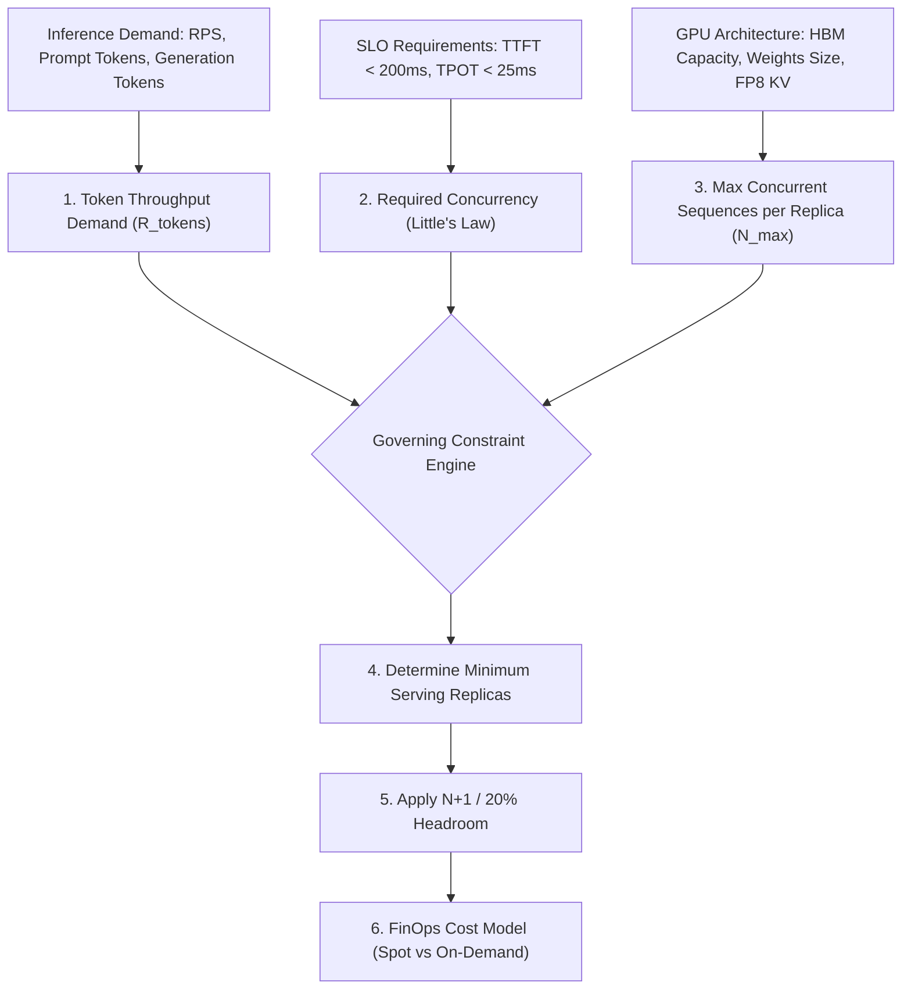

# 10. Production Readiness Checklist & GPU Capacity Planning

> **Target Audience**: Platform Architects, SRE Leads, and FinOps Practitioners certifying Kubernetes GPU clusters for production workloads.  
> **Companion CLI ([`KubeVRAM`](https://github.com/xsub/KubeVRAM))**: `kubevram audit` | `kubevram topology` | `kubevram tune-vllm`

---

## 10.1 The 6-Domain Pre-Flight Production Readiness Checklist

Before onboarding enterprise production inference traffic to a Kubernetes GPU cluster, certify every requirement across the six operational domains:

---

### Domain 1: Node & Kernel Layer

| Checkpoint | Production Requirement | Verification Command / Metric | Severity |
| :--- | :--- | :--- | :--- |
| **IOMMU & VFIO** | VT-d / AMD-Vi enabled in BIOS; `intel_iommu=on iommu=pt` set in kernel bootline for SR-IOV and DMA pass-through. | `dmesg \| grep -E "IOMMU\|DMAR"` | **BLOCKER** |
| **Kernel Version Pinning** | Automatic unattended kernel upgrades are disabled (`apt-mark hold linux-image-generic`). Kernel version matches precompiled NVIDIA driver target. | `uname -r && dpkg --get-selections \| grep linux-image` | **BLOCKER** |
| **cgroup v2 & Systemd** | Kubelet and containerd running with native `systemd` cgroup v2 driver. Legacy cgroup v1 disabled. | `stat -fc %T /sys/fs/cgroup/` (must return `cgroup2fs`) | **BLOCKER** |
| **Hugepages Support** | 2 MiB / 1 GiB Hugepages allocated for DPDK, GPUDirect RDMA, and high-throughput memory mapping. | `grep HugePages_Total /proc/meminfo` | **HIGH** |
| **PCIe AER & Relaxed Ordering** | Advanced Error Reporting (AER) active; PCIe Access Control Services (ACS) enabled for peer-to-peer isolation. | `lspci -vvv \| grep -i "AERCap"` | **HIGH** |
| **NUMA Architecture Balance** | Host CPU sockets, PCIe bridges, and memory channels balanced across NUMA nodes without cross-socket latency penalty. | `numactl --hardware` | **HIGH** |

---

### Domain 2: GPU Operator & Partitioning

| Checkpoint | Production Requirement | Verification Command / Metric | Severity |
| :--- | :--- | :--- | :--- |
| **ClusterPolicy State** | NVIDIA GPU Operator `ClusterPolicy` in `Ready` state across all driver, toolkit, device-plugin, and GFD daemonsets. | `kubectl get clusterpolicy cluster-policy -o jsonpath='{.status.state}'` | **BLOCKER** |
| **Decoupled Drivers** | Drivers loaded via precompiled container images (`usePrecompiled: true`) to guarantee 25-second node spin-up times. | `kubectl logs -n gpu-operator -l app=nvidia-driver-daemonset` | **BLOCKER** |
| **RuntimeClass Registered** | `nvidia` RuntimeClass active and verified with containerd CDI specification (`/var/run/cdi/nvidia.yaml`). | `kubectl get runtimeclass nvidia` | **BLOCKER** |
| **Partitioning Strategy Match** | Nodes labeled with explicit `nvidia.com/gpu.sharing-strategy` (`none`, `mig`, or `time-slicing`). | `kubectl get nodes -L nvidia.com/gpu.sharing-strategy` | **BLOCKER** |
| **MIG Profile Validation** | On A100/H100 clusters, MIG profiles are partitioned symmetrically via `mig-parted` (e.g. `mig-3g.40gb`). | `nvidia-smi mig -lgi` inside operator validator | **HIGH** |
| **Validator Checks Passed** | Driver, CUDA, toolkit, and plugin validation pods completed with `Completed` status on all worker nodes. | `kubectl get pods -n gpu-operator -l app=nvidia-operator-validator` | **BLOCKER** |

---

### Domain 3: Scheduling & Network Fabric

| Checkpoint | Production Requirement | Verification Command / Metric | Severity |
| :--- | :--- | :--- | :--- |
| **Kubelet TopologyManager** | Kubelet configured with `--topology-manager-policy=single-numa-node` and `--cpu-manager-policy=static`. | `kubectl get node <node> -o jsonpath='{.status.allocatable}'` | **BLOCKER** |
| **Gang Scheduling Active** | Volcano or KubeRay installed with admission webhooks to prevent partial-GPU allocation deadlocks on multi-node serving. | `kubectl get podgroups -A` | **BLOCKER** |
| **NVLink Mesh Health** | All NVLink lanes trained at full bandwidth with 0 CRC error drops across all intra-node GPU pairs. | `DCGM_FI_DEV_NVLINK_BANDWIDTH_TOTAL > 0` | **HIGH** |
| **Shared Memory Mounts** | CEL Admission Policy active mandating `emptyDir: {medium: Memory, sizeLimit: 16Gi}` at `/dev/shm` on multi-GPU pods. | `kubectl get validatingadmissionpolicy gpu-inference-security-guardrails` | **BLOCKER** |
| **GPUDirect RDMA / RoCEv2** | NVIDIA Network Operator configured with InfiniBand/RoCE SR-IOV device plugins for zero-copy inter-node KV transfers. | `kubectl describe node \| grep nvidia.com/rdma` | **HIGH** |

---

### Domain 4: Inference Runtime & Storage

| Checkpoint | Production Requirement | Verification Command / Metric | Severity |
| :--- | :--- | :--- | :--- |
| **Direct Safetensors Loading** | Model engine configured to stream weights directly into GPU VRAM (`--load-format=safetensors`), avoiding host RAM OOM (Exit 137). | Container startup arguments inspection | **BLOCKER** |
| **KV-Cache Memory Sizing** | `--gpu-memory-utilization` calibrated (0.85–0.92) with headroom for CUDA graphs and peak sequence lengths. | `kubevram tune-vllm` | **BLOCKER** |
| **FP8 KV-Cache Enabled** | Modern models (e.g., Llama-3, DeepSeek) configure `--kv-cache-dtype=fp8` to double concurrent sequence capacity. | Engine startup flags | **MEDIUM** |
| **Scale-To-Zero Disabled** | Production LLM serving endpoints configure `minReplicas >= 2` to eliminate catastrophic 45–90 second cold starts. | KServe `InferenceService` spec: `minReplicas: 2` | **HIGH** |
| **Container Hardening** | Pod runs as non-root (`runAsNonRoot: true`), `readOnlyRootFilesystem: true`, and all capabilities dropped (`drop: ["ALL"]`). | CEL admission audit | **HIGH** |

---

### Domain 5: Observability & Alerting

| Checkpoint | Production Requirement | Verification Command / Metric | Severity |
| :--- | :--- | :--- | :--- |
| **DCGM Exporter Scraping** | Hardware metrics (`DCGM_FI_DEV_FB_USED`, `PROF_SM_ACTIVE`, `PROF_DRAM_ACTIVE`, `XID_ERRORS`) scraped at 15s intervals. | `up{job="nvidia-dcgm-exporter"} == 1` | **BLOCKER** |
| **vLLM Engine Scraping** | Application Prometheus endpoints scraped for `vllm:gpu_cache_usage_perc` and `vllm:num_preemptions_total`. | `up{job="vllm-inference"} == 1` | **BLOCKER** |
| **5-Way OOM Alerts Active** | Prometheus rules deployed distinguishing Exit 137 (Host RAM) from Exit 1 (CUDA VRAM OOM) and Exit 135 (`/dev/shm`). | Prometheus alert manager active rules | **BLOCKER** |
| **Hardware XID Alerting** | Automated pager alerts configured for fatal silicon faults (`XID 48`, `XID 79`, `XID 94`, `XID 95`). | PrometheusRule `HardwareSiliconFaultDetected` | **BLOCKER** |
| **Grafana Dashboards** | Two-plane dashboard installed correlating hardware framebuffer utilization with engine KV-cache usage. | Platform monitoring dashboard | **HIGH** |

---

### Domain 6: Security, Governance & FinOps

| Checkpoint | Production Requirement | Verification Command / Metric | Severity |
| :--- | :--- | :--- | :--- |
| **Admission Guardrails** | Kubernetes 1.30+ Native `ValidatingAdmissionPolicy` denying `privileged: true` on GPU pods. | `kubectl get validatingadmissionpolicybinding` | **BLOCKER** |
| **OIDC Workload Identity** | Zero static cloud credentials in pods; HuggingFace and S3 credentials injected via External Secrets Operator / IRSA. | `kubectl get externalsecrets -A` | **BLOCKER** |
| **ServiceAccount Hardened** | `automountServiceAccountToken: false` set on all inference pod templates. | Pod spec inspection | **HIGH** |
| **Autoscaling with KEDA** | Horizontal Pod Autoscaler driven by `vllm:gpu_cache_usage_perc > 0.80`, not CPU utilization. | `kubectl get scaledobject -A` | **HIGH** |
| **Spot / On-Demand Mix** | Baseline traffic backed by 1-year or 3-year Reserved / Committed Use instances; peak burst handled via Spot instances. | Node pool labeling & taint matrix | **MEDIUM** |

---

## 10.2 GPU Capacity Planning & FinOps Worksheet

Sizing GPU clusters for LLM serving requires balancing **Compute Throughput (Token Generation Rate)** against **Memory Capacity (KV-Cache Concurrency Limits)**.

### Formal Mathematical Modeling

#### 1. Aggregate Token Throughput Demand
The total token bandwidth $R_{\text{tokens}}$ required by the serving platform is:
$$R_{\text{tokens}} = \text{RPS} \times (\bar{T}_{\text{in}} + \bar{T}_{\text{out}})$$
Where:
- $\text{RPS}$: Target peak requests per second.
- $\bar{T}_{\text{in}}$: Mean prompt (input) tokens.
- $\bar{T}_{\text{out}}$: Mean completion (output) tokens.

#### 2. Target Concurrency in Flight (Little's Law)
Using Little's Law, the mean number of concurrent generation requests actively holding KV-cache buffers is:
$$C_{\text{target}} = \text{RPS} \times \bar{D}_{\text{request}} = \text{RPS} \times \left( \text{TTFT} + \bar{T}_{\text{out}} \times \text{TPOT} \right)$$

#### 3. KV-Cache Memory Capacity per Serving Replica
The maximum concurrent sequences $N_{\text{max\_concurrent}}$ supported by a single serving replica before KV-cache preemption begins:
$$N_{\text{max\_concurrent}} = \left\lfloor \frac{V_{\text{total\_HBM}} \times U_{\text{util}} - V_{\text{weights}} - V_{\text{cuda\_overhead}}}{S_{\text{KV\_per\_token}} \times L_{\text{context}}} \right\rfloor$$
Where:
- $V_{\text{total\_HBM}}$: Total physical GPU memory across all tensor-parallel GPUs in the replica ($V_{\text{total\_HBM}} = \text{TP} \times V_{\text{GPU\_HBM}}$).
- $U_{\text{util}}$: Configured `--gpu-memory-utilization` (typically $0.90$).
- $V_{\text{weights}}$: Total model weights in GiB.
- $V_{\text{cuda\_overhead}}$: Memory consumed by CUDA runtime, activation buffers, and CUDA Graphs ($\sim 4\text{–}8\text{ GiB}$).
- $S_{\text{KV\_per\_token}}$: Memory consumed by KV-cache per token across all layers:
  $$S_{\text{KV\_per\_token}} = 2 \times N_{\text{layers}} \times N_{\text{kv\_heads}} \times d_{\text{head}} \times B_{\text{element}}$$
- $L_{\text{context}}$: Peak context length ($\bar{T}_{\text{in}} + \bar{T}_{\text{out}}$).

#### 4. Total Required GPUs Calculation
The minimum replica count is governed by the maximum of the **Throughput Bound** and the **Memory Concurrency Bound**:
$$N_{\text{replicas}} = \max\left( \left\lceil \frac{\text{RPS} \times \bar{T}_{\text{out}}}{\text{Decode\_Tokens\_Sec\_Per\_Replica}} \right\rceil, \left\lceil \frac{C_{\text{target}}}{N_{\text{max\_concurrent}}} \right\rceil \right)$$
Total physical GPUs required:
$$N_{\text{GPUs}} = N_{\text{replicas}} \times \text{TP} \times H_{\text{HA\_Overhead}}$$
Where $H_{\text{HA\_Overhead}}$ represents $N+1$ or 20% resilience buffer ($H = 1.20$).

---

### Worked Production Example: Llama-3-70B-Instruct at 50 RPS

#### 1. Input Architecture & Workload Profile
- **Model Checkpoint**: Llama-3-70B-Instruct FP8 ($V_{\text{weights}} \approx 70\text{ GB}$).
- **Target Hardware**: NVIDIA H100 SXM5 80GB ($V_{\text{GPU\_HBM}} = 80\text{ GB}$).
- **Tensor Parallelism**: $\text{TP} = 2$ (2 GPUs per serving replica, total HBM $= 160\text{ GB}$).
- **Traffic Demand**:
  - Target Peak Throughput: $\text{RPS} = 50\text{ requests/sec}$.
  - Mean Prompt Length: $\bar{T}_{\text{in}} = 1024\text{ tokens}$.
  - Mean Output Length: $\bar{T}_{\text{out}} = 256\text{ tokens}$.
  - Peak Context Window: $L_{\text{context}} = 1024 + 256 = 1280\text{ tokens}$.
- **SLO Targets**:
  - Time-To-First-Token ($\text{TTFT}$) $p95 \le 200\text{ ms}$ ($0.20\text{ s}$).
  - Time-Per-Output-Token ($\text{TPOT}$) $p95 \le 25\text{ ms}$ ($40\text{ tokens/sec/user}$).

#### 2. Step 1: Calculate KV-Cache Size per Token
For Llama-3-70B with Grouped-Query Attention (GQA):
- $N_{\text{layers}} = 80$
- $N_{\text{kv\_heads}} = 8$
- $d_{\text{head}} = 128$
- FP8 KV-cache precision: $B_{\text{element}} = 1\text{ byte}$
$$S_{\text{KV\_per\_token}} = 2 \times 80 \times 8 \times 128 \times 1\text{ byte} = 163,840\text{ bytes} \approx 0.16384\text{ MB/token}$$
Memory per full sequence ($1280\text{ tokens}$):
$$M_{\text{seq}} = 1280 \times 0.16384\text{ MB} \approx 209.72\text{ MB} \approx 0.205\text{ GB}$$

#### 3. Step 2: Available KV-Cache Space per 2-GPU Replica
- Total HBM ($2 \times 80\text{ GB}$): $160\text{ GB}$.
- Allocated at $U_{\text{util}} = 0.90$: $144\text{ GB}$.
- Less FP8 Model Weights: $-70\text{ GB}$.
- Less CUDA Graphs & Overhead: $-8\text{ GB}$.
- **Usable KV-Cache Framebuffer**: $144 - 70 - 8 = 66\text{ GB}$.

Maximum concurrent sequences per 2x H100 replica:
$$N_{\text{max\_concurrent}} = \left\lfloor \frac{66\text{ GB}}{0.205\text{ GB}} \right\rfloor = 321\text{ concurrent sequences}$$

#### 4. Step 3: Determine Concurrency & Throughput Demand
- Mean generation duration per request:
  $$\bar{D}_{\text{req}} = \text{TTFT} + (\bar{T}_{\text{out}} \times \text{TPOT}) = 0.20\text{ s} + (256 \times 0.025\text{ s}) = 0.20 + 6.40 = 6.60\text{ seconds}$$
- Active concurrent requests in flight (Little's Law):
  $$C_{\text{target}} = 50\text{ RPS} \times 6.60\text{ s} = 330\text{ concurrent requests}$$
- Aggregate output token generation demand:
  $$R_{\text{decode}} = 50\text{ RPS} \times 256\text{ tokens} = 12,800\text{ decode tokens/sec}$$

A tuned 2x H100 vLLM replica (TP=2) running FP8 batched decode sustains $\approx 1,280\text{ output tokens/sec}$ within the $25\text{ ms}$ TPOT budget:
- **Throughput-governed replica count**:
  $$N_{\text{replicas\_throughput}} = \left\lceil \frac{12,800}{1,280} \right\rceil = 10\text{ replicas}$$
- **Memory-governed replica count**:
  $$N_{\text{replicas\_memory}} = \left\lceil \frac{330}{321} \right\rceil = 2\text{ replicas}$$

*The workload is strongly throughput/bandwidth-bound*: **10 serving replicas** are required to meet the 50 RPS SLO.

#### 5. Step 4: High Availability Buffer & Final GPU Count
Apply a 20% resilience and rolling update headroom ($N+2$):
$$N_{\text{replicas\_final}} = \lceil 10 \times 1.20 \rceil = 12\text{ replicas}$$
Total GPUs required:
$$N_{\text{GPUs}} = 12\text{ replicas} \times 2\text{ GPUs} = \mathbf{24\text{ NVIDIA H100 80GB GPUs}}$$
*(Equivalent to 3 standard 8-way H100 SXM5 HGX nodes)*.

---

### FinOps Cost Analysis & Optimization Matrix

Assume market cloud pricing for H100 SXM5 instances:
- **On-Demand Rate**: \$2.50 / GPU-hour
- **3-Year Reserved / Committed Use Rate**: \$1.20 / GPU-hour
- **Spot / Preemptible Rate**: \$0.95 / GPU-hour

| Deployment Strategy | Hourly Run Rate | Monthly Cost (730 Hours) | Annual TCO | FinOps Recommendation |
| :--- | :--- | :--- | :--- | :--- |
| **100% On-Demand** (24 GPUs) | \$60.00 / hr | \$43,800 / month | \$525,600 / yr | **Inefficient**: Unnecessary 108% price premium for predictable baseline load. |
| **100% 3-Year Reserved** (24 GPUs) | \$28.80 / hr | \$21,024 / month | \$252,288 / yr | **Risky**: Locks capital if model architectures or traffic patterns shift over 36 months. |
| **Hybrid Tier (Recommended)** (16 GPUs on 1-Yr Commit at \$1.50/hr + 8 GPUs Burstable Spot at \$0.95/hr) | \$31.60 / hr | \$23,068 / month | \$276,816 / yr | **OPTIMAL**: Secures 80% baseline SLA with reserved nodes while autoscaling peak bursts on spot via KEDA. **Saves \$248,784/yr (47.3%) vs on-demand!** |

### FinOps Optimization Best Practices
1. **Calibrate KEDA Autoscaling to KV-Cache Utilization**:
   Scale out pods when `vllm:gpu_cache_usage_perc > 0.80` and scale down when below `0.40`, shedding idle GPUs during off-peak hours.
2. **Co-Locate Small Models on Hardware MIG**:
   For embeddings (e.g. `bge-large-en`) or rerankers, do not provision dedicated full GPUs. Slice an A100/H100 into `mig-1g.10gb` or `mig-2g.20gb` slices, multiplying density by up to $7\times$.
3. **Enforce FP8 KV-Cache Across Clusters**:
   Halving KV-cache size per token directly doubles concurrent capacity per replica, cutting required GPU counts by up to 30% on memory-bound workloads.

---

## References

1. Kubernetes Production Best Practices: <https://kubernetes.io/docs/setup/best-practices/>
2. NVIDIA DGX H100 System Architecture & Capacity Planning: <https://www.nvidia.com/en-us/data-center/dgx-h100/>
3. FinOps Foundation Framework & Cloud Unit Economics: <https://www.finops.org/framework/>
4. vLLM Benchmark & Capacity Sizing Guides: <https://docs.vllm.ai/en/latest/performance/benchmarks.html>

