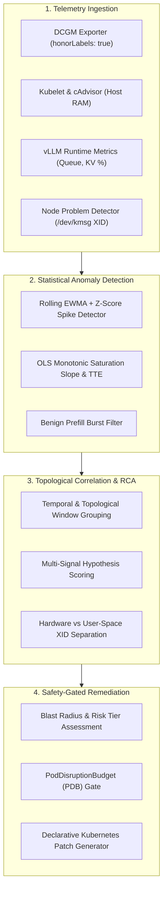

# 11 — AIOps Closed-Loop Architecture, RCA & PDB-Gated Remediation

## Executive Overview

Operating large-scale GPU inference platforms on Kubernetes exposes operational complexities that traditional rule-based alerting cannot handle:
- **Alert Fatigue**: A single GPU hardware failure triggers dozens of cascading alerts across cAdvisor, kube-state-metrics, Prometheus Operator, and application runtimes.
- **Root-Cause Ambiguity**: Pod restarts caused by CUDA out-of-memory errors report identical Kubernetes failure states (`Exit Code 1`, `reason: Error`) as software exceptions or driver crashes.
- **Remediation Blast Radius**: Naive automated remediation (e.g. unconditional node drains or pod restarts) violates application availability, causes cold-start cache thrashing, and breaches tenant SLAs.

This chapter defines the **Closed-Loop AIOps Architecture** implemented in the [`aiops/`](../aiops/) reference engine. The engine continuously ingests telemetry, detects statistical anomalies, correlates events across topological failure domains, identifies the root cause, and executes safety-classified, approval-gated remediations under strict `PodDisruptionBudget` (PDB) constraints.

---

## 11.1 The Closed-Loop AIOps Pipeline



---

## 11.2 Mathematical & Statistical Anomaly Detection

### 1. Rolling EWMA and Z-Score Detection
To detect abnormal latency jumps (TTFT, TPOT) or thermal spikes without generating alerts on normal variance, the detector computes an Exponentially Weighted Moving Average (EWMA) and rolling standard deviation over a sliding window $W$:

$$\mu_t = \alpha \cdot x_t + (1 - \alpha) \cdot \mu_{t-1}$$

$$\sigma_t = \sqrt{\frac{1}{W} \sum_{i=0}^{W-1} (x_{t-i} - \mu_t)^2}$$

$$Z_t = \frac{x_t - \mu_t}{\max(\sigma_t, \epsilon)}$$

An anomaly is flagged when $|Z_t| \ge Z_{\text{threshold}}$ (default: $3.0$).

### 2. Monotonic Slope Estimation & Time-To-Exhaustion (TTE)
For memory leaks and KV-cache saturation, the engine performs Ordinary Least Squares (OLS) linear regression over the recent window to calculate the growth rate:

$$\text{Slope } \beta = \frac{\sum_{i=1}^{N} (t_i - \bar{t})(y_i - \bar{y})}{\sum_{i=1}^{N} (t_i - \bar{t})^2}$$

$$\text{Time-To-Exhaustion (TTE)} = \frac{\text{Capacity} - y_{\text{current}}}{\beta}$$

If $\beta > 0$ and $\text{TTE} < \text{Threshold}$ (e.g. $< 15\text{ minutes}$), an impending saturation alert is emitted before out-of-memory crashes occur.

### 3. Benign Prefill Burst Filter
During large prompt prefill operations, GPU compute engines spike to $100\%$ utilization for 1–2 scraping cycles while KV cache allocation remains stable. The filter prevents false-positive autoscaling triggers by validating that high compute utilization is accompanied by queue growth or memory consumption.

---

## 11.3 Multi-Signal Topological Correlation & RCA Scoring

When incidents occur, raw alerts and anomaly signals are grouped by node, pod, and namespace within a temporal clustering window (default: $120\text{ seconds}$). The correlator evaluates evidence across 7 canonical failure classes:

| Canonical Root Cause | Primary Evidence Signals | Required Exclusion Signals |
| :--- | :--- | :--- |
| **`K8S_CGROUP_HOST_RAM_OOM`** | `last_terminated_reason == "OOMKilled"`, Exit Code 137 | GPU VRAM $< 90\%$ |
| **`CUDA_VRAM_KV_CACHE_OVERFLOW`** | Pod restart with `Error`, VRAM $> 94\%$, `vllm:gpu_cache_usage_perc > 0.95` | Exit Code $\ne 137$ |
| **`TIME_SLICING_CO_TENANT_COLLISION`** | `sharing-strategy: time-slicing`, co-tenant VRAM spike, no memory cap | Node dedicated to single tenant |
| **`NCCL_SHM_BUS_FAULT`** | Exit Code 135 (`SIGBUS`), missing memory emptyDir at `/dev/shm` | Multi-GPU workload ($\ge 2$ GPUs) |
| **`GPU_SILICON_HARDWARE_FAULT`** | Critical XID (`48, 63, 64, 74, 79, 94, 95`), NPD `GPUHardwareFault=True` | Application user-space errors |
| **`USER_SPACE_XID_EXCEPTION`** | Warning XID (`13, 31, 43`), MMU Fault | Hardware silicon healthy |
| **`GANG_SCHEDULING_DEADLOCK`** | `PodGroupPending`, partial replica placement | Head/worker balance satisfied |

---

## 11.4 PodDisruptionBudget (PDB) Safety Gating

Automated remediation actions are categorized by risk:
- **Low Risk (Autonomous)**: Read-only diagnostics, metric re-scraping, horizontal pod scale-up.
- **Medium Risk (PDB-Guarded)**: Dynamic KV-cache memory throttle, traffic reroute away from canary.
- **High Risk (Approval Required)**: Node cordoning, pod evictions, node draining for hardware RMA.

Before evicting pods or cordoning a node, the remediation engine inspects the relevant `PodDisruptionBudget`:

```yaml
apiVersion: policy/v1
kind: PodDisruptionBudget
metadata:
  name: vllm-inference-pdb
  namespace: ai-inference
spec:
  minAvailable: 1
  selector:
    matchLabels:
      app.kubernetes.io/name: vllm-llama3-inference
```

If `currentHealthy - 1 < minAvailable`, the automated remediation is blocked, an alert is dispatched to the on-call engineer, and non-disruptive mitigation (such as queuing traffic at the ingress gateway) is initiated.

---

## 11.5 Running the Reference Engine

The repository includes a reference implementation under [`aiops/`](../aiops/):

```bash
# Run comprehensive offline test dataset evaluation
python3 -m aiops evaluate

# Launch interactive CLI demo
python3 -m aiops demo

# Execute automated test suite
python3 -m unittest discover -s tests -p "test_*.py"
```

---

## References

1. Kubernetes SIG-Apps. *PodDisruptionBudget (PDB) and Disruptions Handling in Kubernetes*. https://kubernetes.io/docs/concepts/workloads/pods/disruptions/
2. NVIDIA Corporation. *NVIDIA System Management Interface (nvidia-smi) & DCGM Documentation*. https://docs.nvidia.com/datacenter/dcgm/latest/
3. vLLM Project. *Production Metrics and Telemetry in vLLM Runtimes*. https://docs.vllm.ai/en/latest/serving/metrics.html
4. Kubernetes Node SIG. *Node Problem Detector (NPD) Architecture & Custom Plugin Monitors*. https://github.com/kubernetes/node-problem-detector
5. Prometheus Operator Community. *ServiceMonitor, PodMonitor, and Alertmanager Specification*. https://prometheus-operator.dev/docs/operator/api/
6. Kubernetes Dynamic Resource Allocation (DRA) Working Group. *Structured Parameters and Claim Allocation in Kubernetes 1.32*. https://kubernetes.io/docs/concepts/scheduling-eviction/dynamic-resource-allocation/
