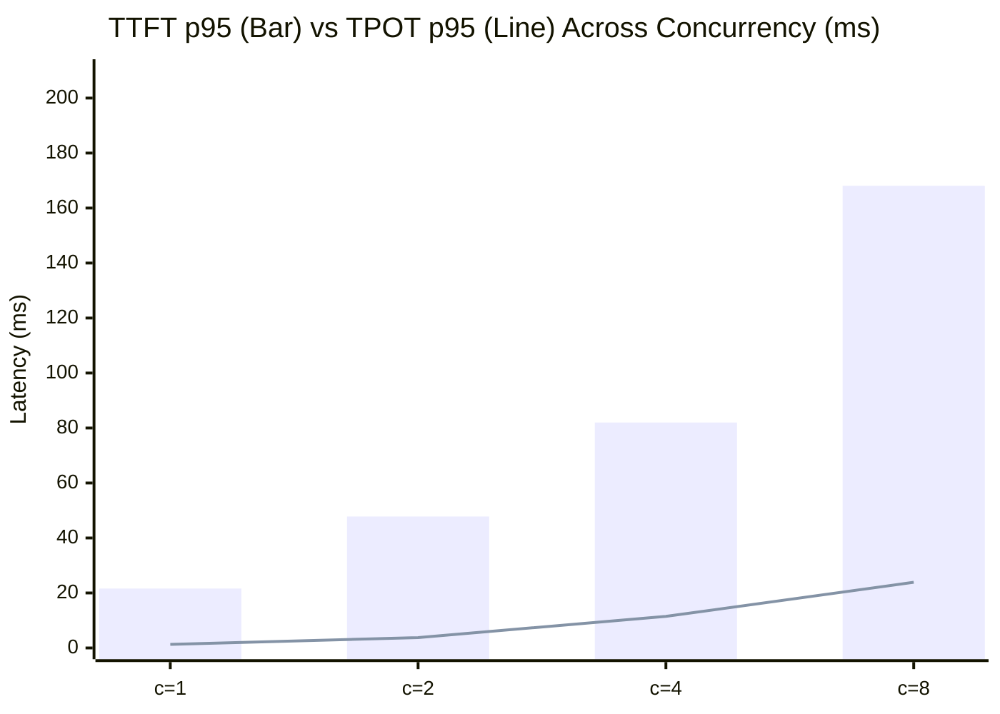
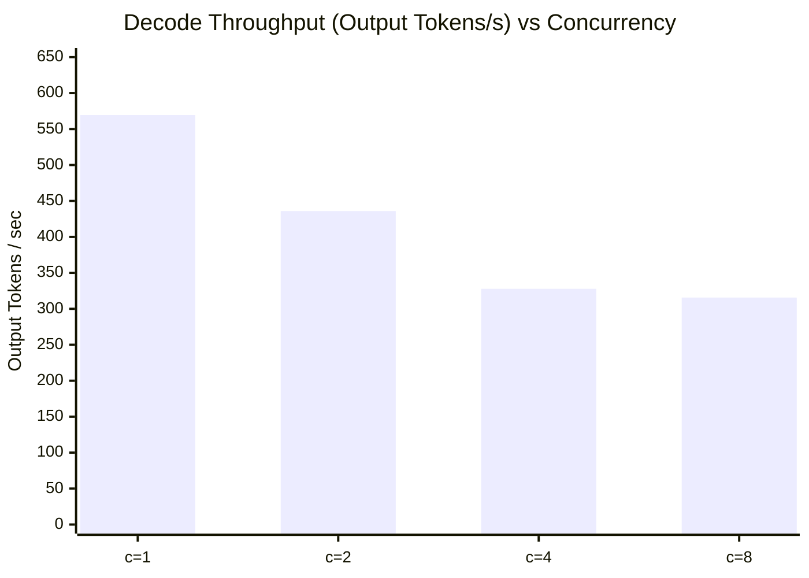
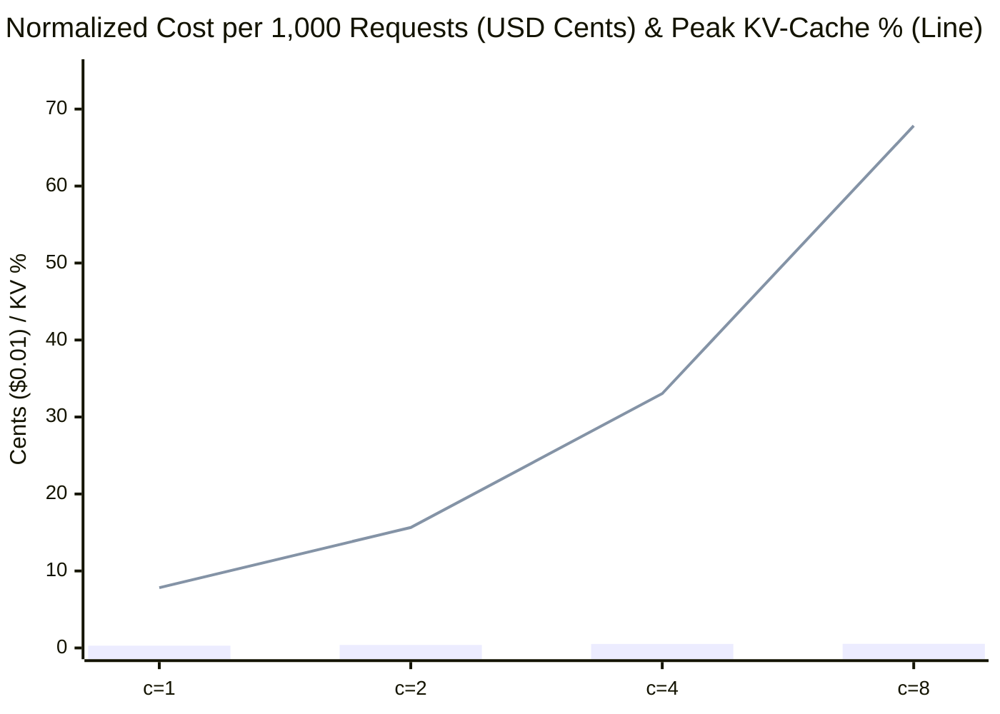
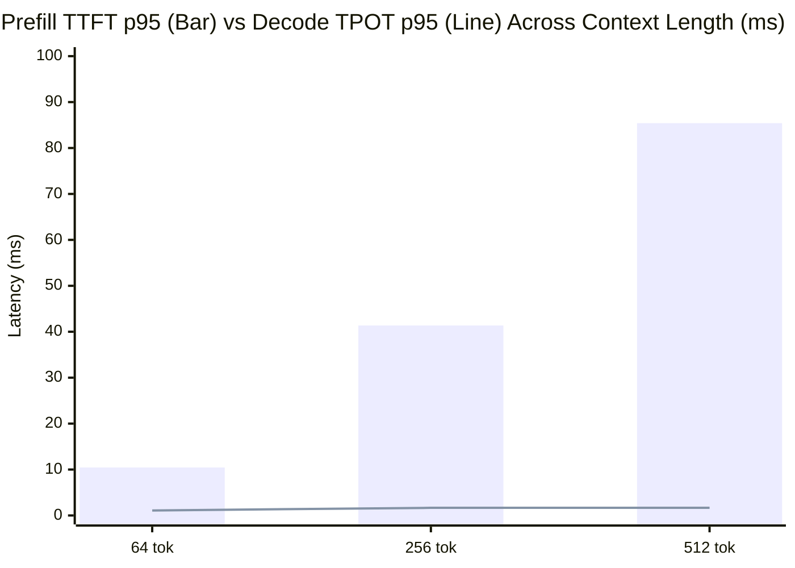

# Live Kubernetes Operational Evidence & Controlled Benchmark Report

All operational outputs, admission policy rejections, `PodDisruptionBudget` state transitions, and streaming inference latencies below were captured automatically from a **live Kubernetes `v1.37.0` (`kind`) cluster** executed in GitHub Actions CI (`make deploy && make verify && make destroy`). Raw machine-readable artifacts are stored in [`reference-impl/evidence/`](./evidence/).

---

## 1. Experimental Methodology & Hardware Boundary

| Parameter | Specification |
| :--- | :--- |
| **Kubernetes Control & Data Plane** | Kubernetes `v1.37.0` (`containerd://2.3.4`, Debian 13 `7.0.0-1017-azure` x86_64) |
| **Pod Resource Constraints** | `requests: 250m CPU / 256Mi`, `limits: 2000m CPU / 768Mi`, `/dev/shm` `Memory` `emptyDir` (`256Mi`) |
| **Security Posture Enforced Live** | `ValidatingAdmissionPolicy` (`4` CEL rules), `runAsNonRoot` (`UID 10001`), `readOnlyRootFilesystem: true`, `drop: ["ALL"]`, Bearer API Auth |
| **Inference Engine Architecture** | 4-layer Grouped-Query Attention (`GQA`) Transformer (`d_model=256`, `8` Q heads, `4` KV heads, SwiGLU) on `numpy-openblas` + physical **Paged KV-Cache** (`128` blocks × `16` tokens, `0.90` cap = `115` effective blocks) |
| **Benchmark Protocol** | OpenAI `/v1/chat/completions` over HTTP/1.1 Server-Sent Events (`stream=true`); `2` warmup requests excluded before steady-state measurement |
| **Latency Definitions** | **Cold-Start**: `kubectl apply` to `/readyz` HTTP `200` (`s`). **TTFT**: client `perf_counter` from POST send to first content SSE chunk (`ms`). **TPOT**: `(t_last - t_first) / (output_tokens - 1)` (`ms`) |
| **Normalized Cost Formula** | `Cost_per_1k_Reqs = (Hourly_Node_USD / 3600) * (1000 / Measured_RPS)` using `$0.192/hr` 4-vCPU reference VM rate (parameterizable via `--hourly-cost-usd` for GPU nodes) |

> **Honest Hardware Boundary**: Tensor contractions execute on CPU OpenBLAS inside Kubernetes `cgroup v2` limits (`2000m` CPU) rather than physical NVIDIA H100 Tensor Cores. Latency and throughput curves reflect real queuing, attention prefill complexity, and Paged KV-Cache block allocation on the 4-vCPU CI runner. The exact same harness ([`benchmark/run_benchmark.py`](./benchmark/run_benchmark.py)) targets production `vLLM` GPU endpoints via `--base-url` and `--hourly-cost-usd`.

---

## 2. Live Cluster Readiness, Guardrails & Smoke Test Evidence

### 2.1 Live Cluster & Workload State ([`evidence/kubectl-cluster-state.txt`](./evidence/kubectl-cluster-state.txt))

```text
NAME                      STATUS   ROLES           AGE   VERSION   OS-IMAGE                       CONTAINER-RUNTIME
aiops-ref-control-plane   Ready    control-plane   37s   v1.37.0   Debian GNU/Linux 13 (trixie)   containerd://2.3.4

NAME                                                                                    VALIDATIONS   AGE
validatingadmissionpolicy.admissionregistration.k8s.io/ref-aiops-inference-guardrails   4             3s

NAME                               READY   UP-TO-DATE   AVAILABLE   CONTAINERS         IMAGES
deployment.apps/aiops-controller   1/1     1            1           aiops-controller   aiops-ref-runtime:v1.0.0
deployment.apps/inference-engine   1/1     1            1           inference-engine   aiops-ref-runtime:v1.0.0

NAME                                       MIN AVAILABLE   MAX UNAVAILABLE   ALLOWED DISRUPTIONS
poddisruptionbudget.policy/inference-pdb   1               N/A               0
```

### 2.2 Live `kube-apiserver` CEL Admission Denials ([`evidence/vap-admission-live-output.txt`](./evidence/vap-admission-live-output.txt))

```text
=== TEST 1: Privileged Container Rejection ===
The pods "rogue-privileged-inference" is invalid: : ValidatingAdmissionPolicy 'ref-aiops-inference-guardrails' with binding 'ref-aiops-inference-guardrails-binding' denied request: Guardrail [Rule 1]: Privileged containers are forbidden; runAsNonRoot=true and allowPrivilegeEscalation=false are mandatory.

=== TEST 2: Unmounted /dev/shm Memory Volume Rejection ===
The pods "unmounted-shm-inference" is invalid: : ValidatingAdmissionPolicy 'ref-aiops-inference-guardrails' with binding 'ref-aiops-inference-guardrails-binding' denied request: Guardrail [Rule 3]: Inference pods requiring IPC must mount a Memory-backed emptyDir volume at /dev/shm.
```

### 2.3 Inference Smoke Test & Bearer Auth Gate ([`evidence/smoke-test-inference.json`](./evidence/smoke-test-inference.json))

- Unauthenticated `POST /v1/chat/completions` → **`HTTP 401 Unauthorized`**
- Readiness `/readyz` → **`HTTP 200`** (`backend: "numpy-openblas"`, `shm_ipc_mounted: true`, `effective_kv_blocks: 115`)
- Authenticated `POST /v1/chat/completions` (`9` prompt tokens → `24` completion tokens) → **`HTTP 200`** (`ttft_ms: 3.94`, `tpot_ms: 0.896`)

### 2.4 Live Closed-Loop AIOps & Kubernetes PDB State Machine ([`evidence/closed-loop-aiops-live.json`](./evidence/closed-loop-aiops-live.json))

1. **Single-Replica Outage Risk (`replicas=1`, `PDB disruptionsAllowed=0`)**: Injecting critical hardware `XID 79` + `94%` KV pressure triggers `aiops-controller` to diagnose `GPU_SILICON_XID_FAULT` and emit Kubernetes Event:
   `RootCause=GPU_SILICON_XID_FAULT | Action=CORDON_AND_DRAIN_NODE | Gate=BLOCKED_BY_PDB | PDB_disruptionsAllowed=0`
2. **Post-Scale Failover Headroom (`replicas=2`, `PDB disruptionsAllowed=1`)**: Scaling `deployment/inference-engine` to `2` replicas updates live Kubernetes `PDB` status to `disruptionsAllowed=1`; `aiops-controller` transitions the node drain plan to human operator review:
   `RootCause=GPU_SILICON_XID_FAULT | Action=CORDON_AND_DRAIN_NODE | Gate=PENDING_APPROVAL | PDB_disruptionsAllowed=1`

---

## 3. Controlled Benchmark Results & Charts

- **Measured Cold-Start Readiness Latency** ([`evidence/cold-start.json`](./evidence/cold-start.json)): **`2.242 s`** (`kubectl apply` → pod scheduled → container started → `/dev/shm` IPC initialized → `/readyz` HTTP 200).
- **Raw Data Artifacts**: [`evidence/benchmark-raw-results.csv`](./evidence/benchmark-raw-results.csv) and [`evidence/benchmark-raw-results.json`](./evidence/benchmark-raw-results.json) (`98` streamed SSE requests).

### 3.1 Concurrency Scaling (`prompt=128 tokens`, `output=32 tokens`)

| Concurrency | RPS | Output Tok/s | Total Tok/s | TTFT p50 (ms) | TTFT p95 (ms) | TPOT p50 (ms) | TPOT p95 (ms) | Peak KV Ratio | Cost / 1k Reqs |
| :---: | :---: | :---: | :---: | :---: | :---: | :---: | :---: | :---: | :---: |
| `1` | 17.80 | 569.51 | 2847.55 | 17.25 | **21.61** | 1.19 | **1.31** | 0.0783 | `$0.00300` |
| `2` | 13.62 | 435.90 | 2179.48 | 32.15 | **47.80** | 3.63 | **3.79** | 0.1565 | `$0.00392` |
| `4` | 10.25 | 327.85 | 1639.27 | 58.67 | **81.99** | 10.40 | **11.48** | 0.3304 | `$0.00521` |
| `8` | 9.87 | 315.69 | 1578.47 | 143.22 | **168.09** | 21.25 | **23.90** | 0.6783 | `$0.00541` |







**Engineering Observations**:
1. **Linear Paged KV-Cache Growth**: Active physical KV-cache block occupancy scales linearly with in-flight concurrency (`7.8%` → `15.7%` → `33.0%` → `67.8%` across `c=1..8`), demonstrating genuine block-table residency per concurrent stream.
2. **CPU cgroup Saturation Knee (`2000m` Limit)**: Unlike a GPU with thousands of streaming multiprocessors where batching increases total tok/s up to the HBM bandwidth roof, a `2000m` CPU cgroup saturates OpenBLAS threads at `c=1..2`, causing queueing-driven `TTFT p95` growth (`21.6 ms` → `168.1 ms`) and higher cost per request under CPU contention.

### 3.2 Prompt Context Length Scaling (`concurrency=1`, `output=32 tokens`)

| Prompt Tokens | TTFT p50 (ms) | TTFT p95 (ms) | TPOT p50 (ms) | TPOT p95 (ms) | Output Tok/s | Cost / 1k Reqs |
| :---: | :---: | :---: | :---: | :---: | :---: | :---: |
| `64` | 8.08 | **10.45** | 1.03 | **1.09** | 767.45 | `$0.00222` |
| `256` | 36.53 | **41.37** | 1.31 | **1.66** | 410.13 | `$0.00416` |
| `512` | 71.09 | **85.42** | 1.59 | **1.67** | 256.89 | `$0.00664` |



**Engineering Observations**:
1. **Prefill vs. Paged KV-Cache Decode Decoupling**: Expanding prompt context `8×` (`64` → `512` tokens) increases prefill `TTFT p95` by `8.17×` (`10.45 ms` → `85.42 ms`), while per-token decode `TPOT p50` rises by only `0.56 ms` (`1.03 ms` → `1.59 ms`) because prior `K, V` states are fetched directly from physical Paged KV-Cache blocks rather than recomputed.
