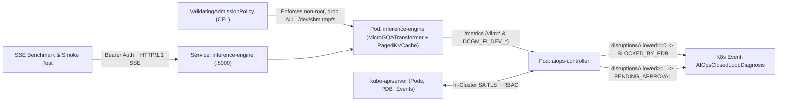

# Runnable Kubernetes Reference Implementation (`reference-impl/`)

This directory provides a cohesive, self-contained, end-to-end runnable reference implementation of the platform patterns and closed-loop AIOps workflows documented in this repository. Every push to `main` boots a live Kubernetes (`kind`) cluster in GitHub Actions CI, enforces admission guardrails via `kube-apiserver`, serves streaming OpenAI SSE tokens from a Paged KV-Cache Transformer engine, runs a controlled latency/throughput/cost benchmark, and verifies closed-loop incident diagnosis gated by live Kubernetes `PodDisruptionBudget` (`PDB`) state.

## Quickstart (`make deploy` / `make verify` / `make destroy`)

Prerequisites: `docker`, `kind`, `kubectl`, and `python3` (3.10+).

```bash
# 1. Create kind cluster, build/load container image, apply RBAC/VAP/PDB/NetworkPolicy & workloads
make deploy

# 2. Verify live CEL admission rejections, 401/200 SSE smoke test, TTFT/TPOT benchmark & AIOps PDB loop
make verify

# 3. Tear down the kind cluster cleanly
make destroy
```

## Architecture & End-to-End Closed Loop



### Components

1. **Inference Runtime ([app/transformer_engine.py](app/transformer_engine.py), [app/server.py](app/server.py))**:
   - Causal Grouped-Query Attention (`GQA`) Transformer (`d_model=256`, `n_heads=8`, `n_kv_heads=4`, `n_layers=4`, SwiGLU MLP) executing real tensor contractions via NumPy OpenBLAS.
   - Physical **Paged KV-Cache Block Allocator** (`block_size=16`) tracking live block utilization, queue wait states, preemptions (`vllm:num_preemptions_total`), and `/dev/shm` `tmpfs` IPC ring health.
   - OpenAI-compatible `/v1/chat/completions` (`stream=true` SSE & JSON) protected by Kubernetes `Secret`-backed Bearer token authentication.
   - Prometheus `/metrics` endpoint exporting `vllm:*` and `DCGM_FI_DEV_*` telemetry labeled via Kubernetes Downward API (`POD_NAME`, `POD_NAMESPACE`, `NODE_NAME`).
2. **Live Kubernetes Guardrails ([k8s/01-guardrails-vap.yaml](k8s/01-guardrails-vap.yaml), [k8s/02-networkpolicy-pdb.yaml](k8s/02-networkpolicy-pdb.yaml))**:
   - Native `admissionregistration.k8s.io/v1` `ValidatingAdmissionPolicy` enforced directly by `kube-apiserver` (denies privileged pods, missing capability drops, unmounted `/dev/shm` `Memory` volumes, and uncapped memory flags).
   - Default-deny `NetworkPolicy`, least-privilege `ServiceAccount` RBAC (`automountServiceAccountToken: false` on inference pods), `readOnlyRootFilesystem: true`, and `PodDisruptionBudget` (`minAvailable: 1`).
3. **In-Cluster Closed-Loop AIOps Controller ([app/k8s_aiops_agent.py](app/k8s_aiops_agent.py))**:
   - Discovers ready inference Pod IPs via Kubernetes API, scrapes `/metrics` time series, runs `UnifiedAnomalyDetector` + `TopologyCorrelator` + `RemediationEngine`, queries live `PodDisruptionBudget.status.disruptionsAllowed`, and emits native `AIOpsClosedLoopDiagnosis` Kubernetes `Events`.
4. **Controlled Streaming Benchmark ([benchmark/run_benchmark.py](benchmark/run_benchmark.py))**:
   - Measures Cold-Start readiness, `TTFT` (`p50`/`p95`/`p99`), `TPOT` (`p50`/`p95`/`p99`), decode throughput (`tok/s`), request rate (`RPS`), peak KV-cache utilization, and normalized `$/1k requests` across concurrency (`c=1..8`) and context lengths (`64..512` tokens).
   - Compatible out-of-the-box with production GPU `vLLM` endpoints (`python3 reference-impl/benchmark/run_benchmark.py --base-url https://vllm.internal --hourly-cost-usd 6.98`).

## Honest Scope & Hardware Boundary

- **Executed on Live Kubernetes in CI**: Full Kubernetes `v1.31+` control plane & kubelet (`kind`), live `kube-apiserver` CEL admission rejections, NetworkPolicy/RBAC/PDB state transitions (`replicas=1 -> BLOCKED_BY_PDB` vs `replicas=2 -> PENDING_APPROVAL`), real OpenBLAS matrix multiplications, Paged KV-Cache block allocation, and HTTP/1.1 SSE token streaming.
- **Hardware Twin Boundary**: Because GitHub Actions standard runners use 4-vCPU AMD EPYC processors without physical NVIDIA H100 GPUs, tensor execution runs on CPU OpenBLAS and GPU framebuffer/XID counters are projected via a deterministic telemetry twin on `/metrics`. Absolute latency and throughput numbers reflect CPU execution on the reference runner, not H100 Tensor Core silicon.
