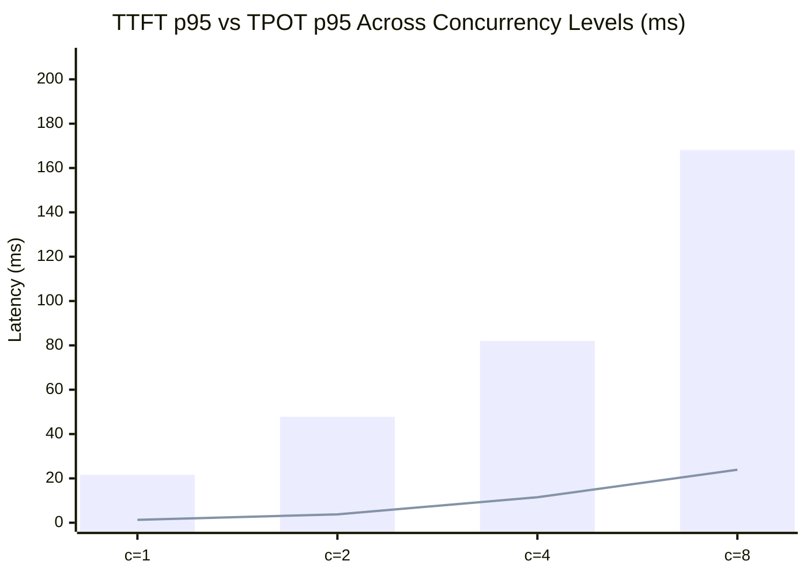
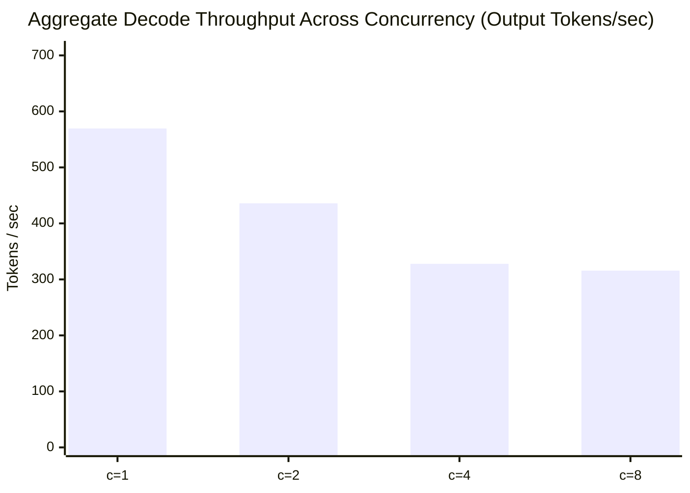
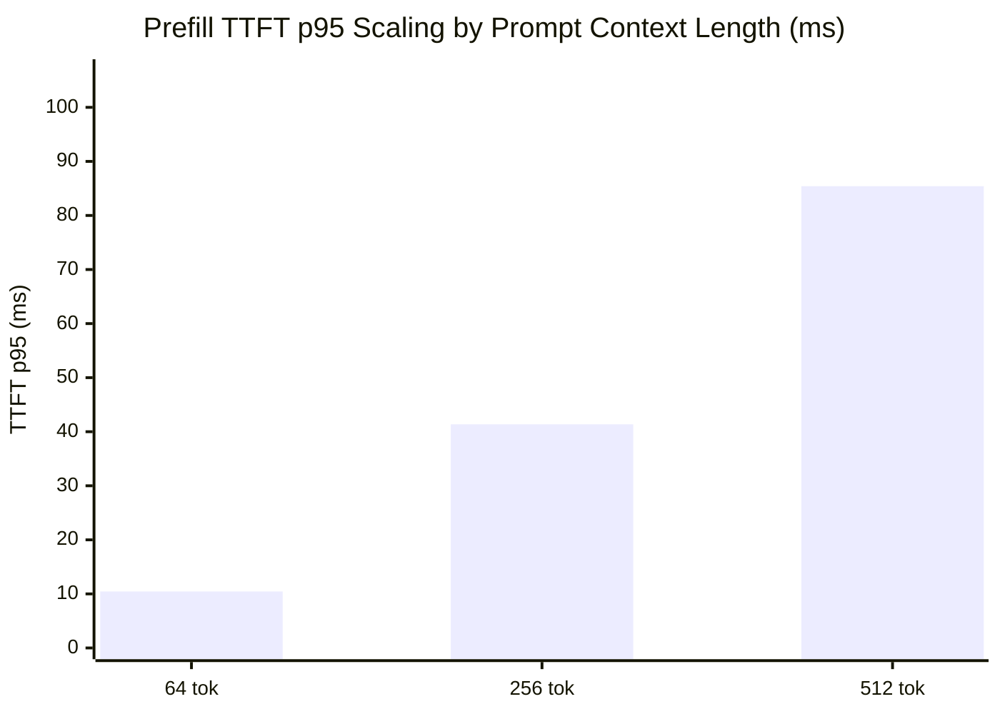

# Controlled Inference Benchmark Report (Live Kubernetes Cluster)

- **Timestamp (UTC)**: `2026-11-05T01:34:08Z`
- **Target Endpoint**: `http://127.0.0.1:18000`
- **Model**: `micro-gqa-llama-ref`
- **Cold-Start Readiness Time**: `2.242 s`
- **Node Hourly Reference Rate**: `$0.19/hr`

## 1. Concurrency Scaling Results (`prompt=128 tokens`, `output=32 tokens`)

| Concurrency | RPS | Output Tok/s | TTFT p50 (ms) | TTFT p95 (ms) | TPOT p50 (ms) | TPOT p95 (ms) | Peak KV Ratio | Cost / 1k Reqs (USD) |
| :---: | :---: | :---: | :---: | :---: | :---: | :---: | :---: | :---: |
| `1` | 17.8 | 569.51 | 17.25 | **21.61** | 1.19 | **1.31** | 0.0783 | `$0.00300` |
| `2` | 13.62 | 435.9 | 32.15 | **47.8** | 3.63 | **3.79** | 0.1565 | `$0.00392` |
| `4` | 10.25 | 327.85 | 58.67 | **81.99** | 10.4 | **11.48** | 0.3304 | `$0.00521` |
| `8` | 9.87 | 315.69 | 143.22 | **168.09** | 21.25 | **23.9** | 0.6783 | `$0.00541` |

## 2. Prompt Context Scaling Results (`concurrency=1`, `output=32 tokens`)

| Prompt Tokens | TTFT p50 (ms) | TTFT p95 (ms) | TPOT p50 (ms) | Output Tok/s | Cost / 1k Reqs (USD) |
| :---: | :---: | :---: | :---: | :---: | :---: |
| `64` | 8.08 | **10.45** | 1.03 | 767.45 | `$0.00222` |
| `256` | 36.53 | **41.37** | 1.31 | 410.13 | `$0.00416` |
| `512` | 71.09 | **85.42** | 1.59 | 256.89 | `$0.00664` |

_Normalized cost curve (cents per 1k requests across concurrency): `[0.3, 0.392, 0.521, 0.541]`._
